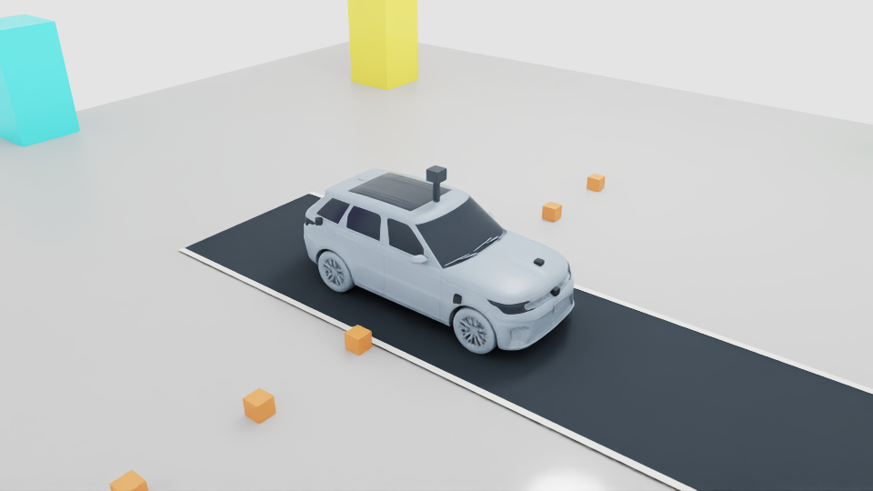
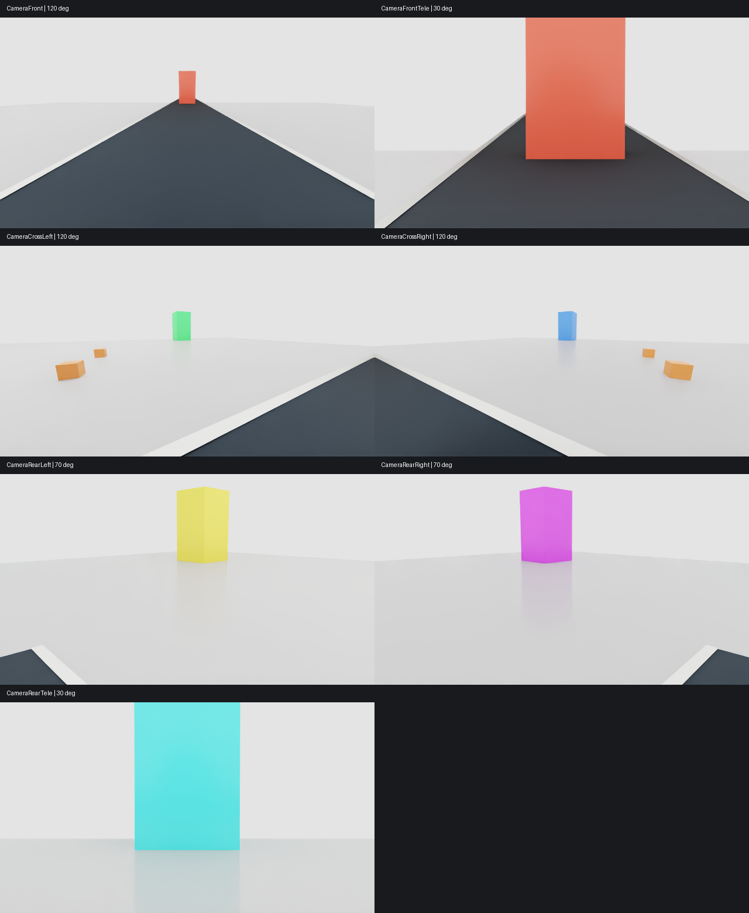

# Body-mounted cameras v01 — vehicle v11

October 26, 2026. The actual reusable local source is
`vehicles/sim_ready/americano-i7-ev/v11/assets/vehicle.usda`.
All seven cameras now use compact housings attached to exterior body surfaces;
all camera roof stalks were removed. The central roof LiDAR is unchanged from
v10. Earlier source versions and checkpoints are preserved.

Placement is measured against the actual `Chassis/Visuals/Body` triangles using
nearest exterior ray intersections, rather than estimated floating positions.
The housings overlap the body surface slightly for seating; the optical center
is 10 cm outward along the camera's horizontal heading. Housings are visual
only and do not change vehicle mass/collisions. This is a simulation mounting
layout, not manufactured attachment hardware or a waterproof automotive design.

| Camera | Body location | Optical center XYZ relative to chassis (m) |
| --- | --- | --- |
| Front wide | Front fascia | 2.3681, 0, -0.05 |
| Front telephoto | Forward hood surface | 1.9398, 0.22, 0.20 |
| Cross left/right | Front fenders | 1.2423, ±1.0940, -0.10 |
| Rear left/right | Rear quarter panels | -1.9207, ±0.9651, 0.25 |
| Rear telephoto | Tailgate | -2.6091, 0, 0.20 |

Camera identities, headings, pitches, optics, 640×360 resolution and 10 Hz
sampling remain as in the seven-camera milestone. Mount positions and the
`multi_camera_rig` version/calibration metadata change. Runtime validation
loads those positions from the composed source's metadata, not old roof specs.
The named camera paths and roof LiDAR path remain stable.

## Validation and evidence

Run `python -m experiments.verify_body_cameras` in the traffic environment;
Isaac runs separately and only if no competing Kit process is active.

Final run **20261026T193608Z-4ea7afd5** passed the six-second test: 59 valid
frames per camera, all camera targets visible, 119 complete LiDAR scans with
returns on all six tall surrounding targets, stable mounts during 0.6299 m
travel, zero contacts, unchanged source hashes and no composition errors.
Two focused exterior-intersection tests pass. Actual v11 source checks confirm
seven cameras, no camera support/stalk prims, metadata-matching transforms,
retained roof LiDAR and clean composition. The native test checks mount
preservation both across RTX initialization and during vehicle movement.

The final rerun also uses the new body-camera calibration identifier in packets.
The initial body layout run `20261026T193358Z-945f52ac` passed target checks but
had excessive hood/body occlusion in cross views. Visual inspection led to
moving those two cameras onto the outer fenders; the final images verify the
improvement. That first run and source snapshot remain under `outputs/`.
An earlier authoring attempt rejected a custom-data list type before saving;
the preserved partial package is `outputs/body-camera-v01/failed-authoring-v11`.

The broad roof-region LiDAR self-return count dropped from 1,666 in v10's test
to zero in this test. This is an observed diagnostic, not proof of no possible
self-occlusion. The prior near-ground LiDAR limitation remains: all 30 cm side
targets at 2–6 m were missed. These tests do not validate full obstacle coverage,
learned sensor fusion or highway-speed driving. No training was started and
existing actors still consume their previous observations.

[Metrics, source hashes and final camera transforms](evidence/body-camera-v01/result.json).
Raw data: `outputs/body-camera/v01/20261026T193608Z-4ea7afd5`.
Source authoring: `usd/body_camera_rig.py`; private vehicle geometry stays local.
