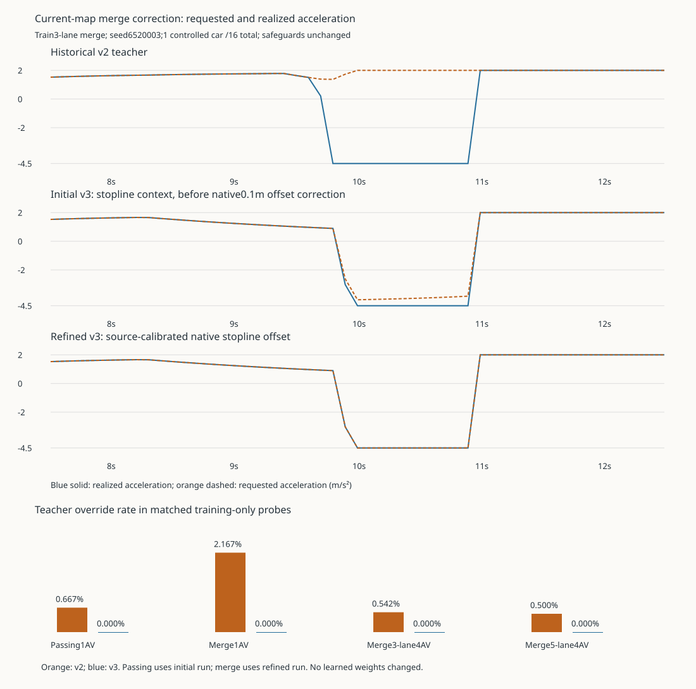

# Population control v03: no-learning corrections

The opt-in v03 teacher and reward now use the **same pure longitudinal target**, calculated from the actor's current 93-field observation. Historical v2 remains the default, with its original control behavior and reward target. No policy weights were trained, updated, replaced or selected here.

## What changed

1. **Near-limit response:** v3 caps its target by a current speed-error response even when no front vehicle is visible within 120 m. Native ACC may still react to traffic out to 250 m. This prevents the missing-neighbor case from requesting full acceleration near the speed ceiling.
2. **First merge conflict:** the old ramp context projected directly to the later auxiliary-to-through lane change (`sb2_1`). The actual ramp first yields to mainline traffic entering the same auxiliary lane (`sb2_0`). V3 exposes that shared entry and physical stopline before exposing the later adjacent-lane target. A projected cross-edge target always has lateral delta 0; internal-ramp context remains unknown until a legal adjacent lane exists.
3. **Native approach calibration:** v3 includes the current-distance discrete Euler stop-speed estimate, with SUMO's source-defined 0.1 m minimum stopline offset and 0.001 m numerical epsilon. This is an observation-only target, not a native API query. It does not replace the existing guards.
4. **Aligned learning target:** `longitudinal_target_v3(obs)` supplies both teacher acceleration and the environment's feasible-acceleration reward target, including merge logic and a gradual ending-lane speed target. The previous disagreement is removed to float32 action-encoding tolerance.

Safety remains speedMode 31, laneChangeMode 512, 0.1 s steps, 60 mph maximum, and the existing 1.5 s headway and stopping-distance gap floor. The original override union and thresholds are unchanged.

## Actual paired results

All cases below use training roads. Each merge case has one ramp merge target, even when four cars are controlled.

| Fixture | Teacher overrides v2 → v3 | Speed/limit v2 → v3 | Task outcome |
| --- | ---: | ---: | --- |
| 3-lane passing, 1 AV / 16 cars, seed 6520002 | 4/600 → 0/600 | 0.918770 → 0.918737 | One pass retained |
| 3-lane merge, 1 AV / 16 cars, seed 6520003 | 13/600 → 0/600 | 0.676589 → 0.676461 | One merge retained |
| 3-lane merge, 4 AVs / 24 cars, seed 6520104 | 13/2400 → 0/2400 | 0.781274 → 0.781404 | One merge retained |
| 5-lane merge, 4 AVs / 24 cars, seed 6520105 | 12/2400 → 0/2400 | 0.926204 → 0.924081 | One merge retained |

Cruise and following probes retain zero teacher overrides and identical speed ratios. The frozen actor receiving v3 merge context improved from 156/600 overrides (26%) to 67/600 (11.167%), with speed/limit 0.675850 → 0.690554 and the merge retained. **It still exceeds the unchanged 5% per-case limit.** This is transfer-initialization evidence, not an accepted learned policy.

Across both bounded attempts: 32,400 decisions, 190.454 seconds wall time, zero reported collisions/teleports/overspeed, and zero native emergency braking/stop warnings. Both same-seed teacher repetitions reproduce their complete recorded control traces exactly. These repeats add reproducibility evidence, not additional scenario coverage. The targeted merge coverage is three seeds, two lane counts, and one or four AVs; broader mixed-population validation is separate.



## Retained revisions and limitations

- Initial 21-episode run: `outputs/population-control-v03/verify-20261105T053939Z-7e23d78b`, 135.110 s, 19,800 decisions. First-entry context and shared targets worked; the ramp teacher still had 11/600 native differences because the minimum native stopline offset was omitted. Passing reached zero teacher overrides. Control-source hashes remained stable. The root population runner was being edited and was not included in this initial snapshot set; this provenance limitation is retained explicitly.
- Source inspection identified the missing offset; it was not fit to outcome scores. Refined 9-episode merge run: `outputs/population-control-v03/verify-20261105T054418Z-b5f89825`, 55.344 s, 12,600 decisions. It includes an unchanged population-runner dependency snapshot, the unchanged frozen actor, full resolved v3 configuration, raw CSVs, journals, native logs and original source files. All three merge fixtures reached zero teacher overrides.
- A subsequent static map-validation addition also rejects larger edge-level stop offsets. It does not change these default maps. Final project preflight checks the final runtime sources separately. Unit-test editing errors were corrected before simulator execution; there were no failed native attempts in this comparison.
- V3 currently supports 4.5 m minor-link visibility and the default 0.1 m stop offset. Larger lane/edge offsets or other visibility values fail explicitly. The pinned controlled vehicle type has no larger vehicle/JM stop-offset override. Arbitrary junction configurations require a new declared contract; this is not universal native-junction prediction.
- The 93-number shape remains compatible with actor initialization, but merge-field meanings changed. Contract version: `highway_graph_entry_and_lane_merge_v3`; reward version: `highway_stage1_shared_longitudinal_target_v3`. Historical weights are not silently treated as semantically interchangeable.

## Observation meaning and verification

For minor entry, fields 33–42 describe the first shared successor and conflict neighbors; field 35 stays 0 and field 36 is distance to the **physical stopline**. Once on an auxiliary lane, the existing adjacent-through target and target-lane-start distance apply. On internal ramp links, that context is unknown. Field 43 remains the original analytical acceleration ceiling; field 44 remains the target lane's allowed speed. No future traffic state, native control-mode memory, or privileged training-only feature enters the actor target.

45 focused tests cover the historical teacher, graph projection, safety filters, unsupported-map rejection, native stopline algebra, and actual environment/teacher target identity. Independent review verified all 12,600 refined CSV rows, all nine CSV hashes/counts, both safety modes, raw warning absence, and the initial passing evidence.

Offline reproduction (requires the retained raw outputs):

```powershell
.\.venv-traffic\Scripts\python.exe documentation/evidence/population-control-v03/control-derive.py
```

It writes a new ignored output directory; it never starts SUMO or overwrites accepted evidence. [Compact metrics/provenance](control-summary.json) contain every episode's counts, actor/source/configuration hashes and runtime versions. No training is authorized by this evidence.

Native references: [ACC response](https://raw.githubusercontent.com/eclipse-sumo/sumo/v1_27_1/src/microsim/cfmodels/MSCFModel_ACC.cpp), [Euler stop-speed implementation](https://raw.githubusercontent.com/eclipse-sumo/sumo/v1_27_1/src/microsim/cfmodels/MSCFModel.cpp), [minor-link wait and stop-offset handling](https://raw.githubusercontent.com/eclipse-sumo/sumo/v1_27_1/src/microsim/MSVehicle.cpp), [native numerical constants](https://raw.githubusercontent.com/eclipse-sumo/sumo/v1_27_1/src/config.h.cmake), and [intersection behavior](https://sumo.dlr.de/docs/Simulation/Intersections.html).
