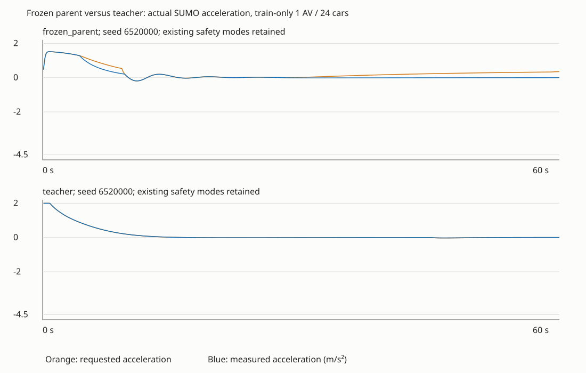

# Frozen-parent acceleration calibration

2026-11-04 local / 2026-11-05 UTC. No learning, optimizer steps, or policy replacement.

## Measured result

The current pure ACC response estimate already matches ordinary following in these fixtures to numerical precision. The frozen policy often requests more acceleration than SUMO's ACC response permits. Changing command duration did not fix this: all 1,200 paired steps with 0.1 s and 0.5 s timelines produced exactly identical requested, filtered and realized acceleration and speed. Both timelines were refreshed each 0.1 s through the existing guards.

`getAcceleration` matched the synchronized speed derivative within **2.57e-13 m/s²** over 7,200 decisions. The tested mismatch is not an off-by-one acceleration sample or duration scaling problem.

| Train-only case, one controlled car | Frozen override | Teacher override | Frozen speed/limit | Teacher speed/limit |
| --- | ---: | ---: | ---: | ---: |
| 2-lane cruise, 24 cars, seed 6520000 | 56.50% | 0% | 0.89367 | 0.89340 |
| 2-lane following, 24 cars, seed 6520001 | 18.50% | 0% | 0.90595 | 0.90912 |
| 3-lane passing, 16 cars, seed 6520002 | 10.00% | 0.667% | 0.90434 | 0.91877 |
| 3-lane merge, 16 cars, seed 6520003 | 26.00% | 2.167% | 0.67585 | 0.67659 |

These speed ratios come from the environment's post-step speed and limit. Raw CSV `speed_ratio` is explicitly a command-context diagnostic using the pre-step limit; its values differ slightly at merge seams. Parent and teacher trajectories can differ, so these are paired initial conditions, not a same-state action ablation. Both passed the slow leader in the passing fixture and completed the merge in the merge fixture. These short training-road probes do not establish acceptance or population generalization.

All runs retained speedMode **31**, laneChangeMode **512**, the analytical filter and the original combined override definition. There were no collisions, teleports or overspeed samples, and no native emergency braking/stop warnings in this diagnostic set. This does not erase historical failures.

## Response calibration and remaining gaps

- **Free cruise and cap:** a constant +2 m/s² request on a sparse 3-lane road had 400 observations without a visible front neighbor. Every filtered command was realized; the filter correctly capped 329 commands near the speed limit. There were 330 samples within 0.5 m/s of the limit.
- **Ordinary following:** prediction `min(filtered request, existing ACC response estimate)` matched all 2-lane cruise/following samples to roughly 1e-14 m/s². The +2 m/s² dense-following probe realized only 0.21560 m/s² on average, with all 400 requests differing from realization. This is a controller/model response limit, not evidence that the safety floor should be reduced.
- **Near-limit passing:** parent had 31 residuals beyond 0.05 m/s² after the existing predictor. Some occur with no front vehicle inside the policy's 120 m observation range; the predictor then returns +2 m/s². Native ACC can still respond to more distant traffic and native speed behavior. Saved data does not identify the specific active limiter for every residual.
- **Merge/junction behavior:** parent retained 47 residuals above 0.05 m/s² after the predictor; teacher retained 13. On the teacher's ramp approach, commands near +2 m/s² were followed by -4.5 m/s² native deceleration despite a front gap around 49–52 m and an increasing leader speed. The stored native counterfactual matches realization at these samples, but does not establish whether a junction, downstream lane or other native constraint caused it. Do not train the teacher as universally correct without resolving these cases.
- **Road seams and ending lanes:** all requested strata are retained with counts and signed residuals in the JSON. Near-limit, seam and ending-lane strata may overlap. `lane_end_distance_m` is the existing route-topology measure, not the nearest physical edge endpoint.

## Historical emergency reconciliation

The preserved population-v02 run `train-20261105T045039Z-a6db8f1b` contains **12 unique native lane-end emergency stops**: nine in training, one in initial validation and two in final validation. All involve controlled cars; none involve background cars. The sampled emergency counter was zero.

At the corresponding warning time, eleven recorded accelerations were approximately -4.5 m/s² and one was +0.147 m/s²; the next sample was zero. SUMO separately reported lane-end position corrections with signed `decel` values from -6.69 to -28.46. Thus a threshold on sampled acceleration misses these native emergency-stop events. Preserve and gate on both native warning events and sampled acceleration; do not relabel one as the other. The compact event supplement retains vehicle ID, timestamp, nearby journal samples and source hashes. Historical validation was read only for this diagnostic and was not used to fit parameters.

The first diagnostic parser searched only “emergency braking.” It has been corrected and tested to include “emergency stop.” Saved logs were reprocessed without simulator reruns. The original raw summary and exact executed source remain preserved; corrected results are in the evidence JSON.

## Provenance and reproduction

- Actor: `policies/versions/highway-stage1-v03-phase0/policy.pt`, SHA256 `8526f6134b7eae90d3370bd12cc0487926a6ec4356c6c6ea2dd231e8aa8b1bb8`, unchanged before/after.
- Source/runtime hashes, commit, Python/Torch/NumPy/SUMO versions and full config hash: [acceleration-summary.json](acceleration-summary.json).
- Raw CSVs, episode logs, native journals, exact executed script and resolved config: `outputs/highway-population-diagnostics/v01/acceleration-20261105T051936Z-5526457f`.
- Versioned offline reproduction: `.venv-traffic\Scripts\python.exe documentation/evidence/population-diagnostics-v01/derive_acceleration.py`. It reads the retained run above and historical population-v02 logs, then writes a new uniquely named directory under `outputs/highway-population-diagnostics/v01/`. `--run` selects a retained diagnostic run and `--output` selects a new directory under project outputs; existing directories are refused. No simulator or learning is started, and accepted evidence is never overwritten. The original postprocessor remains preserved in the raw folder. Measured rows, residuals, duration comparisons and historical events were reproduced exactly; the Git-status snapshot naturally differs when rerun.
- Runtime: **53.77 s**, 14 bounded diagnostic episodes. This wall time is not a throughput benchmark. The initial run did not capture Git dirty status; the supplement labels its later status snapshot honestly. Source hashes are authoritative; future executions also capture start status.
- Fresh diagnostic command: `.venv-traffic\Scripts\python.exe -m experiments.diagnose_population_acceleration --max-wall-seconds 360` (new unique outputs, no learning).
- Focused tests: `4 passed` in `tests/test_population_acceleration_diagnostics.py`; independent review verified every raw artifact hash, sample finiteness and all duration pairs.

## API interpretation

[SUMO retrieval documentation](https://sumo.dlr.de/docs/TraCI/Vehicle_Value_Retrieval.html) defines acceleration as the last-step value and supplies the stored native speed counterfactual. [State-change documentation](https://sumo.dlr.de/docs/TraCI/Change_Vehicle_State.html) explains that speed commands remain constrained by speed mode. The pinned [1.27.1 vehicle source](https://raw.githubusercontent.com/eclipse-sumo/sumo/v1_27_1/src/libsumo/Vehicle.cpp) implements acceleration as a speed timeline; this is not an unrestricted physical actuator. The pinned [ACC source](https://raw.githubusercontent.com/eclipse-sumo/sumo/v1_27_1/src/microsim/cfmodels/MSCFModel_ACC.cpp) supplies the response equations and stateful mode transition. `getFollowSpeed` was deliberately omitted because this ACC path ignores the calculation-reason argument and can update native mode state. `getSpeedWithoutTraCI` is a stored counterfactual, not a separate future rollout or a causal label for a limiter.
