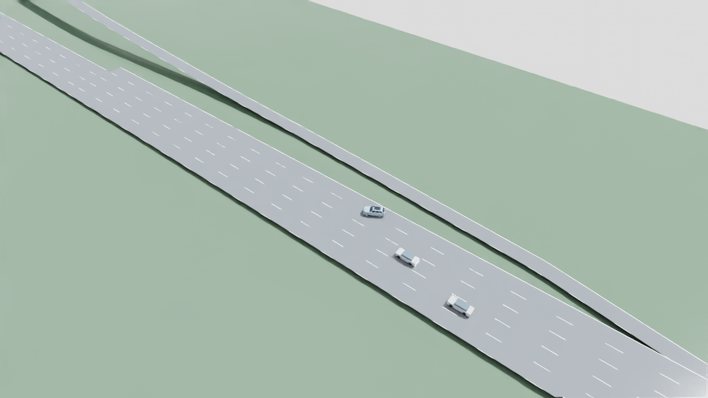

# GPUDrive pretrained I-110 transfer test v01

November 6, 2026. **Rejected for deployment. No training or weight changes.**

Tested the author's frozen 10,000-scenario PPO actor on the existing I-110
network and demand, seed 6800019. Only the main car uses this actor; background
cars use native SUMO. This is a continuous-control transfer experiment, not
native GPUDrive evaluation or physical vehicle validation.

| Main-car result | Native SUMO baseline | Pretrained GPUDrive transfer |
| --- | ---: | ---: |
| Route goal reached | Yes, 37.20 s | No |
| Three-second mainline occupancy | Yes | No |
| Test termination | Arrival | Road boundary at 13.4 s |
| Maximum speed | 18.00 m/s (40.26 mph) | 45.81 m/s (102.48 mph) |
| Measured contact events | 0 | 0 before termination |
| Speed-limit exceedance steps | 0 | 82 |
| Stopped exposure | 0 s | 0 s |
| Peak measured jerk | 65.00 m/s³ | 66.67 m/s³ |

Both episodes had an 80-second maximum and terminated on arrival or failure.
Different realized durations prevent direct throughput comparisons. This is one
exploratory seed. It does not establish general GPUDrive performance or compare
fairly against the historical eight-controller MAPPO/reference runs.

## What actually ran

- [Author checkpoint](https://huggingface.co/daphne-cornelisse/policy_S10_000_02_27/tree/1532950cad84dafc6e9d976a2bcc524ee481a1a1), unchanged, 206,856 bytes;
  SHA256 `f3f26475def35f375c6c72d8f8f20b2b091f77175010345dc3fa968a860521b7`.
- Compatible [upstream source](https://github.com/Emerge-Lab/gpudrive/tree/70e7fadd5d938caebceeb8d42f87ba5f081b6c7d)
  pinned to the checkpoint-era interface. The author's original training commit
  is not supplied by the checkpoint and is not claimed here. MIT notice retained
  in the inference port; weights remain local rather than redistributed.
- CPU PyTorch inference, deterministic argmax, 51,228 frozen parameters.
  Exact logits parity against the upstream network on eight observations.
  **13 focused tests pass**; no extra dependency installation or GPUDrive build.
- 2,984 inputs: six ego values, 63 nearby-car slots of six values, 200 road slots
  of 13 values. Current vehicle states and reconstructed map geometry are used;
  cameras, LiDAR and V2V messages are not inputs.
- 91 categorical actions: seven accelerations from -4 to +4 m/s² crossed with
  13 steering values from -π to +π. No steering-to-lane conversion or scripted
  steering fallback. Historic full-size observation normalization is preserved.
- GPUDrive classic center-of-mass bicycle equations own the main car's motion;
  TraCI places that pose exactly. Maximum position readback error was 5.7e-14 m.
  Native SUMO owns the other cars. Python float64 integration is a numerical
  approximation to upstream float32, not a native simulator reproduction.
- This raw actor test intentionally applies **no MAPPO shield or speed clamp**
  to the externally owned ego. Road limits remain measured, with the scenario's
  18 m/s ceiling and lower ramp limits. Overspeed is a failure, not allowed
  driving. Safety-override rate is **not applicable**, not a passed 0% gate.
- SUMO polylines become 5 m-or-shorter lane, dividing-line and boundary segments;
  nearest visible road midpoints/cars within 50 m are supplied. This selection
  and the new map/goal distribution are transfer approximations. The goal is
  the end of `sb5_1`. We have not isolated which mismatch causes failure.
- Full vehicle footprints are checked, stricter than GPUDrive's reduced
  training collision boxes. The final car corner crossed the mapped lane-ribbon
  boundary by 0.246 m, exceeding the declared 0.05 m tolerance.

## Evidence and replay

[Resolved test configuration](../configs/evaluation/gpudrive-i110-v01.json),
[metrics/provenance](evidence/gpudrive-i110-v01/results.json), and
[tests](evidence/gpudrive-i110-v01/tests.log).
Local raw observations, commands, recordings, source snapshots, simulator logs
and checksums: `outputs/gpudrive-i110/v01/{native-01,policy-01,upstream}`.

Local video: `outputs/gpudrive-i110/v01/replay-01/i110-merge.mp4`.
All 134 original 10 Hz frames were rendered and decoded successfully, with no
pose interpolation. The prepared SimReady v14 main car is used with lightweight
backgrounds. Sensor mounts are retained visually; no sensor capture or PhysX
control was run. USD composition checks pass. Screenshots are actual renders.



Run from the project root with existing local fixtures and pinned weights:

```text
.venv-traffic/Scripts/python.exe scripts/evaluate_gpudrive_i110.py --config configs/evaluation/gpudrive-i110-v01.json --output outputs/gpudrive-i110/v01/policy-new --mode gpudrive
```

This command cannot train and requires a fresh output directory. GPUDrive did
control the car, but did not transfer successfully. Keep our existing policies
unchanged. Before any further experiment, decide whether a speed-limited adapter
and closer map/goal matching justify another bounded test. No training is
authorized by this result. Incremental Google-guide sync is pending; its generated
Markdown mirror was not changed.
