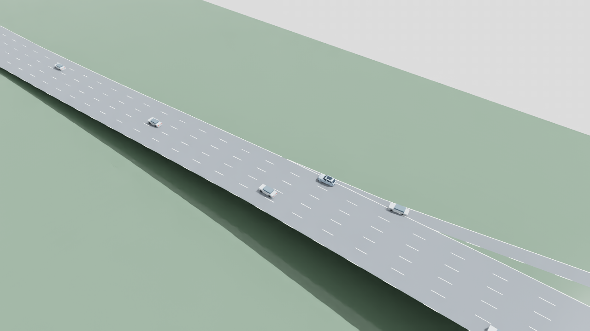

# GPUDrive I-110 v02: 60 mph ceiling and native safety

November 6, 2026. **Completed evaluation; policy still rejected. No training.**

The frozen GPUDrive checkpoint is unchanged. Its acceleration request now passes
through our existing v05 speed, following and ending-lane guards. Lane requests
pass front/rear gap, cooldown, maneuver-lock and full-maneuver runway checks.
SUMO owns all vehicle motion with speed mode 31 and lane-change mode 512; native
collision avoidance and junction priority remain active. There are no external
pose writes. Maximum speed is 26.8224 m/s (60 mph), with lower road limits preserved.

**The interface changed:** GPUDrive's steering cannot be applied directly through
this discrete lane-control stack. A documented adapter computes one-second lateral
slip from its bicycle steering, requests left/right when that displacement reaches
half a lane width, and otherwise requests staying in lane. SUMO performs permitted
maneuvers over three seconds. Acceleration is saturated to our -4.5..2m/s² range.
Raw outputs, adapted requests, guard causes and native realized motion are all
retained. The adapter is not a claim that native SUMO reproduces GPUDrive dynamics.

## Measured results

Both runs use seed 6800019, the same I-110 network, byte-identical generated demand,
one controlled ramp car and 15 initial background cars, sustained inflow, and an
80-second primary horizon. The native baseline releases the focal car to SUMO.
This is a new matched pair; v01's unshielded dynamics/demand differ.

| Metric | Native baseline | GPUDrive + adapter + safety |
| --- | ---: | ---: |
| Stable merge | 1 | 0 |
| Maximum focal speed | 26.18 m/s | 8.61 m/s |
| Collisions / teleports | 0 / 0 | 0 / 0 |
| Local or global speed violations | 0 | 0 |
| Focal stopped exposure | 0 s | 71.9 s |
| Existing-stack intervention rate | N/A | 91.125% |
| Combined rate including adapter saturation | N/A | 92.25% |
| Completed / requested trips at 80 s | 38 / 55 | 36 / 55 |

Of 800 actor decisions, 714 had a native realization change, 15 lane requests were
rejected, and 9 were acceleration-range clips. Combined interventions occurred
on 738 decisions. Native realization differences are explicitly unattributed;
do not assume every difference was an imminent collision or a specific gap rule.
The actor did not enter the mainline and remained unfinished at the horizon.
It fails the 5% intervention and merge/progress criteria. No policy promotion.

## Evidence and replay

- [Configuration](../configs/evaluation/gpudrive-i110-v02.json)
- [Metrics, manifests and matching-demand hashes](evidence/gpudrive-i110-v02/results.json)
- [Checks](evidence/gpudrive-i110-v02/tests.txt): 17 focused tests pass, plus fixed-study configuration rejection checks.
- Local raw evidence: `outputs/gpudrive-i110/v02/{native-01,policy-01}`.
  Includes source snapshots, actor observations/commands, native action journals,
  full 80-second recordings, safety metrics and checkpoint checksum.
- Local video: `outputs/gpudrive-i110/v02/replay-01/i110-merge.mp4`.
  Shows the first 40 seconds at 5 fps, using exact every-other recorded frame and
  the prepared SimReady v14 main car. Background cars remain lightweight.
  No sensor capture or PhysX validation; road rendering is illustrative.



Run from the project root with existing pinned checkpoint/network fixtures:

```text
.venv-traffic/Scripts/python.exe scripts/evaluate_gpudrive_shielded_i110.py --config configs/evaluation/gpudrive-i110-v02.json --output outputs/gpudrive-i110/v02/policy-new --mode gpudrive
```

The evaluator rejects altered fixed-study settings and cannot train. The final
configuration-validation addition followed the runs and changes no settings or
control behavior used in this evidence; original run sources remain snapshotted.
Native baseline and guarded test took 10.625 s and 17.0 s of evaluator wall time.
Next work would need to address pretrained-policy/adapter compatibility before
more training. Google-guide synchronization of this incremental note is pending.
