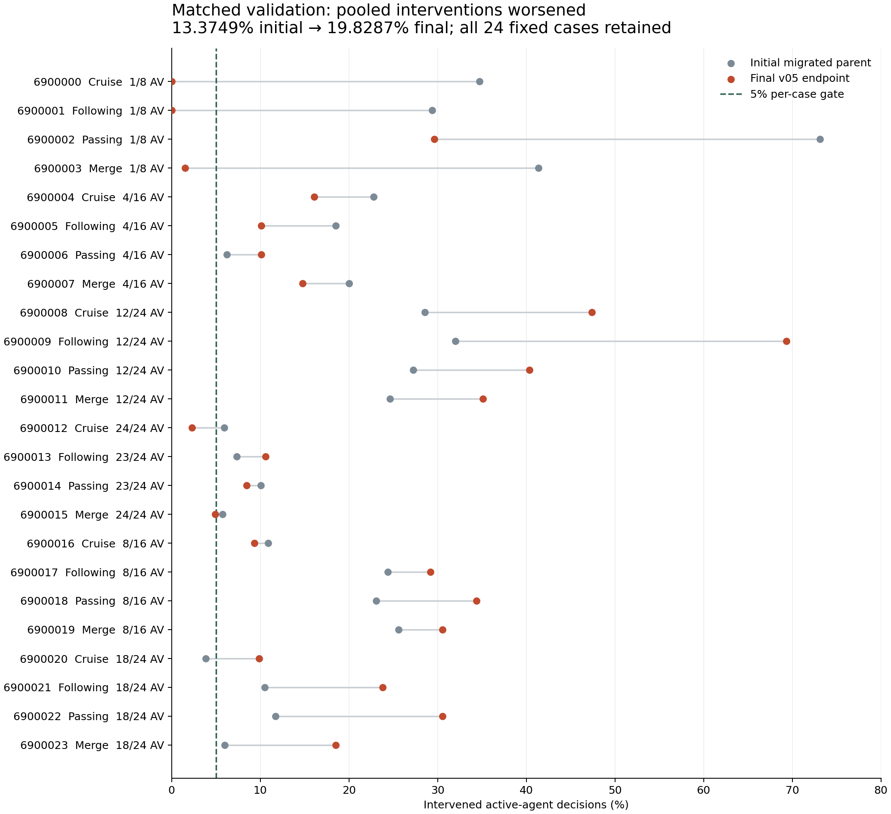
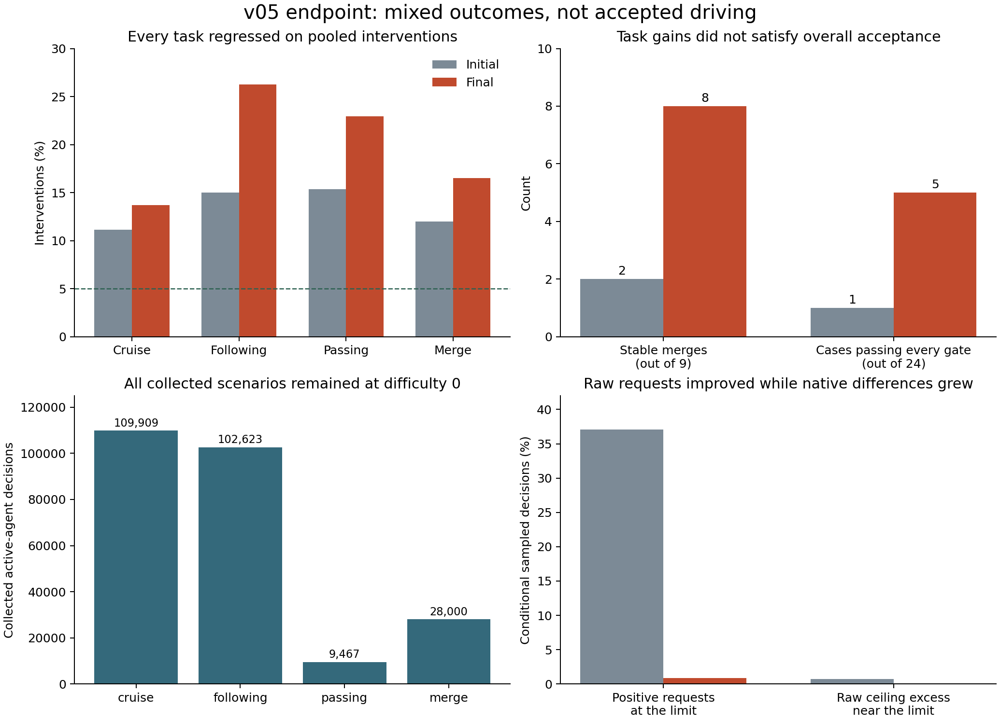

# Highway environment v05 pilot results

November 5, 2026, America/Los_Angeles. **The bounded pilot completed, but the
final policy is not accepted.** On all 24 fixed validation cases, pooled
interventions increased from **13.3749% to 19.8287%**, a **6.4538 percentage-point
regression**. Stable merges improved from **2/9 to 8/9**, and observed passes
increased from **55 to 59**. Those gains do not offset the intervention failure.

This compares the initial migrated parent and final endpoint in the same repaired
v05 environment. It is not a comparison against historical policies evaluated in
different environments. The [preparation note](highway-environment-v05.md) records
the motion/occupancy work and its earlier evidence; this note records the actual
completed attempt and supersedes its pending-results status.

Run: `outputs/highway-environment/v05/train-20261106T024828Z-90b25880/`.
The [compact comparison](evidence/highway-environment-v05/results/comparison-summary.json),
[all paired rows](evidence/highway-environment-v05/results/paired-validation.csv)
and [source index](evidence/highway-environment-v05/results/source-index.json)
are derived from the saved reports. No evaluation case was removed or rerolled.

## Complete matched validation

| Metric | Initial migrated parent | Final v05 endpoint |
| --- | ---: | ---: |
| Intervened decisions / active-agent decisions | 26,251 / 196,270 | 38,852 / 195,938 |
| Pooled intervention fraction | 13.3749% | 19.8287% |
| Worst case intervention fraction | 73.1250% | 69.3339% |
| Cases failing at least one gate | 23 / 24 | 19 / 24 |
| Cases passing every gate | 1 / 24 | 5 / 24 |
| Completed lateral merges | 8 / 9 | 8 / 9 |
| Complete eight-second stable merges | 2 / 9 | 8 / 9 |
| Pending merge targets at truncation | 1 / 9 | 1 / 9 |
| Observed passes | 55 | 59 |
| Collisions, teleports, overspeed samples | 0 each | 0 each |
| Measured emergency-braking samples | 0 | 0 |
| Native emergency warning events | 0 | 0 |

Every initial/final report completed its declared primary horizon with valid
accounting. Agent-decision denominators differ because policies change arrivals
and active lifetimes; the pooled rates are recomputed from raw counts. The
stable-merge total is **88.89%**, below the 90% aggregate target; the I-110 merge
case also fails its own gate. All 19 final failed cases exceed the unchanged 5%
intervention limit, and I-110 additionally lacks a completed merge.

The five final cases passing all gates are seeds 6900000, 6900001, 6900003,
6900012 and 6900015. The last two are 24/24 AV initial-only cruise and merge;
their interventions are 2.3012% and 4.9348%, respectively. These individual
successes do not establish accepted general driving. The final 12/24 AV
following case has the worst rate, 69.3339%.

The [raw warning audit](evidence/highway-environment-v05/results/native-warning-audit.json)
also checks every complete native log independently of the emergency parser.
All 24 final `sumo-errors.log` files have zero warning lines and zero other
nonempty lines. Emergency counts and general warning counts remain separate
measurements; no absent log is treated as zero.

## What improved and what regressed

| Task | Initial pooled interventions | Final pooled interventions |
| --- | ---: | ---: |
| Cruise | 11.1562% | 13.6870% |
| Following | 15.0162% | 26.2364% |
| Passing | 15.3459% | 22.9498% |
| Merge | 12.0043% | 16.5314% |

Every task worsened on this primary measure. Policy-filter changes decreased
from **1,692 to 391**, while measured native realization differences increased
from **24,554 to 38,464**. These counters overlap and must not be added as
independent events. The recorded native differences remain **unattributed**:
the journal measures requested, filtered and realized acceleration but does not
prove which internal SUMO rule caused each difference.

Conditional near-limit diagnostics improved: raw acceleration teacher RMSE
decreased from **0.22746 to 0.11733 m/s²**; positive requests at the limit fell
from **1,320/3,562 (37.06%) to 20/2,351 (0.85%)**; raw ceiling-excess requests
fell from **853/121,792 to 3/127,937 near-limit decisions**. These are sampled
state-conditional measures with different denominators. They show progress on
the localized raw-action objective, not overall feasible native control.

## I-110 entry remains unresolved

The [saved-journal audit](evidence/highway-environment-v05/results/i110-entry-audit.json)
covers validation seed **6900019**, `v05-validation-i110-merge`, ramp car
`agent_0`. In both initial and final evaluation, this car never entered a through
lane. Its merge is **pending at truncation**, with no post-merge window; it must
not be relabeled as a failed completed stability window or as success.

The final car advanced **34.4558 m** across the reported route interval, compared
with 34.4565 m initially. From 5.1 through 80.1 seconds, its realized
acceleration and progress reward are zero for all **751 samples**. Across all 800 decisions it asks
for positive acceleration; **777/800** have native realization differences and
none have policy-filter changes. After 5.0 seconds, its mean raw request is
**1.61213 m/s²**. The shared teacher target is also positive on **606/751**
samples, averaging **1.61384 m/s²**. Stronger imitation alone therefore cannot
be assumed to resolve the stalled entry.

All 800 lane requests are stay, but allowed lane masks were not saved in that
journal. This does not establish an avoidable lane-choice error. The existing
evidence does not identify why native SUMO held the car. Priority handling,
conflict gaps and the target near the stop point are diagnostic hypotheses.
The complete I-110 merge case worsened from **25.5792% to 30.5337%** interventions;
the absence of merging itself was already present in the initial evaluation.

Raw journal:
`outputs/highway-environment/v05/train-20261106T024828Z-90b25880/final-validation/19/episode-6900019-1ea27c5c/actions.jsonl.gz`.

## What the curriculum actually covered

| Task | Collected episodes | Active-agent decisions |
| --- | ---: | ---: |
| Cruise | 21 | 109,909 |
| Following | 19 | 102,623 |
| Passing | 6 | 9,467 |
| Merge | 4 | 28,000 |
| Total | 50 | 249,999 |

The [curriculum audit](evidence/highway-environment-v05/results/curriculum-coverage.json)
shows **grade 0 throughout**; every collected scenario used difficulty 0.
The final 32 admitted reports passed cruise 0/13, following 4/13, passing 1/4
and merge 0/2. The foundations did not meet advancement gates, so no grade-1/2
training occurred. All declared totals, participation fractions, speed ceilings
and communication modes appeared, but this was not full factorial coverage.
I-110 received two cruise and two following training episodes, with **no I-110
merge or passing episode**.

There were 51 issued rows but 50 collected episodes; the final draw could not fit
the one remaining decision. Ten collected episodes were fresh training-scenario
retries, exactly 20% of collected episodes. Forty-six complete PPO reports,
covering 240,879 decisions, entered curriculum evidence; two critic episodes and
two partial PPO episodes did not. No validation trajectory entered training.

## Budget, repairs and reproducibility

The attempt collected **249,999 decisions**: **4,096 critic-warmup** and
**245,903 PPO** decisions. It performed **50 rollout updates**, **2,025 joint PPO
optimizer steps** and **68 critic-only optimizer steps**. It stopped with one
decision unused under the 250,000 ceiling. The saved checkpoint charges
**2,455.032 seconds**, including **512.048 seconds** from two failed pre-learning
invocations, within the 3,600-second aggregate cap and 600-second final-evaluation
reserve. The successful invocation's process wall time is 1,943.046 seconds;
checkpoint elapsed time excludes a small final serialization/reporting tail.

The [provenance and recovery chain](evidence/highway-environment-v05/results/run-provenance.json)
preserves both failures: departure timestamp precision at 125.344 seconds,
then incomplete native initial-cohort insertion at a further 386.704 seconds.
Both stopped before collected training or optimizer updates. Scoped repairs
aligned requested departure times with native millisecond precision, handled
interrupted maneuvers and insufficient lane runway, and increased initial ACC
spawn clearance. Initial and final comparisons here use the same repaired
source snapshot. Recovery migrations preserved model, optimizer, RNG and charged
time; historical failures were not discarded.

The run used Git commit **`02948d76f16f4d2c56d839ad72c1266777b373c6`** with a
recorded dirty worktree; exact runtime source hashes and source copies are saved,
and the run reports no source changes. Runtime: **Python 3.11.9, PyTorch
2.14.0+cpu, SUMO/TraCI 1.27.1, Windows build 26200**. One CPU worker/thread,
training seed 9507, four PPO epochs, minibatch 256 and the reviewed objective
coefficients remain recorded in the run configuration.

| Artifact | SHA-256 |
| --- | --- |
| Frozen final `policy.pt` | `fd639c39f0c514256a458b2b85d35baba242125f44dcc3d9542d767eb2dd46ec` |
| Full final `last.pt` | `9279b6103d13d2be3fd18fe05e9bae72462e581a16d881fc9e4ff87b0b2ac02d` |
| Semantic authorized configuration | `a9db9895d18a9b3760977603a152cd5d4c52ad82d7e3a0dd8e4d9b9628855f78` |
| Saved `config.json` bytes | `17a28932f90c0ae64d875beab733c4d275de506487f7cad7b1a11909423121f9` |

The [policy card](../policies/versions/highway-environment-v05/README.md) records
the 99-field actor, 24-slot training critic and intended diagnostic use.
[All six previous versioned actor files](evidence/highway-environment-v05/results/previous-policy-preservation.json)
match their bytes at the run's Git commit. This endpoint does not replace an
accepted actor or promote a production controller.

## Next scoped correction proposal

First run a separately bounded **training-partition priority-entry diagnostic**,
logging observed stop distance, conflict gaps, allowed lane masks and
raw/filtered/native acceleration alongside the teacher target. Compare native
traffic, scripted teacher and frozen initial/final actors on the same training
fixtures. Resolve any confirmed entry-state target/context discrepancy before
increasing imitation or launching more PPO. Do not fit validation seed 6900019.

Also require explicit training-bank I-110 merge exposure and review following
control under mixed sustained traffic, where the largest intervention regression
appears. Retain foundational tasks, the 5% intervention gate, the full eight-second
window and all safety thresholds. This is a proposed diagnostic/correction scope,
not implemented work or authorization for another training run.

The evidence is one bounded training seed and 24 development-validation cases.
There is no untouched test result, repeatability claim, noisy-observation study,
camera/LiDAR policy input or physical closed-loop qualification. Zero observed
safety events in this sample does not establish safety outside these fixtures.
Plots use only saved numerical results; selected replay visuals are separate
presentation evidence and cannot substitute for the complete reports.
