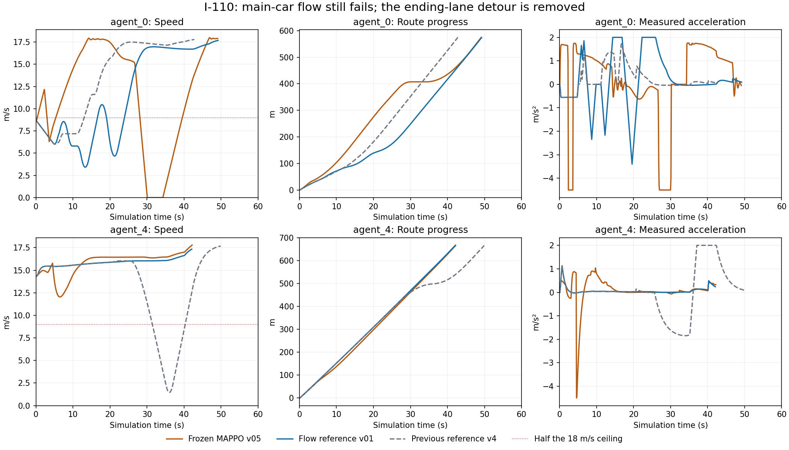
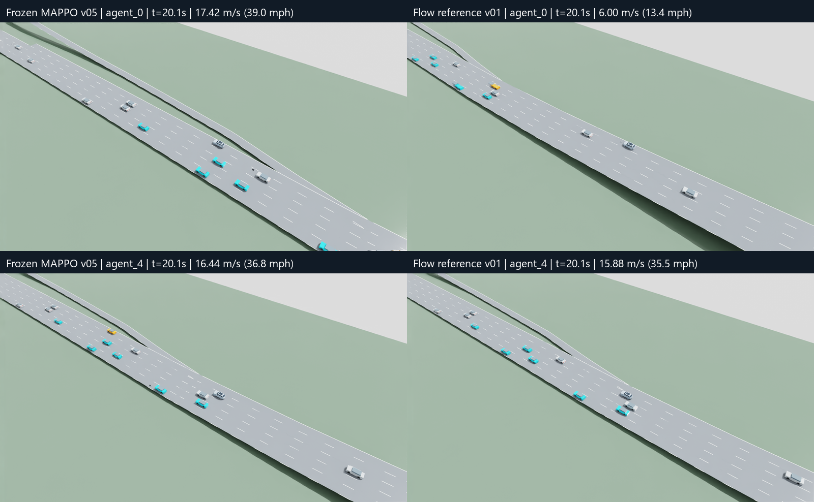
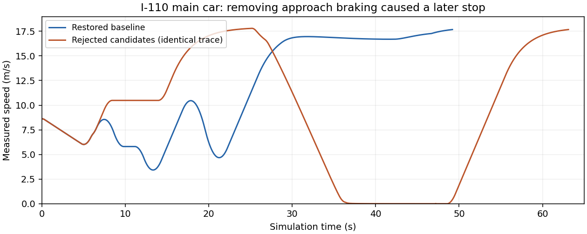

# Highway flow preparation v01

November 6, 2026. Implements steps 1–3 of the
[training rethink](highway-training-rethink-v01.md). Training remains disabled;
no optimizer updates or new learned weights are authorized by this milestone.

**Outcome: implementation is tested, but the reference is not qualified and the
training configuration is not launch-ready.** The new route behavior removes an
ending-lane detour, but the I-110 main car makes less early progress. Low safety
override rates did not establish good driving. Initializer selection and training
remain deferred.

## Implementation

The separate flow environment adds route continuation, distance to a mandatory
lane exit, declared entry visibility, separate lane-following response estimates,
lateral motion and local speed limits. Its actor has 117 inputs: 69 local fields
and six delivered eight-field messages. The centralized critic has 24 masked
slots (2,832 fields). Existing checkpoints migrate with zero weights on the 18
new inputs; frozen inference is preserved. Actions remain physical acceleration
in −4.5…2 m/s² and masked right/stay/left lane intent, at 0.1-second intervals.
These are structured simulation/map inputs, not camera/LiDAR perception.

The new current-observation reference rejects passing into an ending lane without
a route benefit, searches six-second acceleration/gap candidates through a full
three-second lateral maneuver, considers both occupied corridors, and applies
an ending-lane stopping profile only when it binds. Its forecasts assume current
neighbor speeds; they are not future simulator observations. Actual maneuvers
lock for three seconds. Persistent gap identity before a maneuver is not yet
implemented. Labels carry separate acceleration/lane eligibility masks; local
eligibility does not establish that the reference has passed native evaluation.

The proposed first learning comparison keeps the legacy reward formulas and
coefficients under the same new reference. It varies only acceleration imitation
strength, 1 versus 5, with an overall imitation coefficient of 0.04. The larger
alignment reward, Huber comfort loss and command/reference residual penalty from
the prior unlaunched bundle are omitted. Historical runtime files and weights
remain unchanged.

## Evidence and limitations

Raw runs, commands, source snapshots, measured motion, decisions, failed attempts,
cohort accounting and the append-only runtime ledger are retained under
`outputs/highway-flow/v01/`. Full 80-second traffic accounting includes waiting
and unfinished trips. Per-car speed, fixed-time distance, low-speed exposure,
consecutive stops, ending-lane excursions and measured jerk are retained through
the native tail. A focal merge timestamp cannot substitute for fleet progress.

The first native attempt caught a NumPy boolean in diagnostic JSON. A second
attempt completed native and reference episodes but was rejected when a runner
source changed during the batch. Both remain recorded. The second trace also
exposed a substantive error: a future lateral projection on an exclusive
added-lane ramp was incorrectly treated as a minor yield entry. Requiring an
actual positive declared entry-visibility field removes that false stop rule.

That original synthetic ramp also contained a short 15.29 m/s connector between
18 m/s lanes. Native braking produced a 45 m/s³ jerk peak. A separately versioned
straight, tangent added-lane fixture addresses the geometric kink without
overriding native turn speeds. The original bank and imported I-110 networks
remain preserved. The current observation does not yet preview every upcoming
internal-lane speed restriction; real-map anticipation remains a limitation.

## Proposed learning configuration

The resolved file is `configs/training/highway-flow-v01.json`. The paired study
uses two 30,000-active-decision arms, including at most 2,048 critic-warmup
decisions each, and one shared 5,400-second runtime ceiling. Preparation consumes
at most 1,800 seconds of that ceiling; 900 seconds are reserved for final
evaluation. Failed attempts and resumes retain their charged costs.

Actor/critic learning rates are 0.0001/0.0003, with four epochs, PPO clipping 0.2,
gamma 0.99 and GAE 0.95. The initial stage samples cruise/following cases across
speeds 12, 18, 22.352 and 26.8224 m/s, independently varied traffic populations
and communication conditions. Planned case coverage and actual decision/event
exposure are separate; incomplete coverage cannot advance the stage.

Two frozen initializer candidates are compared on the same full 24 development
rows before selecting a starting point. Selection does not promote an accepted
policy. Both future arms retain those 24 rows, foundation gates and non-foundation
retention checks. Training requires passing source/config-bound preflight,
explicit authorization and the exact reviewed configuration checksum.

The first PPO block uses one controlled AV in each of the 18 foundation cases,
with total traffic still independently varied. Its maximum 14,400 decisions plus
the 2,048 warmup ceiling leave at least 13,552 decisions for later varied AV
participation. Warmup has its own schedule cursor and cannot skip the PPO
coverage block. This is a foundation pilot, not proof of mixed-fleet robustness.

`training_authorized: false`, `readiness: null`, and
`initialization.selected_id: null` remain deliberate. Both candidates are pinned:
the completed v05 actor and its earlier initializer. The 48-case initializer
comparison is implemented but deferred because reference qualification failed;
neither candidate has been newly selected or accepted. Preparation digest:
`c6cf17738213774e7c4580bfbb24b13db8c585a2a818adc881ed6df30d6f8019`.
The final [failed-readiness proof](evidence/highway-flow-preparation-v01/final-readiness-failed.json)
cannot authorize training.

## Measured results

[Compact results](evidence/highway-flow-preparation-v01/results.json) and
[CSV](evidence/highway-flow-preparation-v01/results.csv) retain 81 allocated
80-second recordings: 27 scenarios/seeds for native SUMO, the reference and the
unchanged frozen v05 actor. Of these, 54 completed recordings are reused only
after exact control-source, network, actual demand and effective-input checks.
The sole source difference is the builder; added validation metadata is
independently recomputed. Twenty-six recordings are fresh and one is an explicit
deadline repair. This is compatible cached evidence, not a claim that all 81
were rerun under a single builder version.

All failed JSON, source-change, invalid-spawn and 500-second batch-deadline
attempts remain preserved and charged. The final incomplete I-110 frozen run was
rerun in full under the same inputs; no outcome was selected by score.
The ledger records **978.186 seconds** of bounded preparation, including renders
and media, below the 1,800-second ceiling. Code development and unit-test runtime
are separate. Three frozen-actor trials did not complete their prescribed
external lane-change event; those coverage failures remain failed. No result is
held-out acceptance.

| Controller | Passing recorded cases | Worst raw intervention rate | Uncensored worst controlled jerk |
| --- | ---: | ---: | ---: |
| Native SUMO | 13/27 | 0% | 65.00 m/s³ |
| New reference | 17/27 | 0.172% | 45.00 m/s³ |
| Frozen MAPPO v05 | 3/27 | 71.326% | 59.96 m/s³ |

All 27 reference cases pass the preserved raw safety and 5% intervention checks,
but six counterfactual task gates fail (farther slow leader and ending-lane
temptation, three seeds each). Four nominal legacy cases fail comfort and retain
censored full-route completion: cruise **21.959**, following **45.000**, passing
**10.927**, generic merge **22.412 m/s³**, against the unchanged 5 m/s³ criterion.
Some long legacy routes cannot finish within the 80-second horizon; complete
horizon accounting is not complete route traversal. Unfinished trips remain in
the fixed-cohort boundary-time metric. Native startup and stress peaks are not
removed from reporting.

The corrected empty added-lane reference stays at or above **16 m/s**, has no
below-half-limit exposure or overrides, and peaks at approximately **2 m/s³**.
This establishes that the erroneous entry stop was removed in that fixture,
not that real-road merging is solved.

### I-110 and the regression that remains

The main reference car reaches **3.421 m/s**, spends **17.9 seconds** below half
the local speed limit, and travels **248.454 m at 30 seconds**. The previous v4
reference traveled **352.482 m** and frozen MAPPO **407.304 m** at that time.
The new reference has zero interventions and no complete stop, but still drives
poorly through the approach. I-110 was predeclared a stress case: its formal
nominal comfort/low-speed gates do not apply. Its passing row must not be
presented as passing the additional main-car flow concern.

The previously affected highway car, `agent_4`, no longer detours into the
ending lane: its minimum rises from v4's **1.456** to **14.323 m/s**. The all-trip
boundary mean improves slightly, **34.2374 to 34.1102 seconds**, with **33/55**
completed trips in both. That fleet mean does not erase the main-car regression.

### Loss comparison without learning

The explicitly named v05-final **diagnostic candidate**, not a selected training
initializer, produced identical **308-active-sample** batches in both arms
(512-sample ceiling). The gradient inspection uses the first 256 active rows.
Parameters, optimizer state, RNG and qualified labels remain unchanged;
optimizer steps are zero. Actor gradient norms are PPO **5.044**, acceleration
imitation **0.00748** at multiplier 1 and **0.03742** at multiplier 5. Their cosine
is about **−0.861** on this batch. These are local loss derivatives, not evidence
that either proposed arm improves driving. The fresh critic's scale is also
retained in the [candidate diagnostic](evidence/highway-flow-preparation-v01/candidate-gradient.json).
This does not satisfy a final selected-initializer gradient gate.

## Actual visual replay and verification

Four fresh 60-second, 300-frame SimReady v14 renders cover the main car and
`agent_4` under both controllers. Exact every-other native frame is used at
5 fps; the raw measurements remain at 10 Hz. Shared time windows and the same
follow-camera settings reveal the entire approach, maneuver and recovery.
All four decode checks pass, pose error is zero, and vehicle sources/authored
layers remain unchanged. The main vehicle retains its prepared sensor mounts;
backgrounds remain lightweight. These are kinematic SUMO replays with illustrative
road rendering, not PhysX control or camera/LiDAR inference validation.

Local replay: `outputs/highway-flow/v01/visual-comparison-01/i110-flow-comparison.mp4`.
It contains all four views with native time and speed overlays. Raw videos and
recordings remain local; the compact measurements and screenshots are published.
The native Parallel API and seed checks pass, and 11 actual USD/renderer tests
pass. The [final focused suite](evidence/highway-flow-preparation-v01/final-tests.log) passes **144 tests plus 22 subtests**.
[Portable mode](evidence/highway-flow-preparation-v01/portable-tests.log) passes **141 tests plus 22 subtests**, with three explicit skips for unavailable local artifacts.
See `tests/HIGHWAY_FLOW_ARTIFACTS.md` for artifact requirements.

## Next action

Keep this configuration disabled. Resolve anticipatory native cut-in responses,
the main car's oscillating gap/approach plan, upcoming internal-lane speed-limit
preview, and meaningful full-route qualification. Persistent pre-maneuver gap
identity remains unimplemented. Requalify the reference with all-car progress and
comfort retained, then run the fixed initializer comparison and final-bound
gradient check. Present that genuinely launch-ready configuration for approval;
do not train the actor to imitate this unqualified reference more strongly.

## Focused approach ablation — November 6, 2026

Two same-seed I-110 checks tested removing premature adjacent-lane braking, then predicting the following response at future entry. Both were rejected and the original reference/test files restored exactly. A focused subagent reviewed the constraints. Each check used 80 simulated seconds; wall times were 19.125 and 20.157 seconds. No training or new 3D renders ran.

| Main car metric | Baseline | Both rejected candidates |
| --- | ---: | ---: |
| Arrival time | 49.3 s | 63.2 s |
| Minimum speed | 3.421 m/s | 0 m/s |
| Time below half local limit | 17.9 s | 25.9 s |
| Stopped exposure | 0 s | 12.3 s |
| Peak measured jerk | 2.000 m/s³ | 4.000 m/s³ |
| Safety overrides | 0% | 0% |

All runs completed one stable merge with zero collisions/teleports and 33/55 trips completed within the common horizon. Agent_4 was unchanged. Removing the early braking improved the approach briefly but left no certified complete maneuver, then the ending-lane stopping profile became binding. Recomputing future following response alone did not change that trajectory; clipped ACC estimates also cannot prove a farther leader is absent. Neither patch is retained.

Next: inspect a single failed gap window and prepare longitudinal slot alignment before changing reward weights. Preserve occupied-lane constraints, native safety and full-maneuver gap checks. Training configuration stays disabled and initializer/readiness null. The restored reference passes 27 tests plus 3 subtests. [Compact results](evidence/highway-flow-preparation-v01/approach-ablation/results.json) retain source identities and paths to both failed recordings. Google guide/mirror unchanged; this incremental evidence note is pending guide sync.

