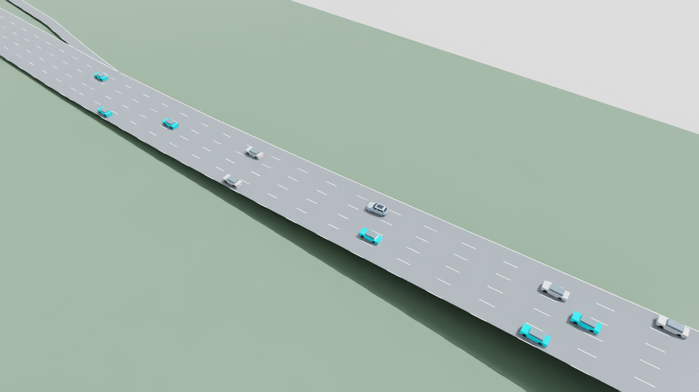

# Flow117 teacher-free MAPPO pilot — November 8, 2026

User authorized revising the plan, training, reviewing only terminal results,
then adjusting/restarting within a bounded study. This separate experimental
pilot supersedes the imitation launch for this task; it does not declare the
failed flow reference qualified or modify its original disabled configuration.

**Completed:** both bounded rounds and their fixed development evaluations ran.
The round-two actor is published as an experimental candidate; acceptance gates
still fail. Training was left unattended until each process exited.

## Revised learning contract

- Shared MAPPO actor:117 inputs; centralized training critic:2,832 inputs.
  Explicit checksum-pinned migration from the earlier v05 initializer, selected
  in advance for this exploratory study; no new comparative selection claim.
- Native SUMO motion and three-second lane changes; 10 Hz decisions; normalized
  acceleration maps to −4.5…+2 m/s²; masked right/stay/left; 60 mph/lower limit.
- Remove the teacher-alignment reward, imitation loss and near-limit teacher
  auxiliary. Keep progress, native merge/pass/arrival, collision, intervention,
  analytical unsafe-request, measured jerk, lane and cooperation terms.
- No GPUDrive weights, continuous-pose adapter, comfort filter or steering port.
  Native route/link execution and existing stable-merge metrics remain enforced.
- Round1 jerk coefficient .01, actor/critic LR1e-4/3e-4; PPOclip .2, four epochs,
  batch256, entropy .001, global gradient clip .5, target KL .02. No teacher labels.
- Mixed predeclared cruise/follow/pass/merge cases, including I-110, with varied
  speeds, 8/16/24 total cars, controlled counts, messages and packet loss. Critic
  warmup has an independent cursor so PPO starts with the I-110 merge case.

## Cost, review and restart

At most two sequential rounds,30,000 active decisions each,1,500 learning-wall
seconds each. Round1 includes up to2,048 critic-warmup decisions. The existing
5,400-second shared ceiling retains1,018.6849924 seconds already spent and900
seconds for final evaluation; all new preflight/evaluation/failure costs persist
in `outputs/highway-flow-rl/v01/cost-ledger.json`. Unit tests/development are
separate from simulation/training wall accounting, as in the parent study.

Four fixed development validation rows (cruise, passing, I-110 following/merge)
run before/after each round. These are not held-out qualification. No live result
inspection while learning runs. After terminal review, round2 may raise the
jerk coefficient to .03 if measured peak jerk exceeds5 m/s³ and lower actor LR
to5e-5 if KL or intervention regression warrants it. A changed objective uses a
pinned model warm start and fresh optimizer, explicitly not an exact resume.
Unchanged interrupted jobs require matching config/source and charged resume.

The runner preserves per-episode reports, raw native journals, gradient/update
metrics, coverage, initial/final evaluation, actor export, checkpoint/RNG state,
source snapshots and failed attempts. An interrupted update is rolled back to
the pre-update model/optimizer. No automatic budget extension or policy promotion.

## Preparation evidence

Environment/native tests passed; zero-update migration/gradient and live guard
checks are recorded separately. First runtime preflight caught unsupported total
population12/20 before learning; corrected to the existing8/16/24 contract and
added validation. Failed evidence remains charged. Preflight02 passed; the final
source revision requires a refreshed source-bound proof before launch.

[Round1 config](../configs/training/highway-flow-rl-v01.json).
Initial state of this note: implementation prepared; results appended only after
completion/failure. Google engineering-guide incremental sync pending.

## Completed results

| Four matched development cases | Initializer | Round 1 | Round 2 |
|---|---:|---:|---:|
| Pooled interventions | 24.94% | 16.44% | 7.61% |
| I-110 merge-case interventions | 6.87% | 6.70% | 0.67% |
| Stable merge targets passed | 0/1 | 0/1 | 1/1 |
| Worst measured longitudinal jerk | 57.94 | 59.60 | 57.38 m/s³ |
| Collisions / teleports / overspeed | 0 / 0 / 0 | 0 / 0 / 0 | 0 / 0 / 0 |

Round 1 consumed29,998 active decisions, including2,048 critic warmup, with315
PPO and36 critic optimizer steps. After its terminal evaluation, the measured
high jerk justified the predeclared .01→.03 penalty change. KL was .00435 and
interventions improved, so actor learning rate remained1e-4. Round2 loaded the
exact pinned round1 checkpoint into a fresh optimizer; it collected29,997 PPO
decisions and389 optimizer steps. This is sequential learning with a revised
objective, **not an isolated causal test of the jerk coefficient**.

Actual I-110 merge PPO exposure was1,463 decisions in round1 and1,407 in round2;
both observed entry events. The independent warmup cursor prevents the earlier
curriculum-skipping problem. Coverage remains incomplete: round2's final I-110
cruise row had only4 PPO decisions. Planned rows and partial episodes do not
establish full scenario coverage.

Round2 final interventions by case: cruise14.50%, passing37.38%, I-110
following5.46%, I-110 merge0.67%. All four still fail the nominal5 m/s³ peak
comfort gate. In fact, peak jerk worsened in cruise, passing and following versus
round1 (10.75,39.46,46.06 respectively); the overall maximum alone hides this.
No policy promotion, held-out test, physical validation or camera/LiDAR claim.
Long generic cases still have unfinished trips at80s; full-horizon accounting
is preserved and does not mean every trip completed.

The two training-plus-evaluation jobs took183.609 and183.735 seconds. All new
runtime including preflights/failure was375.969 seconds; the reconciled study
total is1,394.654 seconds, below5,400. Exactly one unsupported-population
preflight failure is retained; no learning job failed. Model reasoning inspected
results only after each job terminated, not during learning.

Validation:88 focused tests passed, earlier native-environment regression tests
passed, and final CPU export loading/finite inference matched the checkpoint
actor exactly. Runtime sources remain those frozen in each manifest. The actor
SHA-256 is`888a380b7c6741aea623e9b99ad155f7cb9a2ef8fdc2e590823b7e2629031819`.

- [Published actor and contract](../policies/versions/highway-flow-rl-v01/README.md)
- [Round2 resolved configuration](../configs/training/highway-flow-rl-v01-round2.json)
- [Complete compact comparison](evidence/highway-flow-rl-v01/results.json)
- Full local runs/checkpoints/journals: `outputs/highway-flow-rl/v01/round-01`
  and `outputs/highway-flow-rl/v01/round-02`; launch logs are under `logs/`.

Next work should diagnose the remaining cruise/passing interventions and measured
jerk spikes using these journals before another revision. Preserve all safety
thresholds and distinguish peak/typical comfort and unfinished trips. The two
planned rounds are complete; no third round was started.


## November 8: frozen-policy merge video

Recorded the final round-two TorchScript actor on the same I-110 merge development
case (seed 6900019, 8 controlled / 16 total cars). The original evaluation had
no full pose recording. This fresh deterministic replay exactly matches all ten
compared metrics, including the complete stable-merge report: 21 interventions
in 3,123 decisions (0.6724%), zero collisions/teleports/speed violations, and
16 completed trips. Agent 0 enters the through lane at 9.1 s, completes its
lateral merge at 10.6 s and passes its eight-second stability window.

The local video is `outputs/highway-flow-rl/v01/round-02/replay-01/i110-merge.mp4`:
25 seconds, 1280x720, 10 fps, normal playback speed, simulation 0.1-25.0 s.
Americano v14 SimReady is the main car; background cars use lightweight assets.
Every pose is recorded native SUMO motion. This is kinematic visualization, not
physical-control validation or sensor capture. Road markings are illustrative.
The actor remains experimental; this clip does not remove the other failed gates.

Validation: 250 frames encoded and decoded; exact pose placement; static layers
and prepared source assets unchanged. No training or weight changes.
[Video provenance and metric comparison](evidence/highway-flow-rl-v01/video.json).



Reproduce the recording from the project root:

```text
.venv-traffic/Scripts/python.exe scripts/record_highway_flow_rl.py --config policies/versions/highway-flow-rl-v01/training-config.json --policy policies/versions/highway-flow-rl-v01/policy.pt --reference outputs/highway-flow-rl/v01/round-02/final-validation/03.json --output outputs/highway-flow-rl/v01/round-02/video-recording-new
```

Use `scripts/render_i110_merge_replay.py` with `--simready-main`,
`--focal-agent agent_0`, `--camera-mode follow`, `--fps 10`, and the 0.1-25.0 s
window. Exact render inputs/source/asset hashes are retained locally. Google
engineering-guide synchronization of this incremental video note remains pending.


## November 8: velocity diagnosis of the video

[Full offline analysis](highway-flow-rl-velocity-analysis.md) distinguishes native junction braking from later learned braking and an optional detour into an ending lane. It also reveals a larger slowdown after the 25-second clip. The successful initial merge does not establish full-route smoothness. CSV, charts and command-stage attribution are saved; no new simulation or training.
