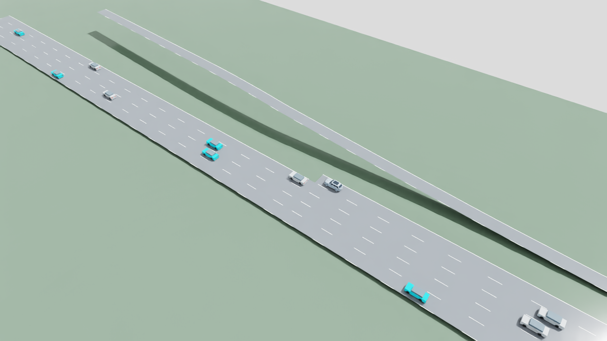
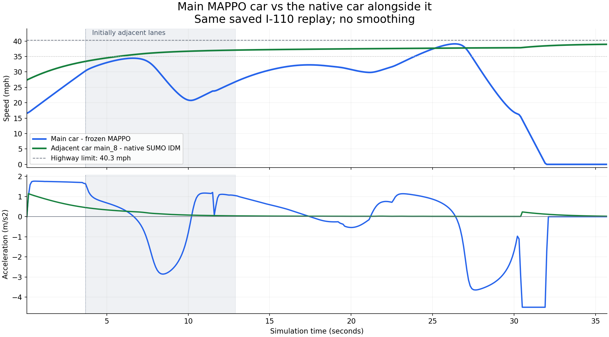

# Flow117 v02 preparation: ramp visibility and driving rewards

November 8, 2026. **Implemented and tested; training remains disabled pending
review of the resolved configuration. No new actor has been trained or accepted.**
Follows the [approved preparation plan](highway-flow-rl-v02-plan.md).

## What changed

- A separately versioned I-110 network changes only the ramp connection's
  visibility from 4.5 to 100 m. This is a declared synthetic unobstructed-sight
  assumption, not a survey of the real highway. Priority, conflicts, geometry,
  speed limits and native safety modes 31/512 remain unchanged.
- A separate v02 environment retains the 117-input actor, 2,832-input centralized
  critic, acceleration/lane-intent actions and original safety filter/masks.
- Cruise bonus is `0.1 * (speed / effective legal limit)^2`, bounded to 0..0.1.
  Eligibility excludes required merging/yielding, lateral motion, braking,
  impending lower limits and route ends. It permits no leader, or a leader
  pulling away by at least 1 m/s with at least 3 s headway and a current response
  estimate of at least +0.2 m/s2. Post-step braking below -0.05 m/s2 vetoes the
  bonus. This is reward supervision; no new actor inputs or teacher actions.
- An optional through-to-ending-auxiliary detour without current route/passing
  benefit receives -0.5 once at first observed lateral movement. Required route
  changes and plausible useful passing are exempt. Masks are unchanged; this
  teaches a preference rather than silently blocking the old actor's decisions.
- V02 journals the full pre-action observation, allowed actions and reward
  evidence. Mask counts stay separate from executed-action interventions.
- A separate runner supports zero-update preflight, recorded evaluation,
  checkpointed learning and exact-source/config resume. Failed/reserved work is
  charged; completed optimizer updates and pending batches are preserved.
  Historical v01 runner, networks, actors and results remain unchanged.

## Measured preparation results

The first four allocated network episodes took 34.703 seconds. A diagnostic log
entry interrupted the occupied-original run at 8.3 s; that failed attempt and
source snapshot remain saved. After correcting the logger, one explicitly charged
recovery episode completed the original comparison in another 11.672 seconds.
No learning occurred in either attempt.

| Matched comparison | Original visibility | Candidate visibility |
| --- | ---: | ---: |
| Clear approach: native hard-braking ticks | 11 | 0 |
| Clear approach: focal arrival, approximately | 40.1 s | 54.6 s |
| Occupied approach: hard-braking ticks | 18 | 18 |
| Occupied approach: measured entry gap margin | +3.91 m | +3.93 m |
| Occupied approach: completed trips | 16/16 | 16/16 |

The comparisons have matching demand hashes. Conflict occupancy was observed,
and there were no collisions, teleports, speeding or native emergency warnings.
Visibility also changes an existing actor input, so this is an end-to-end frozen
actor comparison, not isolation of physics from policy response.

**The candidate fixes the empty-approach brake but does not fix full-route driving.**
The frozen actor still enters an ending lane and stops. Focal interventions on
the clear candidate are 21.51%, even though the fleet average is only 3.72%.
Occupied cases also fail broader headway/intervention checks; the single entry
gap margin is not a general safety certificate.

The final offline reward audit detects the known detour at 18.9 s in the original
saved trajectory. It awards 19 eligible cruise samples totaling +1.35171 and one
-0.5 detour penalty across 400 focal decisions. The stricter initial audit with
zero eligible samples is retained. This verifies reward behavior, not improved
driving from an untrained objective.

158 focused tests pass. Native preflight verifies finite observations/gradients,
native modes, reward/mask versions and exported inference with **zero optimizer
updates**. Five additional frozen-policy development evaluations completed:

| Case | Fleet interventions | Peak jerk, m/s3 | Driving gates |
| --- | ---: | ---: | --- |
| I-110 merge candidate | 3.72% | 47.88 | Fail |
| Generic cruise | 14.25% | 11.90 | Fail |
| Generic passing | 18.64% | 39.46 | Fail |
| I-110 following | 5.46% | 46.06 | Fail |
| Generic 60 mph cruise | 0.12% | 27.73 | Fail |

All five had zero collisions. Comfort, individual interventions, route behavior
and other recorded gates still fail. No held-out cases were consumed. The extra
generic merge case remains declared but unrun in preparation, reserving one of
eight additional diagnostic allocations for a refreshed preflight after launch
authorization changes. Raw headway/TTC, per-car completion and uncensored comfort
remain in the evidence, including failures.

## Resolved training configuration for review

[Exact configuration](../configs/training/highway-flow-rl-v02.json).

| Setting | Prepared value |
| --- | --- |
| Algorithm | Shared MAPPO, decentralized actor and masked centralized critic |
| Initialization | Frozen v01 round-two actor/critic; fresh optimizer |
| Inputs / actions | 117 inputs; acceleration -4.5..+2 m/s2, right/stay/left intent at 10 Hz |
| Networks | Versioned I-110 visibility candidate and existing generic 2-5-lane roads |
| Speeds | Explicit 40/50/60 mph-class curriculum caps; lower lane/ramp limits preserved |
| Traffic | Initial cohorts of 8/16/24; controlled counts 1/4/8/12/16, up to 100% in selected cruise cases |
| Communication | Existing delivered V2V slots; local/off and 0/10% packet-loss cases |
| Base rewards | Progress 1, merge 5, passing 2, arrival 2, collision -20, intervention -0.2, jerk coefficient 0.03, lane-change -0.1, unsafe-request coefficient 0.5, cooperation 0.1 |
| New rewards | Eligible cruise bonus up to +0.1 per step; unnecessary detour -0.5 once |
| Optimizer | Actor 1e-4; critic 3e-4; PPO clip 0.2; 4 epochs; minibatch 256; target KL 0.02; entropy 0.001 |
| Learning allocation | 30,000 active-agent decisions; 900-second cap including development evaluations |
| Curriculum coverage | 12 rows; first-cycle maximum 27,136 decisions; selected four-AV I-110 rows allow full 800-step episodes within 3,200 decisions |
| Other rollouts | 2,048-decision cap; larger cohorts can truncate with bootstrapped returns, explicitly reported |
| Further round | Conditional and separately disabled; no automatic open-ended tuning |
| Launch state | `training_authorized: false` |

There is no new critic warmup or imitation/teacher auxiliary. Inherited MAPPO
advantage defaults are gamma 0.99 and GAE lambda 0.95; actor layers are 128/128
and critic layers 256/256. These defaults are pinned by the runtime source hashes. Full development horizons are
80 s for I-110 and 200 s for generic cases; training generic horizons are 160 s.
Completion is checked per car, not assumed from an elapsed horizon. Selected
population ratios are coverage, not proof of arbitrary/live slider adaptation.

The new study has its own ledger: 360 s preparation CPU allowance, at most two
900 s learning/evaluation rounds and 600 s final evaluation reserve (2,760 s
maximum). Preparation so far charged 115.734 s, including failures. The original
study budget is not reopened. Training starts only after configuration review;
changing authorization requires a fresh matching zero-update preflight. During
learning, scripts checkpoint and report completion/failure without chat polling.

## Replay and retained evidence

The full focal-route replay uses the SimReady Americano v14 main car and
lightweight backgrounds, with exact recorded poses at 5 fps and normal speed.
It deliberately includes the stop and recovery after the earlier 25-second clip.
Verified render: 273 frames, 54.6 seconds at normal speed, successful full decode,
exact pose placement and unchanged source assets/static layers.
Local video: `outputs/highway-flow-rl/v02/replay-01/i110-merge.mp4`.
This is frozen v01 policy inference on the v02 setup, not newly trained v02 weights.
The rendering is kinematic visualization, not physics or sensor validation.

- [Preparation results and provenance](evidence/highway-flow-rl-v02/results.json)
- [Reward audit](evidence/highway-flow-rl-v02/reward-audit.json)
- [Preflight checks and source hashes](evidence/highway-flow-rl-v02/preflight.json)
- [Focused test output](evidence/highway-flow-rl-v02/tests.txt)
- Local complete metrics, action/observation journals, recordings, failed attempt,
  checkpoint-load evidence and source snapshots: `outputs/highway-flow-rl/v02/`.

Next: review this resolved configuration before launching learning. No policy is
promoted. The Google engineering guide has not been updated for this milestone;
its incremental synchronization remains pending.

## November 8 - Speed comparison with adjacent native traffic

Offline analysis of the same v02 development-case-0 replay selects `main_8`,
the nearest non-policy car in the adjacent through lane at the main car's first
external highway entry (3.7 s). Its longitudinal offset is only -0.080 m,
with 3.700 m position separation. Selection uses geometry, not performance.
They remain in adjacent lanes on the same edge from 3.7 to 12.9 s (93 samples).
The shaded graph region is this interval; the native car subsequently pulls ahead.

| Measurement, 3.7-12.9 s | MAPPO `agent_0` | Native SUMO IDM `main_8` |
| --- | ---: | ---: |
| Start -> end speed (mph) | 30.34 -> 26.80 | 33.42 -> 37.07 |
| Minimum / maximum speed (mph) | 20.76 / 34.44 | 33.42 / 37.07 |
| Mean absolute acceleration (m/s2) | 1.163 | 0.180 |
| Mean absolute jerk (m/s3; lower is smoother) | 1.176 | 0.045 |

The MAPPO car is not yet comparably smooth: it accelerates, brakes and then
accelerates again, while this native car steadily approaches its target.
In the shared recording, the native car first reaches 35 mph at 5.7 s and MAPPO
at 23.9 s. These are simulation timestamps, not matched acceleration-test times.
The actual highway limit here is 18 m/s (40.3 mph), below the overall 60 mph
ceiling. Native speedFactor 0.97 gives it a 39.1 mph allowed speed; MAPPO's is 1.0.
Both have 2 m/s2 acceleration and 4.5 m/s2 routine deceleration limits, but different
following models/headways and initial speeds. The native car begins on the
highway; the focal car begins on the ramp. They interact with the same traffic.
This descriptive single-replay comparison does not isolate policy causality.

The chart retains the later ending-lane stop, through the native car's network
exit at 35.7 s. The full focal replay continues to 54.6 s and includes recovery.
Jerk is the change in recorded acceleration divided by the 0.1 s interval,
excluding differences that begin before each analysis window. Nothing is smoothed.
Finite values, cadence, control ownership, source hash and speed/acceleration
consistency were verified. No new simulation, training, configuration or policy
changes; existing acceptance failures remain.

[Metrics and selection](evidence/highway-flow-rl-v02/neighbor-comparison/comparison.json) |
[Validation and provenance](evidence/highway-flow-rl-v02/neighbor-comparison/validation.json).
Full numeric traces and analysis snapshot: `outputs/highway-flow-rl/v02/neighbor-comparison-01/`.
Reproduce with `scripts/compare_replay_neighbor.py` using the command in validation.json
and a fresh output directory. The JSON window named `first_25_seconds_after_start`
means entry at 3.7 s through simulation time 25.0 s; explicit bounds are authoritative.
Next action remains configuration review before learning. Google guide sync pending.
