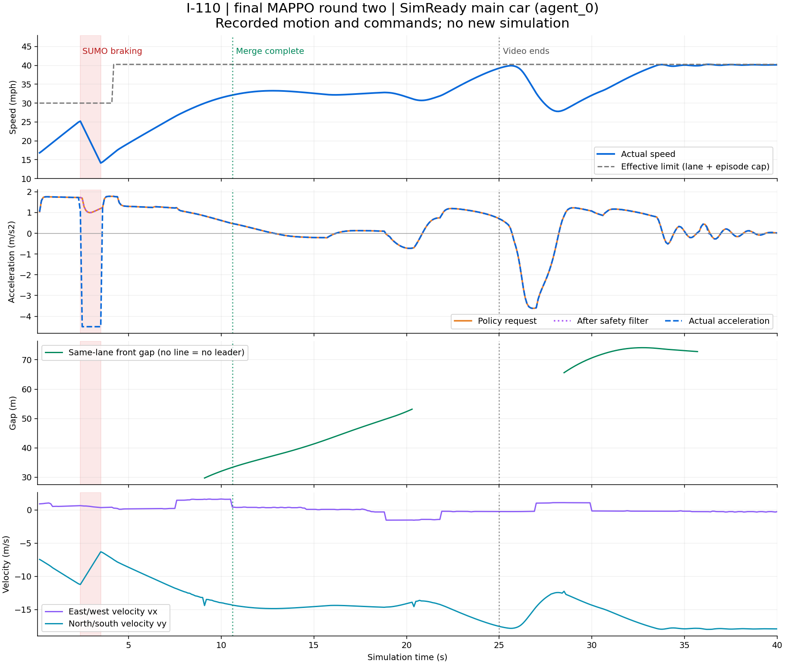

# Flow117 round two: why the main car slows

November 8, 2026. Offline analysis only: no simulator runs, training, policy
changes or environment changes. Input is the exact frozen-policy replay used
for the 25-second SimReady video, seed 6900019. The analysis covers the entire
available focal-car trajectory, including behavior after the video ends.

## Findings

| Interval, simulation seconds | Actual speed, mph | Command-stage evidence |
| --- | --- | --- |
| 2.4-3.5 | 25.20 to 14.13 | Policy requests +0.995 to +1.693 m/s2; explicit filter passes it unchanged. SUMO realizes -4.5 m/s2 for 11 consecutive steps. |
| 12.8-16.1 | 33.28 to 32.18 | Policy requests mild braking, down to -0.219 m/s2. No overrides. Leader gap grows from 37.3 to 43.5 m and leader is faster. |
| 18.8-20.8 | 32.81 to 30.71 | Policy requests braking down to -0.724 m/s2 while changing right into the ending auxiliary lane. No overrides. |
| 25.6-28.2, after video | 39.91 to 27.81 | Policy requests braking down to -3.615 m/s2, then merges left out of that ending lane. No overrides and no same-lane leader. |

The initial sharp brake is imposed by native SUMO. The later dips are directly
requested by the actor, not added by the explicit safety filter or native SUMO.
All 399 measured speed changes agree with recorded acceleration to within
7.8e-14 m/s2. This is a real speed change, not just a moving-camera effect.

### Native junction behavior

The saved network declares `mlk_on_0 -> sb2_0` via `:n2_5_0` as a minor/yielding
connection (`state=m`) at priority junction `n2`. Its recorded visibility is
4.5 m. At the decision ending at 3.5 s, the pre-command distance is 4.849 m
and SUMO still brakes. At the next decision it is 4.218 m and SUMO follows the
positive actor command again. Recorded frames from 2.3 through 3.6 s contain
no vehicles on `sb1_0`, `:n2_0_0` or `sb2_0`; no same-lane front car is recorded.

This closely matches SUMO's documented default minor-road approach slowdown,
which can occur even without priority traffic nearby until the visibility
threshold is reached. [SUMO vehicle-speed documentation](https://sumo.dlr.de/docs/Simulation/VehicleSpeed.html),
[intersection behavior](https://sumo.dlr.de/userdoc/Simulation/Intersections.html).
The original native intervention reason is only logged as unattributed, so the
specific internal cause remains a strong diagnosis, not a controlled ablation.
The connector is not a lower speed-limit bottleneck.

### Learned speed and route behavior

The first post-merge dip occurs while its leader is pulling away by at least
1.68 m/s. The explicit acceleration ceiling remains positive. A recorded left
request starts at 15.6 s but does not move the car; native refusal is reported
at 18.8 s. A right request at 18.8 s then moves it into `sb3_0`. This lane has
no outgoing connection; `sb3_1 -> sb4_0` is the through continuation. The actor
later brakes and requests left at 26.9 s to leave the ending lane again.

The lane mask enforces immediate safety and maneuver runway. It does not forbid
this optional route detour. These observed choices explain why successful initial
merging does not establish good full-route driving. A hypothesis about which
neural input caused a decision would require a separate observation ablation;
the action journal stores partial context, not the complete 117-input vector.

The speed cap in this particular evaluation is **18 m/s (40.26 mph)**, while
the ramp is **13.41 m/s (30 mph)**. The global 60 mph ceiling does not override
those lower limits or act as a cruise target. Plots use the executed cap plus
lane limit, not the uncapped network XML values.

### Correlations and reward limits

- Policy-requested versus realized acceleration: Pearson r=0.6745 over 399 steps.
- Excluding the 15 intervention steps: r=1.0000 over 384 steps; command and
  realized values match to floating-point precision. This is command tracing,
  not a claim of causal feature attribution.
- Pre-command speed versus requested acceleration: r=-0.4622. Higher speed
  generally coincides with less acceleration, but route phase and traffic are
  confounded in one trajectory.
- Gap versus requested acceleration: r=+0.4334 over the 186 leader-present
  steps. Pooling the whole route hides the specific slowdowns with growing gaps.

The executed weights include progress 1.0, jerk 0.03, intervention 0.2 and
unsafe-request 0.5; imitation, near-limit auxiliary and teacher alignment are
disabled. Penalizing jerk does not guarantee constant cruise speed or discourage
every unnecessary maneuver. This single replay cannot prove that a particular
reward weight caused the dips. No weights were adjusted during this analysis.

The published 0.67% intervention figure pools all eight AVs. The focal car has
15/399 interventions (3.76%); 11 contain the severe entry brake. A low aggregate
override rate and one successful eight-second stable-merge window therefore do
not establish acceptable smoothness or complete-route performance.

## Evidence and next diagnostic

- [CSV: speed, x/y velocity, commands, context and attribution](evidence/highway-flow-rl-v01/velocity/velocity-commands.csv)
- [Machine-readable metrics and input hashes](evidence/highway-flow-rl-v01/velocity/analysis.json)
- [First 25 seconds](evidence/highway-flow-rl-v01/velocity/merge-speed-policy.png)
- Script: `scripts/analyze_flow_replay_velocity.py`. Run with the existing plotting
  Python, `--recording outputs/highway-flow-rl/v01/round-02/video-recording-01`
  and a fresh `--output outputs/highway-flow-rl/v01/round-02/velocity-analysis-new`.

Each row at t joins a pre-command context at t-0.1 with the post-command speed
and realized acceleration at t. x/y velocities are finite differences of native
SUMO front-bumper poses, including lateral motion and geometric/reference-point
effects. They are not a replacement for native longitudinal speed. Acceleration
stage differences integrate exactly to the observed speed changes. The initial
local plot draft used uncapped XML limits; the published analysis-02 corrects
this to the executed episode cap. Both local artifacts are retained.

Next work should separately test a highway-appropriate merge connection and
visibility model while retaining right-of-way/collision protection, then address
optional detours into ending lanes and target-speed behavior. Score the entire
route, individual cars and worst braking events rather than only the initial
merge window. Those are proposed changes; no new tests or learning were launched.
The next action in the living roadmap now reflects these findings. Google-guide
synchronization of this incremental analysis remains pending.
