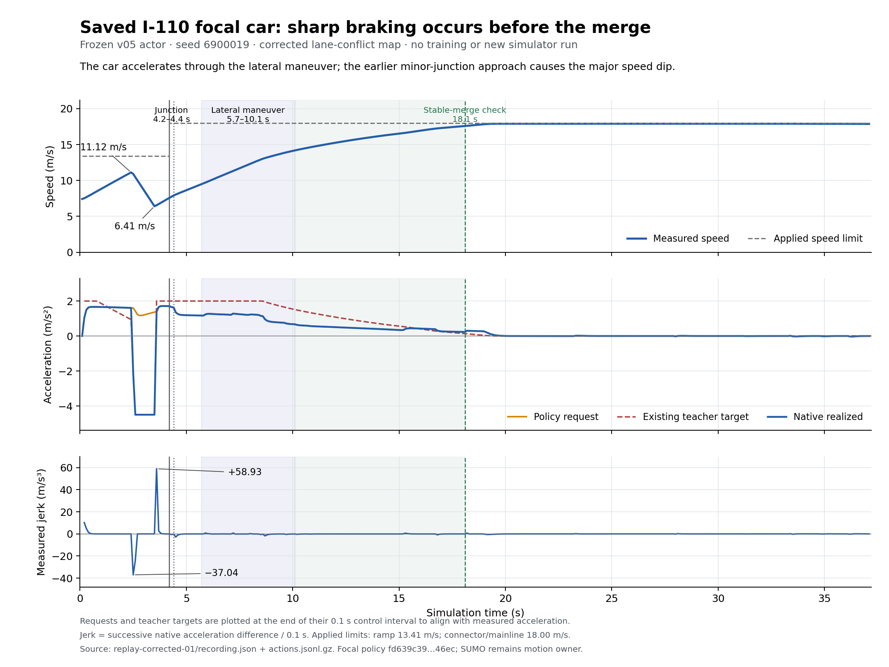
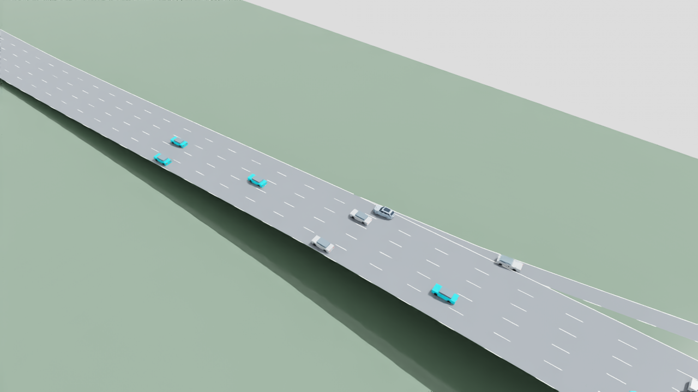
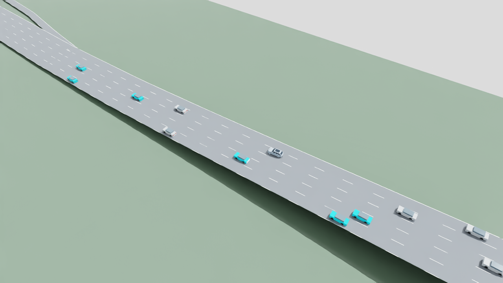
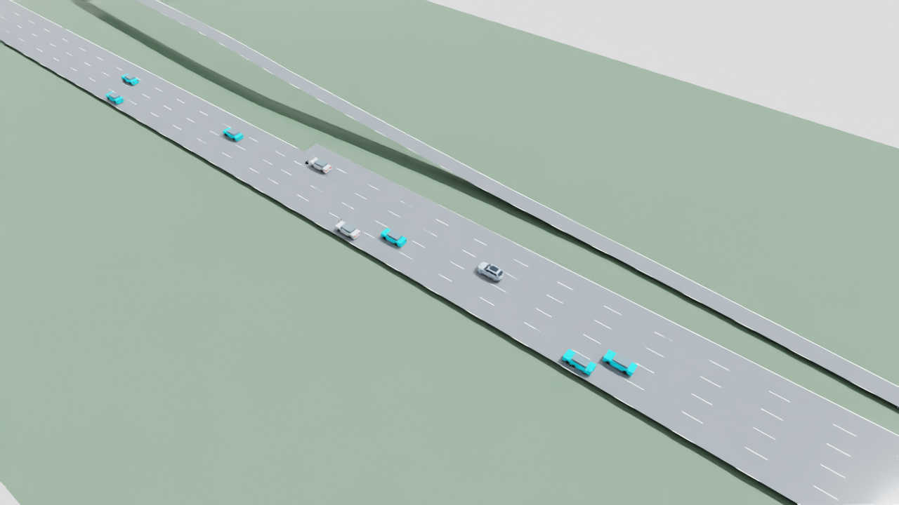

# Highway smooth control v01: frozen-policy diagnosis

November 6, 2026. **No training; the v05 policy remains unaccepted.**

The latest repeat reproduces the corrected I-110 replay exactly. It confirms
that the earlier junction blockage is gone, but the remaining **244/2,864
interventions (8.5196%) still fail the unchanged 5% gate**. This milestone
diagnoses the remaining behavior; it does not claim a smoother or accepted
policy. The [original v05 failures](highway-environment-v05-results.md) and
[previous junction correction](i110-merge-blocking-v01.md) remain preserved.

## What the repeat establishes

Fixed validation row 19, seed `6900019`, frozen MAPPO actor, eight controlled
cars among 16 initial vehicles, sustained native inflow, local communication,
zero packet loss, and an 18 m/s episode ceiling. The runtime is Python 3.11.9,
PyTorch 2.14.0+cpu and SUMO 1.27.1. SUMO owns all vehicle motion.

| Measurement | Previous corrected replay | Fresh repeat |
| --- | ---: | ---: |
| Native frames, 0.1–80.1 s | 801 | 801, exactly identical |
| Controlled steps + native tail | 410 + 390 | 410 + 390 |
| Interventions / decisions | 244 / 2,864 | 244 / 2,864 |
| Stable merge targets | 1/1 | 1/1 |
| Controlled trips completed | 8/8 | 8/8 |
| All trips completed at horizon | 32/55 | 32/55 |
| Observed vehicles with speed below 0.1 m/s | 0/55 | 0/55 |
| Collisions / teleports / controlled overspeed | 0 / 0 / 0 | 0 / 0 / 0 |
| Measured emergency steps / native emergency warnings | 0 / 0 | 0 / 0 |
| Peak measured absolute jerk | 58.9257 m/s³ | 58.9257 m/s³ |

[Exact comparison and all-vehicle stop audit](evidence/highway-smooth-control-v01/repeat-comparison.json)
show identical complete frame objects and physical trajectories. Evaluation
JSON differs only in local episode directory and wall time. Only the recorder
source hash differs; actor, environment, reward, graph and native car-following
sources are unchanged. The [recording check](evidence/highway-smooth-control-v01/recording-check.json)
passes full-horizon, monotonic-time and unchanged-input checks. Twenty-three
native trips remain active at the horizon; zero stops does not imply all trips
finished.

## Why the remaining interventions occur

[Saved-control analysis 02](evidence/highway-smooth-control-v01/saved-control-analysis-02.json)
reconstructs the existing actor-visible targets without simulation, policy
inference, optimizer steps or demonstration export. All 244 recorded native
differences agree with the existing target to within `1e-4 m/s²`; their maximum
native/target residual is `4.284e-6 m/s²`.

- **233 differences match ordinary ACC following response.** `agent_7` contributes
  198, mainly at 16.5–36.2 s; `agent_5` contributes 26. The actor requests more
  acceleration than the compatible following response.
- **11 focal differences match minor-junction approach braking**, at 2.5–3.5 s.
  The actor continues requesting positive acceleration while the existing target
  and native junction model require braking.

These are analytical matches to pinned SUMO equations, not new native cause
labels. Historical `native_realization_unattributed` records remain unchanged.
The equation sources are [SUMO 1.27.1 ACC](https://github.com/eclipse-sumo/sumo/blob/v1_27_1/src/microsim/cfmodels/MSCFModel_ACC.cpp)
and [native vehicle/junction logic](https://github.com/eclipse-sumo/sumo/blob/v1_27_1/src/microsim/MSVehicle.cpp#L3675).
No alternative car-following model, native-safety bypass, relaxed intervention
threshold, hidden controller or overwritten actor was introduced.

Decision accounting includes eight terminal-arrival decisions without a measured
post-arrival state. Thus focal journal interventions are 11/371 (2.9650%), while
the sampled full-route figure is 11/370 (2.9730%). Neither replaces the fleet
acceptance denominator of 2,864.

## The speed dip precedes the merge



The focal car accelerates from **7.42 to 11.12 m/s** by 2.4 s, brakes to
**6.41 m/s** by 3.5 s, then resumes acceleration. At 3.6 s, native acceleration
changes from −4.5 to +1.3926 m/s² in one 0.1 s tick: **58.9257 m/s³ jerk**.
That release tick is not an intervention, demonstrating why low intervention
alone cannot establish comfortable driving.

Native junction entry is 4.2 s; arrival in the auxiliary lane is 4.4 s. The
policy-requested lateral maneuver runs from 5.7 to 10.1 s, and the stability
check succeeds at 18.1 s. Speed increases throughout that maneuver and afterward.
The ramp limit is 13.41 m/s, increasing to 18 m/s at its connector; no downstream
limit reduction explains a post-merge slowdown. The 1 m/s near-limit band is a
training-loss sample selector, not an inference-time switch.

See the [approach detail](evidence/highway-smooth-control-v01/focal-merge-approach-detail.png)
and [phase/feature audit](evidence/highway-smooth-control-v01/focal-saved-audit.json).
The latter exactly reconstructs every saved focal teacher target from current
recorded state, map and masks. SVG plots and per-frame CSV remain under
`outputs/i110-smooth-control/v01/` with hashes in the
[source index](evidence/highway-smooth-control-v01/source-index.json).

## Visibility and the safe next proposal

SUMO defaults a non-zipper connection's visibility to **4.5 m**. Its minor-road
model prepares to brake outside that boundary even when the link is open; once
inside, it can accelerate if conflicting traffic permits. This is a configured
visibility assumption, not a camera/LiDAR result.
[Intersection behavior](https://sumo.dlr.de/docs/Simulation/Intersections.html),
[connection parameter](https://sumo.dlr.de/docs/Networks/PlainXML.html#lane-to-lane_connectivity),
[versioned default](https://github.com/eclipse-sumo/sumo/blob/v1_27_1/src/netload/NLHandler.cpp#L1382).

Increasing it to 75 m would retain conflict checking but assume earlier sight of
all conflicting traffic. The provisional I-110 profiles have no sightline survey
supporting that value, and the current v3 observation contract rejects visibility
other than 4.5 m. Keep the current assumption and genuine auxiliary-lane yield.
A future open-sight synthetic scenario would require its own explicit geometry,
visibility contract and occupied-conflict tests.

The proposed learning direction is earlier anticipation of the existing approach
envelope, better matching of ordinary following response, and smoother recovery.
It should avoid accelerating into a predictable later brake, while retaining
necessary yielding. Assess speed loss/recovery and realized jerk alongside the
unchanged intervention, progress and safety gates. The validation trajectories
are diagnosis only; they must not become training demonstrations. Learning needs
a separately reviewed configuration and explicit approval.

## Training-seed teacher check

A bounded **no-update** comparison used the predeclared training seed `6800019`,
the same corrected network, eight controlled cars, 55 scheduled trips and
byte-identical demand for both controllers. It did not use the validation
trajectory as demonstrations or update weights.

| Training-seed diagnostic | Frozen MAPPO actor | Existing v3 teacher |
| --- | ---: | ---: |
| Interventions / decisions | 557 / 3,183 (17.4992%) | 0 / 3,059 (0%) |
| Stable merge targets | 1/1 | 1/1 |
| Completed trips at horizon | 33/55 | 33/55 |
| Collisions / teleports / overspeed / native warnings | 0 / 0 / 0 / 0 | 0 / 0 / 0 / 0 |
| Mean absolute realized jerk | 0.1861 m/s³ | 0.1281 m/s³ |
| 95th-percentile absolute realized jerk | 0.4459 m/s³ | 0.2886 m/s³ |
| Maximum absolute realized jerk | 59.9553 m/s³ | **64.9999 m/s³** |

The teacher's zero intervention rate **does not establish comfortable control**.
At 3.6 s the focal teacher car is braking at −4.5 m/s² with 4.444 m remaining;
its next step reaches approximately +2 m/s² at 3.7 s. Simply cloning this
reference could reduce intervention counts while preserving that abrupt release.
It is therefore inadequate as the sole comfort reference for the next training
proposal. The [proposed training plan](highway-smooth-training-plan-v01.md) must
address anticipation and release smoothness before any new launch.

The [paired summary](evidence/highway-smooth-control-v01/reference-check-summary.json)
and [teacher manifest](evidence/highway-smooth-control-v01/teacher-reference-manifest.json)
retain results and source hashes. The script's teacher adapter calls the existing
observation-only teacher; it does not invoke the learned actor. Teacher manifest,
recording and evaluation correctly say `controller="teacher"`, `policy_sha256=null`
and identify the teacher implementation; the frozen actor checksum is retained
only as `reference_actor_sha256`. The shared `control_mode="policy"` denotes the
ordinary command-application path, not which algorithm supplied those commands.
Both 801-frame runs retain the full horizon, zero optimizer steps and unchanged
sources. This single paired check is neither MAPPO acceptance nor held-out proof.

## Fresh SimReady visual repeat

The fresh SimReady replay passed and was visually inspected. The prepared
Americano i7 EV **v14** is the focal car; background vehicles remain lightweight.
The [render report](evidence/highway-smooth-control-v01/render-report.json) verifies
251 decoded frames at 10 fps, covering native times 0.1–25.1 s, no source-pose
interpolation, **0 m maximum replay-position error**, unchanged prepared sources
and unchanged static scene layers. The full performance report still covers
80 seconds. This is an accurate visual repeat of unchanged behavior, not an
improved controller or a new pass below 5%.

| Approach slowdown, 3.5 s | Lateral merge settled, 10.1 s | After the merge, 25.1 s |
| --- | --- | --- |
|  |  |  |

Local video: `outputs/highway-smooth-control/v01/render-current-01/i110-merge.mp4`.
Visualization follows recorded SUMO poses; it is not PhysX control validation
or sensor capture. The prepared local-only vehicle package is not redistributed.

## Reproduction and retained evidence

From the project root, using the documented traffic environment and a fresh
output directory:

```text
python scripts/record_highway_environment_v05.py --config configs/diagnostics/i110-merge-blocking-v01.json --policy policies/versions/highway-environment-v05/policy.pt --expected-policy-sha256 fd639c39f0c514256a458b2b85d35baba242125f44dcc3d9542d767eb2dd46ec --case-index 19 --output outputs/highway-smooth-control/v01/replay-new --max-wall-seconds 180
```

The fresh package is `outputs/highway-smooth-control/v01/replay-current-01`.
Network SHA256 is `ae829282ad98cfaeeba806fba30e44536361ccabf4d0861708c5638fff512836`.
The package preserves configuration, weights, source snapshots, native logs,
action journal, complete frames, metrics and recording checks. Bulk artifacts
remain local; compact published evidence links to their exact hashes.

Three subagents separately handled (1) native-control/analytical mismatch diagnosis
and the training-seed controller check, (2) independent map, observation, trajectory
and visibility audit with measured plots, and (3) training-plan/acceptance review.
The parent coordinated the frozen repeat, visual rendering and documentation.
The plots are standard Matplotlib renderings of saved data, not generated imagery.
