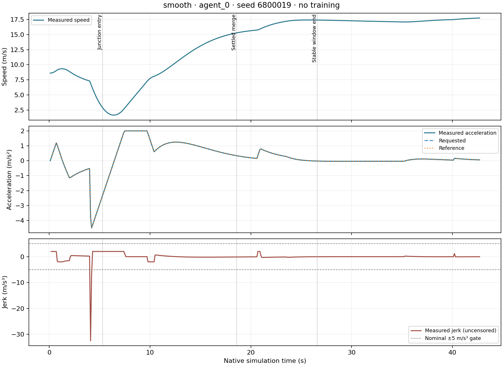
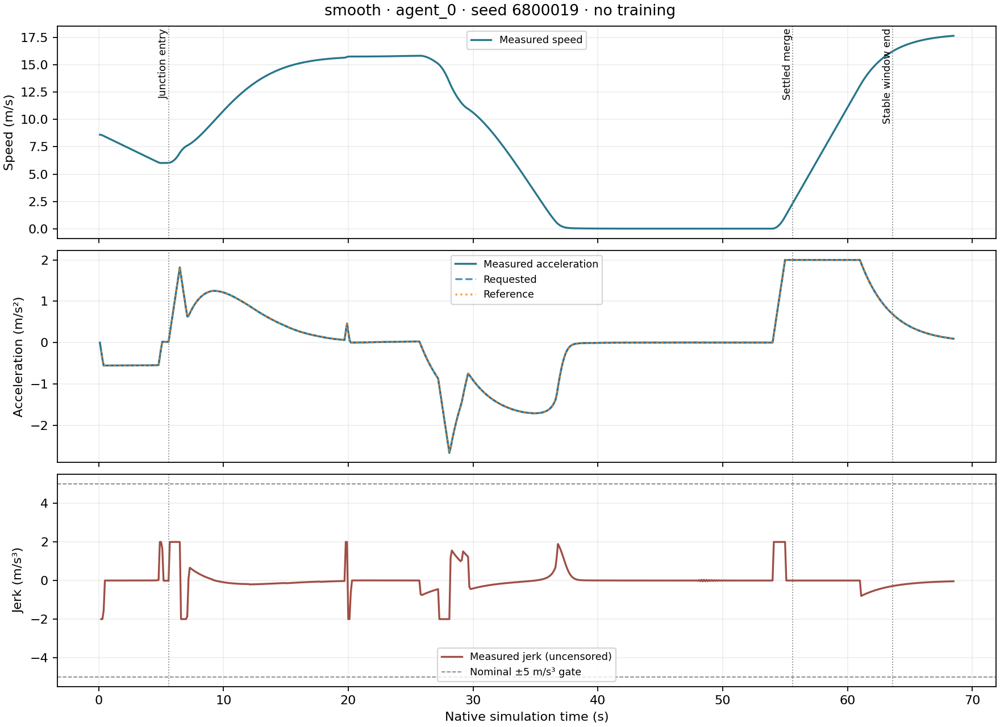
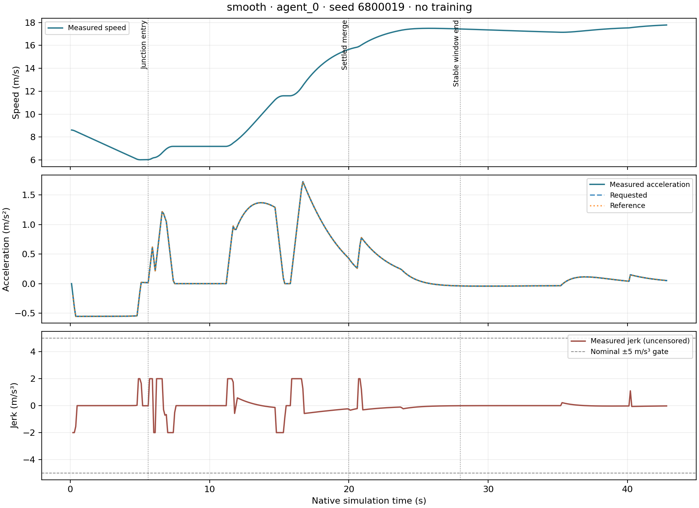
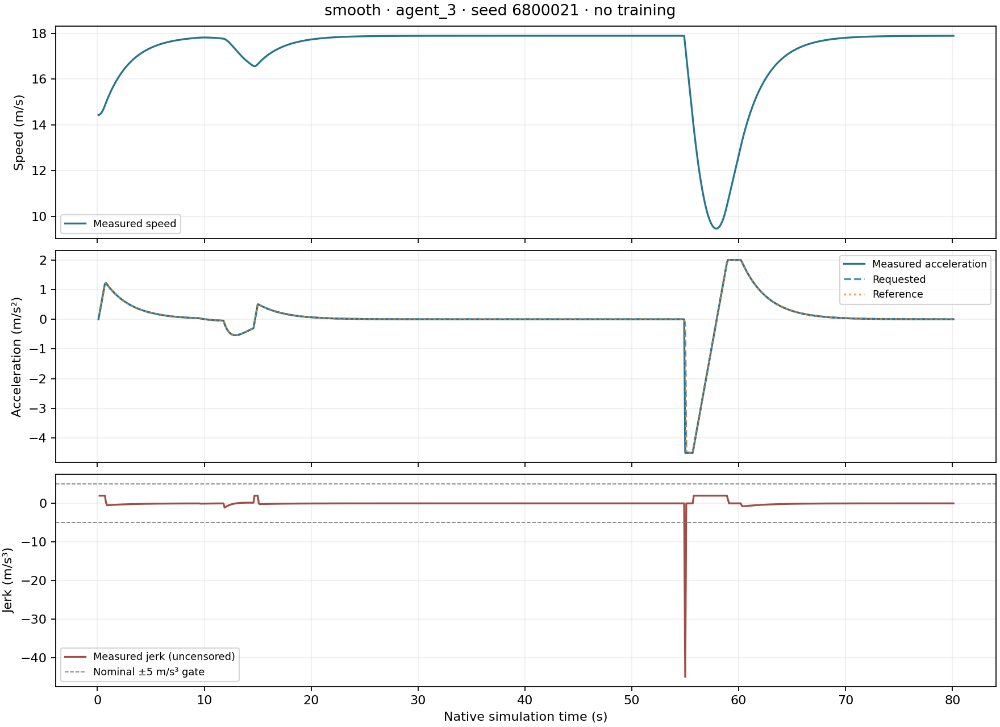
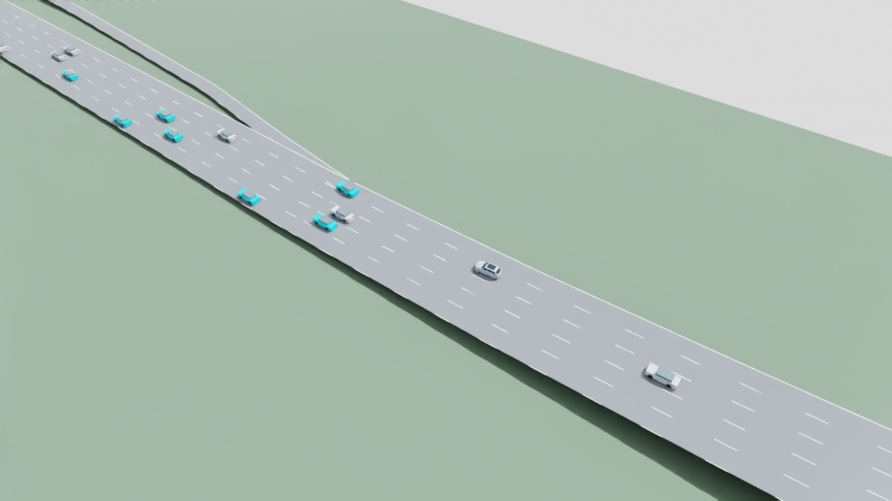
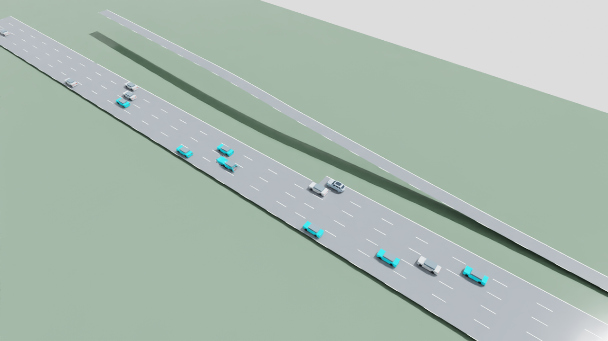

# Smooth highway control — preparation v01

Preparation is implemented and tested without training. The fourth scripted
reference improves the I-110 merge and passes dense following, but four of six
nominal fixtures still exceed the strict measured-jerk limit. **Training readiness
is false.** The frozen MAPPO actor has not changed, and no new accepted policy is
claimed. The proposed experiment and its acceptance rules remain in the
[training plan](highway-smooth-training-plan-v01.md).
The [final readiness record](evidence/highway-smooth-preparation-v01/final-readiness-failed.json)
passes contract, safety, reference, invariance, gradient and coverage checks,
but explicitly fails comfort on the retained fourth-reference matrix.

## Implementation and preserved behavior

`environments/highway_smooth_control.py` wraps the unchanged v05 environment.
The `v05` arm preserves its reference and reward; `smooth_v01` changes only
supervisory labels and the reviewed alignment/Huber-jerk/residual-slew reward
terms. The actor still receives 99 fields and emits acceleration/lane intent;
native SUMO owns motion. Demand, hard guards, speed/lane-change safety modes,
4.5 m minor-entry visibility and the 0.1 m stop offset remain intact.

Metrics retain raw, filtered and measured jerk, startup, missing-sample counts,
each car, fixed assigned-controller/background groups, merge phases and observed
slowdown. The direct native tail is measured through the full accounting horizon.
Unavailable arrival acceleration and first-command history are not replaced by
zeros. The first measured acceleration interval is included in the nominal peak.

The new wrapper's old-objective teacher produced **801 native frames exactly
equal** to the previous environment's same-seed teacher run. The
[comparison evidence](evidence/highway-smooth-preparation-v01/legacy-invariance.json)
preserves both recording hashes. Pure tests also verify identical actor inputs,
native commands, states and safety counts when only the reward version changes.

Three agents divided the work: reference design and boundary tests; environment,
reward and metrics plus this offline audit; and matched schedule, budget and
launch contracts. The coordinating agent owns native capture, final gate review,
configuration and shared project documentation.

## First preserved failure: `entry-probe-01`

Training-only I-110 seed **6800019**, eight controlled cars in a 16-car initial
population, sustained inflow, 18 m/s ceiling, full 80 seconds. Both runs retained
55 requested trips and identical demand. This was scripted reference evaluation,
not learned-policy improvement.

| Measured result | Existing teacher | Proposed reference, first revision |
| --- | ---: | ---: |
| Interventions | 0 / 3,059 | 0 / 3,181 |
| Stable focal merges | 1 | 1 |
| Completed / requested trips | 33 / 55 | 33 / 55 |
| Mean boundary time, including unfinished trips | 33.9320 s | 34.2283 s |
| Controlled native mean / p95 jerk | 0.1281 / 0.2886 m/s³ | 0.1409 / 0.5066 m/s³ |
| Controlled native peak jerk, startup included | 64.9999 m/s³ | **32.4907 m/s³** |
| Collisions / teleports / overspeed / emergency events | 0 / 0 / 0 / 0 | 0 / 0 / 0 / 0 |

The proposed reference still exceeds the **5 m/s³** nominal peak gate. Its focal
speed falls 7.7015 m/s from 1.3 to 6.4 seconds, including braking after junction
entry. Matching requested, reference and measured acceleration shows this dip is
in the reference's requested trajectory; zero overrides alone do not establish
comfort. The complete [offline gate report](evidence/highway-smooth-preparation-v01/entry-probe-01-gates.json)
retains the failure and marks the not-yet-run fixture/actor comparisons incomplete.



The only measured stop is `agent_4`: 1.7 seconds below 0.1 m/s at 33.9–35.5 s.
It reaches the ending auxiliary lane 1.8566 m before its end. The hard lane-end
ceiling is −4.5 m/s²; a safe left-lane request is accepted at 33.8 s, and the
vehicle reaches the through-lane midpoint at 35.3 s. Braking to zero produces
a 28.6879 m/s³ acceleration change. This supports earlier preparation for the
ending lane, while retaining the hard stopping guard. No stop lasts two seconds.

First-reference source SHA256:
`5d6817c1503007671f2c64e18a1c078be0b69e6ecedd97283544976f354a9d65`.
Full source snapshots, manifests, actual action journals, native recordings and
evaluations remain under `outputs/highway-smooth-control/v02/entry-probe-01/`.
They are preserved independently of subsequent revisions.

## Second preserved defect: `entry-probe-02`

The next reference adds finite-distance entry braking and a smooth ending-lane
stopping/recovery profile, keeping the hard guard unchanged. On the same frozen
fixture it records **6 / 3,362 interventions (0.1785%)**, a controlled peak jerk
of **2.000001 m/s³**, one stable merge, 33/55 completed trips and zero recorded
safety events. The comfort ceiling passes in this fixture.

Progress is still poor: the focal car is below 0.1 m/s from **37.5–54.2 s
(16.8 sampled seconds)** and completes the merge at 55.6 s. It matches a car
beside it rather than making room for an available gap. At 12 s the projected
rear car, `agent_4`, is only 3.909 m behind and closing at 2.706 m/s. By 16–26 s
the bumper gap clamps to zero while both cars approach 15.8 m/s. The reference
follows the target lane's front car without resolving the unsafe rear spacing.
Once `agent_4` moves ahead, the reference slows late. Six lane requests expire
without native lateral motion; the eventual empty gap permits the maneuver.
This is evidence for earlier gap alignment, not for weakening native safeguards.



The existing quantitative comparison must be described accurately. Its mean
boundary time is 34.9429 s, **2.98%** above the teacher, within the proposed 5%
limit. Its observed merge speed loss is 15.8509 m/s; the same-demand frozen actor
previously lost 17.9294 m/s and also stopped, so the proposed actor-relative
drawdown bound does not reject this behavior. The
[matching-recording audit](evidence/highway-smooth-preparation-v01/entry-probe-02-actor-comparison.json)
confirms identical demand bytes, network and frozen actor checksum. The actor's
missing pre-reset approach history remains explicitly censored. A relative
slowdown comparison is not a no-stop guarantee.

The [second offline gate report](evidence/highway-smooth-preparation-v01/entry-probe-02-gates.json)
therefore reports incomplete full-matrix readiness, not a fabricated failure of
those numerical bounds. The avoidable long stop remains a separate progress
defect under investigation. No learning follows from a single passing comfort
case. Second-reference source SHA256:
`f33df82b9f47dbf95a8d9d98c68bc42f36195734bab69d708873b66710807e18`.

## Criterion refinement declared before `entry-probe-03`

On **2026-11-06, before the third trial**, the preparation criteria were extended
to capture the requested continuous merge behavior: on the six nominal fixtures,
each controlled merge target must avoid a **consecutive measured stop of at
least two seconds below 0.1 m/s before or at its first stable completion**.
Necessary safety stops in explicitly dangerous boundary fixtures are reported
but do not use this nominal comfort/progress criterion. The original safety,
trip-time and relative slowdown comparisons remain separately reported.

Duration uses consecutive measured intervals, from the first low-speed timestamp
to the last, including the reset sample where available; it does not invent a
first or arrival interval. Thus the second trial has 16.8 seconds of sampled
low-speed exposure and a **16.7-second observed span**. It fails this newly
declared continuous-merge criterion in the [revised audit](evidence/highway-smooth-preparation-v01/entry-probe-02-revised-criteria.json).
That is a transparent refinement after a
revealed limitation, not a claim that it failed the older numerical rules.
Missing stable completion leaves coverage incomplete while retaining any
observed long stop. The new runtime metric is
`smooth_control.per_car[vehicle_id].nominal_merge_stop`; it preserves its cutoff,
sample coverage, threshold and longest interval.

## Third entry trial: `entry-probe-03`

The third reference keeps the smoother stop profile and adds a current-observation
gap-alignment target. When the target-lane rear clearance deficit exceeds the
front surplus, it can yield behind the closing rear car instead of matching
speed alongside it. Existing masks, lane decisions, safety gaps and native
authority remain unchanged.

The same I-110 fixture now has **0 / 3,183 interventions**, controlled peak jerk
**2.000001 m/s³**, one stable merge, **no measured stops**, and 33/55 completed
trips. The focal car enters the junction at 5.6 s, finishes its lateral merge
at **20.0 s** and completes the stability window at **28.0 s**. Observed merge
speed loss is **2.3703 m/s**. Mean boundary time is 34.2374 s, within the teacher
comparison bound. The single-fixture [gate report](evidence/highway-smooth-preparation-v01/entry-probe-03-gates.json)
passes all of its measured gates; full-fixture readiness is still incomplete.


This is a scripted-reference result. The frozen learned actor still records
**17.4992% interventions** under either objective. The live
[invariance comparison](evidence/highway-smooth-preparation-v01/frozen-objective-invariance.json)
confirms identical complete native recordings and raw/filtered commands when
only the objective version changes. Live observation arrays were not separately
recorded; their exact invariance is covered by unit tests. No actor update was
performed, and the reference's zero-intervention result must not be attributed
to MAPPO. Third-reference source SHA256:
`09663d7e0d87a36e6aa7f966121ef99b986886696d1d30cc04832688a49b3ef2`.

## Full nominal matrix: `matrix-01`

All **24 runs** completed: six fixed nominal fixtures with native automatic
driving, existing teacher, scripted new reference and frozen MAPPO actor.
The [aggregate](evidence/highway-smooth-preparation-v01/matrix-01-gates.json)
verifies the saved source snapshots and actual measured jerk. Native driving
remains context, not a learned-policy result. These are the scripted reference's
results under the third reference version:

| Fixed fixture | Overrides / decisions | Controlled peak jerk | Completed / requested trips | Gate result |
| --- | ---: | ---: | ---: | --- |
| Cruise | 1 / 6,400 | 21.9587 m/s³ | 0 / 36 | Comfort fails |
| Following | 0 / 6,400 | 45.0000 m/s³ | 0 / 35 | Comfort fails |
| Passing | 13 / 6,400 | 22.9691 m/s³ | 0 / 35 | Comfort fails; 7 passes |
| Generic merge | 5 / 6,400 | 10.7391 m/s³ | 0 / 36 | Comfort fails; 1 stable merge |
| Dense following | 1 / 6,400 | 44.3672 m/s³ | 0 / 63 | Comfort fails |
| I-110 merge | 0 / 3,183 | 2.0000 m/s³ | 33 / 55 | Measured fixture gates pass |

All six scripted-reference runs pass the unchanged safety/task acceptance gates
and retain their full 80-second accounting. The zero completed trips on the
other networks must remain visible; matching their teacher's completion count
does not establish route-completion competence within that horizon.

The [peak-event audit](evidence/highway-smooth-preparation-v01/matrix-01-peak-events.json)
separates two mechanisms. Four peaks originate in the ordinary ACC response
estimate being applied after the comfort limiter, while the hard ceiling still
permits positive acceleration. This is a reference-design problem, not evidence
that those ordinary response estimates are hard safety constraints. The passing
peak is different: at 44.8 s `agent_1` requests −0.589 m/s² but native motion
realizes −2.855 m/s² during a lane maneuver. That native event must remain in the
metrics and cannot be removed by relabeling the reference.

The original aggregate marked the generic merge's frozen-actor comparison incomplete: it settles
at 75.5 s, so its requested eight-second post-merge window ends at 83.5 s,
beyond the fixed 80.1 s recorded boundary. Its available drawdown exceeds the
candidate's, but the missing post-window remains explicit. No tail was invented.
The one-sided comparison refinement below subsequently resolves the inequality
without claiming complete baseline coverage.

The fourth reference moves the ordinary response estimate before the soft
jerk limiter, while keeping hard safety/minor-entry constraints afterward.
Six new scripted-reference runs were compared with the **already fixed
`matrix-01` native/teacher/frozen-actor baselines**. The baseline order is chosen
before examining outcomes. Prior runs stay immutable; readiness remains false
if strict measured comfort or other required evidence fails.

## Fourth-reference matrix: `matrix-02`

The six fourth-reference candidates completed their full horizons. Their
[fourth-reference gate report](evidence/highway-smooth-preparation-v01/matrix-02-gates.json)
uses the fixed prior baselines; no controller or seed was selected by its outcome.

| Fixed fixture | Overrides / decisions | Controlled peak jerk | Measured result |
| --- | ---: | ---: | --- |
| Cruise | 2 / 6,400 | 21.9587 m/s³ | Comfort fails |
| Following | 8 / 6,400 | 45.0000 m/s³ | Comfort fails |
| Passing | 16 / 6,400 | 22.9691 m/s³ | Comfort fails; 7 passes |
| Generic merge | 14 / 6,400 | 10.7391 m/s³ | Comfort fails; 1 stable merge |
| Dense following | 8 / 6,400 | 3.6904 m/s³ | Measured fixture gates pass |
| I-110 merge | 0 / 3,183 | 2.0000 m/s³ | Measured fixture gates pass |

All six retain zero counted collisions, teleports, overspeed, measured emergency
braking and native emergency warnings. The largest intervention fraction is
0.25%, below 5%; low intervention is still insufficient for readiness. Completion
counts and boundary times retain the previous matrix's accounting. The generic
merge actor's post-window coverage remains incomplete. It is not imputed, and
the four comfort failures remain failures.

Every remaining failing peak is now a **measured native response beyond the
requested acceleration**. The [fourth-reference peak events](evidence/highway-smooth-preparation-v01/matrix-02-peak-events.json)
show cruise requesting −0.200 and realizing −2.196 m/s², following requesting
−0.200 and realizing −4.500, passing requesting −0.589 and realizing −2.855,
and generic merge requesting −0.022 and realizing −0.896. Their underlying native
cause remains unattributed; the evidence does not justify labeling every one an
emergency or weakening a native safeguard. More anticipatory control/scenario
analysis is needed before the same strict all-case comfort gate can pass.



The fourth-reference I-110 focal result retains its 20.0 s settled merge, 28.0 s stable
completion, 2.3703 m/s observed speed loss and zero stops. The following failure
is shown alongside it so the successful scene is not presented as full readiness:



Fourth-reference source SHA256:
`ed3780f990e0751bb5e8f23b491c918e8a84162402a0fb352a5b71b966b8fc6c`.
The [evidence index](evidence/highway-smooth-preparation-v01/evidence-index.json)
records all retained local run paths, source versions and compact-file hashes.
These measurements are supervisory-reference preparation, not trained-actor
performance. Configuration remains disabled with no passed readiness certificate.
The subsequent bounded adjacent-risk preview is retained below. The same fixed
baselines, six nominal fixtures and strict gates stayed in force.

### One-sided slowdown comparison proof

The original aggregate reports above are preserved. A subsequent
[comparison revision](evidence/highway-smooth-preparation-v01/matrix-02-monotone-bound-revision.json)
correctly resolves the generic merge's actor-relative slowdown inequality:
the candidate's complete observed window loses **0.9538 m/s**, while the actor
has already lost **16.8614 m/s** in its available partial window. Additional
actor samples can only retain or increase its maximum drawdown. Thus the
candidate is already below the actor's lower bound plus the unchanged 0.1 m/s
allowance. This proves the inequality without claiming that the actor's
post-window is complete. The helper records
`proof_type=one_sided_observed_baseline_lower_bound` and retains
`baseline_full_window_claim=false`.

This shortcut cannot accept an incomplete candidate window, cannot infer a
failure when the actor's lower bound is smaller, and cannot use an undefined
baseline window. Dedicated tests cover those restrictions. It changes no
physical measurement or threshold; overall readiness still fails on comfort.

## Rejected fifth reference and retained active version

`matrix-03` tested a soft preview of adjacent traffic using existing observations;
it did not change the native controller or hard guard. The
[fifth-reference aggregate](evidence/highway-smooth-preparation-v01/matrix-03-gates.json)
keeps its improvements and regressions against the same fixed `matrix-01`
baselines:

| Fixture | Fourth-reference peak jerk | Fifth-reference peak jerk |
| --- | ---: | ---: |
| Cruise | 21.9587 | 16.1656 |
| Following | 45.0000 | 25.3940 |
| Passing | 22.9691 | 11.3570 |
| Generic merge | 10.7391 | 6.5714 |
| Dense following | 3.6904 | 3.6898 |
| I-110 merge | 2.0000 | 35.8422 |

Units are m/s³, including startup and every measured peak. Five cases still
fail comfort. Passing events fall from seven to one. On I-110, the focal car
merges earlier at 13.3 s, but another controlled car, `agent_4`, stops in the
ending auxiliary lane from 37.3 to 51.3 s: **14.0 seconds of consecutive observed
low-speed span**. Its braking-to-zero transition produces the 35.8422 m/s³
peak, and all-trip mean boundary time rises from 34.2374 to 35.1338 s. The
target-only continuous-merge gate does not cover this other car; the full-car
stop audit and peak remain visible. No claim is made that the focal merge itself
became slower.

The fifth reference was rejected, and the source was restored **byte-for-byte
to the fourth reference**, SHA256
`ed3780f990e0751bb5e8f23b491c918e8a84162402a0fb352a5b71b966b8fc6c`.
Its rejected SHA256 is
`3de267351af2a152be8e4e45e1189318774980fcc7f959f4325e4e37416e8502`.
The reference agent preserved the [rejected patch](evidence/highway-smooth-preparation-v01/v5-rejected-adjacent-preview.patch),
[comparison and source hashes](evidence/highway-smooth-preparation-v01/v5-rejected-adjacent-preview.json),
and [restoration note](evidence/highway-smooth-preparation-v01/v5-rejected-adjacent-preview.md).

The retained fourth reference is preparation code for further work, **not an
accepted trained policy**. All six of its cases meet the existing safety/task
and 5% intervention gates; four still fail the unchanged 5 m/s³ comfort gate.
Training stays disabled. Future work must address anticipatory response to the
remaining native events and review full-car progress, while preserving the
recorded failures and safety authority.

## Completed SimReady visual comparison

Both actual renders use the prepared **SimReady v14 main car**, original prepared
materials and lightweight background vehicles. Each contains **300 decoded
frames at 10 fps**, covering native times 0.1–30.0 s. The
[reference render](evidence/highway-smooth-preparation-v01/simready-reference-render-report.json)
and [frozen-policy render](evidence/highway-smooth-preparation-v01/simready-frozen-render-report.json)
both pass: maximum recorded-position error is **0 m**, no pose interpolation is
used, and static layers and source assets remain unchanged.

The local 30-second comparison video is
`outputs/highway-smooth-control/v02/visual-comparison-v01/i110-frozen-vs-reference.mp4`.
Its labels identify **left: unchanged frozen MAPPO; right: scripted training
reference v4**. The [comparison manifest](evidence/highway-smooth-preparation-v01/visual-comparison-manifest.json)
retains the input/output checksums and frame verification. The prepared vehicle
asset and videos remain local; selected actual screenshots are included here.

Scripted reference, settled merge at 20.0 s:



Unchanged frozen MAPPO at 30.0 s, still approaching its later merge:



This is a **kinematic visualization of recorded SUMO motion**, not a PhysX
control or sensor-validation run. Cameras/LiDAR mounts remain in the prepared
asset, but sensor capture and physical-car control are false for these renders.
Road geometry comes from the recorded SUMO network; lane markings are
illustrative. The successful reference scene does not remove the four other
fixture comfort failures or establish an improved learned policy.

## Final zero-update derivative check

`gradients-02` passed with **512 actual active decisions per objective**, identical
observations, global states, agent indices, raw/pre-tanh actions, active masks and old
log probabilities across the two collections. It computes weighted component
derivatives on the first 256 active rows and critic diagnostics on all 512.
The [final gradient proof](evidence/highway-smooth-preparation-v01/final-gradient-summary.json)
reports **zero optimizer steps** and unchanged model/optimizer state; the
[manifest](evidence/highway-smooth-preparation-v01/final-gradient-manifest.json)
binds its training-only case and exact restored-v4 source hashes.

These are measured derivatives, not parameter updates or evidence of driving
improvement. The local batch checksum is retained in the proof; the batch itself
is not copied into published documentation. The 512-row collection gives direct
observation-array invariance evidence beyond the earlier unit checks; it does
not claim that full 80-second observation arrays were separately archived.

The [preparation cost ledger](evidence/highway-smooth-preparation-v01/preparation-cost-ledger.json)
charges **1,241.094 s**: 1,000.031 s of native/gradient work, a conservative
120 s per render, and 1.063 s of comparison encoding. The render charges are
reservations, not claimed measured application totals. Software development,
documentation and unit-test time are outside this runtime budget. Of the
proposed 3,600 s ceiling, **2,358.906 s** remains, including the fixed 900 s
final-evaluation reserve; at most **1,458.906 s** remains for initial evaluation
and learning if subsequently authorized. Readiness failure prevents launching
now; the remaining budget is not permission to train.

## Offline verification and final tests

`scripts/summarize_highway_smooth_preflight.py` reads saved artifacts and applies
the unchanged `highway_v05_support.acceptance` gates plus the controlled peak,
completed-trip, boundary-time and merge-slowdown comparisons. It verifies source
snapshots and reconstructs measured jerk from native recording frames, including
startup. Native automatic driving is context only; it is never scored as a
successful trained controller.

The six fixed nominal fixtures require candidate, existing-teacher and frozen
actor recordings. Mean boundary time includes every requested trip through its
successful arrival or the horizon. For entry earlier than five seconds after
reset, the requested approach window begins before the car has recorded history.
That boundary censoring remains explicit; compare every available measured
approach sample through settled completion plus eight seconds. Missing existing
samples or a missing candidate post-merge window cannot pass. A missing baseline
tail may support only the explicitly labeled one-sided lower-bound proof above.

Reproduce the initial aggregate with traffic Python from the project root,
choosing a fresh output filename to preserve earlier evidence:

```powershell
.venv-traffic/Scripts/python.exe -B scripts/summarize_highway_smooth_preflight.py --candidate-study outputs/highway-smooth-control/v02/entry-probe-01 --output outputs/highway-smooth-control/v02/review-copy/gates.json
```

Make an actual-sample plot with the installed standalone plotting runtime; this
does not start Isaac, a simulator application, or a GPU job:

```powershell
& C:/isaacsim/python.bat scripts/summarize_highway_smooth_preflight.py --plot-run outputs/highway-smooth-control/v02/entry-probe-01/i110-merge/smooth --output outputs/highway-smooth-control/v02/review-copy/focal.png
```

Rebuild the final comparison without simulation or training:

```powershell
.venv-traffic/Scripts/python.exe -B scripts/summarize_highway_smooth_preflight.py --candidate-study outputs/highway-smooth-control/v02/matrix-02 --baseline-studies outputs/highway-smooth-control/v02/matrix-01 --output outputs/highway-smooth-control/v02/review-copy/final-gates.json
```

The [final test run](evidence/highway-smooth-preparation-v01/final-tests-initial.log)
recorded **194 passed, one failed and eight subtests passed**. The single failure
was a status-string mismatch between the disabled configuration and its builder;
the configuration status was corrected to the builder's exact value, and the
[targeted recheck](evidence/highway-smooth-preparation-v01/final-tests-config-recheck.log)
passed. This verifies **195 checks across those runs**, not one clean 195-test
run. The coordinating agent also verified
[11/11 actual USD/renderer tests](evidence/highway-smooth-preparation-v01/final-render-tests.log)
with the Isaac runtime.
All displayed plots were visually inspected against the retained measurements.
The final configuration must be shown, unresolved gates addressed, and explicit
training approval obtained before any learning launch.
