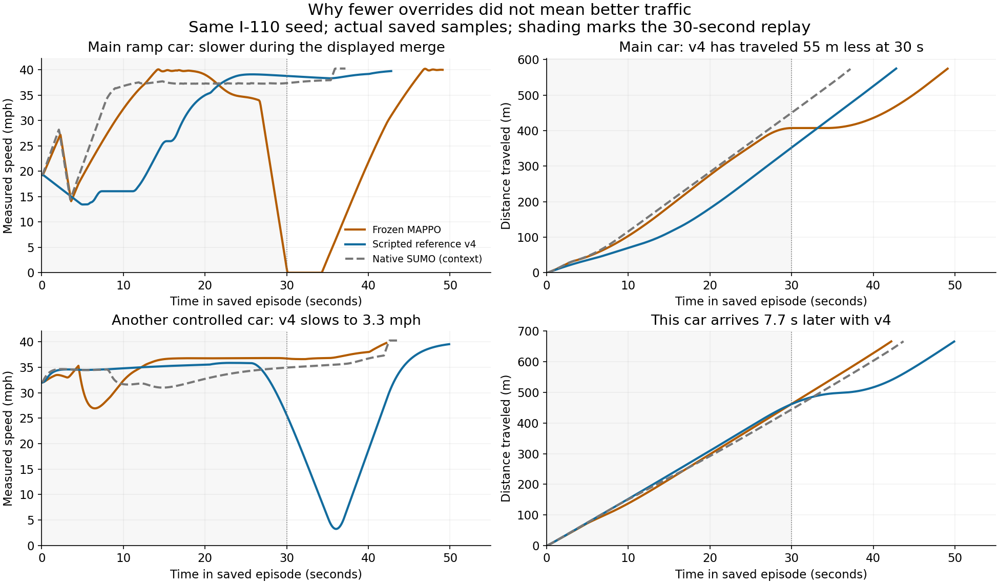

# Highway training rethink: flow and route decisions before reward tuning

November 6, 2026. **Proposed plan, not implementation or training approval.**
This replaces the next-action recommendation in the unlaunched
[smooth-control plan](highway-smooth-training-plan-v01.md); its code, disabled
configuration, failed readiness and all historical evidence remain unchanged.

## What the replay actually shows

The scripted reference improves one car's final arrival while creating a severe
slowdown for another. An earlier merge timestamp is not necessarily faster
travel: the reference merges earlier along the road and initially travels less
distance. The previous emphasis on the focal merge, intervention rate and jerk
was insufficient to establish improved traffic behavior.

Matched I-110 seed 6800019, 80-second accounting, eight controlled cars among
16 initially present, sustained inflow. The ceiling is **18 m/s (40.3 mph)**,
with a **13.41 m/s (30 mph)** ramp; this is not a demonstrated 60 mph merge.
The gray native baseline has automatic lane choices and is context, not an
actor-only ablation. The shaded interval is the prior 30-second video.

| Saved measurement | Frozen MAPPO v05 | Scripted reference v4 |
| --- | ---: | ---: |
| Main car distance traveled at 30 s | 407.304 m | 352.482 m |
| Main car sampled time below 9 m/s during first 30 s | 4.6 s | 13.0 s |
| Main car final arrival | 49.2 s | 42.9 s |
| Another controlled car (`agent_4`), minimum speed | 12.042 m/s | 1.456 m/s |
| That car's arrival | 42.3 s | 50.0 s |
| Controlled-car mean boundary time | 39.8875 s | 39.8875 s |
| All-trip mean boundary time | 34.2138 s | 34.2374 s |

The learned car later stops, so it is not a good alternative either. Lower
overrides and smoother braking alone did not solve the maneuver. Native ramp
inflows also show matching low-speed minima across the native, old teacher,
frozen actor and v4 recordings, separating the entry behavior from actor weights.
See the [native/control audit](evidence/highway-training-rethink-v01/native-audit.md),
[learning audit](evidence/highway-training-rethink-v01/learning-audit.md) and
[checkpoint audit](evidence/highway-training-rethink-v01/checkpoint-audit.md).

## Why the cars slow

1. **The ramp still has minor-junction approach behavior.** The earlier map fix
   removed false conflicts with non-crossing lanes, but retained a real yield
   into an auxiliary corridor. The native model prepares to brake until its
   visibility threshold, currently 4.5 m, even when no priority vehicle is nearby.
   SUMO documents exactly this behavior. It must be checked against the intended
   highway topology and sight distance before asking a policy to learn around it.
   This is different from disabling right-of-way or collision protection.
   [SUMO vehicle-speed rules](https://sumo.dlr.de/docs/Simulation/VehicleSpeed.html#intersections),
   [intersection approach model](https://sumo.dlr.de/docs/Simulation/Intersections.html#speed_when_approaching_the_intersection).

2. **The scripted teacher makes a bad route decision.** Its local passing rule
   permits a right pass into an ending auxiliary lane. In this replay, `agent_4`
   leaves a through lane for `sb2_0`/`sb3_0`, then has to remerge and slows almost
   to walking speed. The current mask checks room for a three-second maneuver;
   it does not establish that entering the lane is useful over the remaining
   route. The stopping-profile feed-forward term also applies while its target
   is above the buffered legal speed. At 26 s it contributes -1.642 m/s²,
   outweighing +1.393 m/s² of speed tracking and producing an unnecessary early
   braking request. See `traffic/highway_stage1_teacher.py:137` and
   `traffic/highway_smooth_reference.py:159`.

3. **Lane changes alter which vehicles constrain acceleration.** Offline fits
   to the saved states reproduce all four retained comfort-failure accelerations
   using the existing ACC equation to less than 2e-14 m/s². These are analytical
   matches, not newly emitted native cause labels. In the passing case, reducing
   two occupied corridors to the nearest leader keeps a fast car 32.478 m ahead
   while missing the more restrictive slow car 84.698 m ahead in the destination
   corridor: estimated acceleration -0.589 versus native -2.855 m/s². Other
   peaks follow observed cut-ins or the ego's own lane entry. Anticipation must
   consider each relevant corridor before initiating lateral motion.
   [Exact saved-state fits](evidence/highway-training-rethink-v01/native-acc-peak-fits.json).

4. **The objective is not a direct traffic-delay objective.** Historical progress
   is distance/2.68224 per 0.1 s tick. A 0.2 intervention charge offsets the
   immediate progress reward from 5.36 m/s of extra speed. The proposed stronger
   alignment charges a 1 m/s² mismatch as much as 5.96 m/s of extra speed.
   There is no direct all-trip delay or route-usefulness reward. These scales can
   favor cautious local actions; they do not prove a particular trajectory's
   cause. More equality supervision would also reinforce the bad teacher choice.
   The saved smooth diagnostic's acceleration-imitation gradient strongly
   opposes PPO on one inspected batch (cosine -0.955), despite remaining small
   relative to PPO. A fivefold coefficient increase is not evidence of a fix.

5. **The training coverage was much narrower than the evaluation.** The completed
   v05 PPO run had 20 cruise, 18 following, six passing and four merge episodes,
   all at difficulty 0, with no I-110 merge training episode. Evaluation included
   all three difficulty levels. It improved stable merges 2/9 to 8/9 and pooled
   speed utilization 0.916 to 0.931, but intervention dependence worsened 13.37%
   to 19.83%. The policy did not simply learn to drive slower everywhere; it
   learned incomplete behavior under an inadequate mixture.

## What was inspected and what the weights establish

Three agents reviewed the native-control/network chain, learner/reward math,
and checkpoint ancestry. The repository inventory covers 1,039 tracked files in
source, configs, policies, tests and documentation; cataloguing is not a claim
that every historical artifact or vehicle mesh was read. Detailed audit notes
identify the files actually reviewed. The active 40-file preparation source
manifest and saved native evidence were checked. No simulator, optimizer or new
training run was started. Weight checks used trusted local CPU checkpoints and
frozen synthetic inputs only.

Seven exported actors match their trusted resume checkpoints and contain finite
weights. Twelve empty-cruise probes per actor show no blanket saturation. Weight
norms and these toy probes do not establish real driving competence. Accepted
v04r2 has an 81-field straight-road contract; later Stage 1/population actors
have 93 fields; v05 has 99. Population v03/v04 preparation folders are not newly
trained policies. They cannot be treated as interchangeable controllers.

Retain the current 99-field v05 actor
`fd639c39f0c514256a458b2b85d35baba242125f44dcc3d9542d767eb2dd46ec`
as the merge-progress baseline, and the exactly migrated earlier initializer as
the retention comparator. Select a warm start only after a matched, predeclared
evaluation on the corrected contract. Do not select an old actor from an easier
network's headline score or describe the selected initializer as accepted.

## New plan and gates

### 1. Establish an achievable highway maneuver before learning

First implement a small train-only counterfactual bank: empty ramp; one target
leader; one rear vehicle; a closing adjacent vehicle; a slower farther leader
during lane overlap; an already-highway car tempted into the ending lane; and
dense genuinely blocked traffic. Use three fixed training seeds, exact demand,
same speed/safety modes, all-car traces and full route accounting. Compare
native behavior, the frozen actor and separately labeled candidate references.

Audit physical lane continuity, actual conflicts, connector speed/curvature,
usable sight distance and acceleration-lane length. Test topology/visibility
changes only where supported by the intended road; keep real conflicting paths,
safe gaps and emergency stopping. Empty-road behavior should not contain an
artificial yield-speed dip when the intended road is an unobstructed continuation.
An actual yield or blocked gap must still permit necessary braking.

Track the limiting front vehicle separately in every occupied/candidate corridor;
do not replace them with a single nearest car. Predict the consequences of the
whole three-second lateral maneuver before accepting its longitudinal target.
Record requested, filtered and realized acceleration, current/destination leader
IDs, link state, limiting constraint, lane intent and merge phase. Preserve the
historical 5% override count and add cause breakdowns rather than redefining it.

**Gate:** specified empty-road, cut-in, farther-leader and ending-lane cases have
explainable motion; the candidate target preserves required safety and route
progress for every controlled car. Keep every failed counterfactual. Proposed
preparation runtime cap: 1,800 s for the 63 planned full episodes, zero learning;
if insufficient, report incomplete
coverage rather than shortening episodes or extending the budget silently.

### 2. Build useful targets for speed, passing and gap selection

Separate three questions: is an action safe now; does the lane serve the route;
and will the chosen gap remain feasible through the maneuver? A safety ceiling
is not automatically the desired acceleration.

- A through car should not enter an ending auxiliary lane merely to pass unless
  the route actually needs it and the future exit is feasible. Score sustained
  forward progress and remerge cost, not just an instantaneous speed advantage.
- Choose ahead/behind target gaps over a proposed 5–6 s lookahead and maintain a
  coherent intent. Change the choice when evidence invalidates it, not every tick.
  Use current tracks/map and delivered messages with stated prediction assumptions;
  never feed future simulator trajectories to the actor.
- Activate stopping-profile feed-forward only when that profile is the active
  target. Correct the unconditional braking contribution. Keep a separate
  immediate safety fallback when no feasible gap remains.
- Before adding new actor fields, check which quantities can be derived from the
  current 99 fields. Missing adjacent-lane continuation, target-gap commitment or
  history must be explicit versioned observations, with migration/export tests;
  a privileged teacher must not silently require information the student lacks.

**Gate:** the reference passes the six existing fixtures plus the new all-car
route-choice fixtures, with useful speed, no gratuitous detours/stops, unchanged
safety and uncensored comfort metrics. Do not generate imitation labels from
the currently rejected v4 behavior. Qualify labels on states visited by the
student, not only ideal teacher trajectories; keep those supervised samples
separate from PPO's fresh on-policy batches. This follows the motivation of
[DAgger](https://proceedings.mlr.press/v15/ross11a.html).

### 3. Repair objective alignment with one factor per comparison

The next pilot should use the legacy reward/loss formulas and coefficients as
its control, under the same corrected environment, qualified reference,
initializer and case schedule in both arms. Its reference-dependent terms will
therefore differ from historical v05; it is not an exact historical replay.
Do not combine new reference logic, fourfold reward alignment,
fivefold imitation and two new comfort losses in one experiment.

| Component | Current v05 | Unlaunched smooth bundle | Proposed next action |
| --- | ---: | ---: | --- |
| Progress | 1.0, global-cap distance scale | unchanged | Keep in first control; test local-limit normalization and explicit avoidable delay separately |
| Acceleration alignment | 0.25 | 1.0 | Retain 0.25 while qualifying the new target |
| Acceleration imitation multiplier | 1.0 | 5.0 | Compare 1 vs 5 alone, only with qualified identical targets; overall coefficient 0.04 |
| Measured jerk | 0.01 × absolute jerk | 0.03 × Huber jerk | Keep legacy control first; test Huber alone after route/speed competence |
| Previous command/reference residual slew | absent | 0.01 × Huber | Omit from next pilot: previous reference is absent from the feedforward observation |
| Unsafe request / intervention / collision | 0.5 / 0.2 / 20 | unchanged | Retain safety terms and all safety gates |
| Merge / stable merge / pass / arrival | 5 / 2 / 2 / 2 | unchanged | Add separately tested quality conditions: route-useful pass, sustained appropriate speed and fleet progress |

Before selecting any new coefficients, calculate component returns and gradient
directions on the same saved training scenarios. Check that safe steady progress
beats creeping, a route-useful pass beats an auxiliary-lane detour, and required
braking beats unsafe persistence. Propose a local-limit speed objective and a
small fleet-delay component normalized by the fixed declared/requested trip
cohort, including waiting and unfinished trips. An active-car-only average is
a different diagnostic and must not be called all-trip delay. Fix the cohort,
time integration and population scaling before choosing numbers.
Do not penalize every necessary speed adjustment just because it is a slowdown.

The existing learner's likelihood, termination/bootstrap and inactive masks
show no verified implementation bug in this audit. Keep actor LR 1e-4, critic
LR 3e-4, four epochs, clip 0.2, gamma 0.99 and GAE 0.95 for the first identifiable
comparison. Value normalization and separate actor/critic clipping merit later
ablations, not simultaneous changes. The completed run's actor usually dominated
the gradient; the fresh-critic diagnostic alone does not prove otherwise.
The [MAPPO study](https://arxiv.org/html/2103.01955v4#S5) supports checking value
scaling and data reuse, but its game results do not prescribe AV reward weights.

### 4. Train foundations, then merge decisions, then coordination

Proposed stages require separate final configurations and permission; none are
queued by this document.

| Stage | Training allocation and ceiling | Evidence required before advancing |
| --- | --- | --- |
| Longitudinal pilot | Two matched 30k-active-decision arms, including up to 2,048 critic-warmup decisions each; 5,400 s total including the 1,800 s preparation allowance and evaluation, with 900 s final reserve | Cruise/following at 12/18/22.352/26.8224 m/s; low overrides and retained progress; compare only imitation strength |
| Route and merge pilot | Separately approved two × 100k decisions; 7,200 s including failures/evaluation, 1,800 s final reserve | Mixed cruise/follow/pass/merge; generic and I-110 entry; no ending-lane detour regression; full all-car evaluation |
| Cooperation and robustness | New budget/config after the first two gates; at least three training RNG seeds for a robustness claim | No/local/impaired communications; varied AV participation, density, lane count, ramp length and traffic behavior |

For the route/merge stage use a declared 20/30/20/30% **case** mixture with
difficulty 0/1/2 represented in every bounded block, including real I-110
training cases. Log active-decision and event exposure separately. Curriculum
promotion controls emphasis, not whether harder scenarios ever appear. Retain
foundation cases throughout. Do not call one large number of agent transitions
equivalent to many diverse traffic episodes.

Vary initial AV count independently of total traffic, include an isolated AV,
mixed fractions and all-AV traffic, and include zero-AV as an evaluation baseline.
Teach the mainline car to create a useful gap as well as teaching the ramp car
to use it. Test communication loss and stale/missing messages; no cooperation
benefit may depend on undeclared global state. Live mid-episode slider handoff
is a separate runtime validation gate, not established by episode-start sampling.

Evaluate and report all 24 development rows at the longitudinal stage, but
advance on foundation competence plus retention of non-foundation behavior;
do not claim global merging/passing acceptance from foundation-only learning.
The later route/merge stage must satisfy the full task gates.

The previous pilot's spent preparation remains recorded. These are new proposed
ceilings, not an automatic extension or replacement of its ledger. Caps are not
promises of completed sample counts; preserve unfinished runs and reserved costs.
The current disabled runner enforces 3,600 s; the proposed 5,400 s study requires
a separately versioned and reviewed contract, not reinterpretation of that cap.

### 5. Evaluate the traffic outcome, then replay it

Retain all 24 existing development rows with explicit network-version treatment,
the old failures and all safety/5% intervention gates. Add a separately frozen
regression bank for low-speed non-focal cars, ending-lane excursions, safe
highway-speed entry and overlapping-leader changes. Leave held-out tests untouched
until the implementation/configuration and checkpoint-selection rule are fixed.

Measure each car and the fleet: distance at fixed times, full-route arrival and
censored boundary time, speed matched to lawful traffic conditions, queued/stopped
time, minimum speed, pass usefulness, stable merges, safety interventions and
mean/p95/peak jerk. Count sampled exposure and consecutive stop duration separately.
Report approach, entry, lane change and post-merge phases. Neither a focal car's
early merge nor a fleet average may hide another car's near-stop.

Proposed additional nominal gates, to freeze before new runs: no unnecessary
ending-lane excursion; no consecutive observed stopped span of at least 2 s
below 0.1 m/s; no more than 2 s cumulative measured exposure below half of
`min(current local legal speed, episode ceiling)` in cases designated before
evaluation as having a feasible unobstructed path. Apply these to every
controlled car in its complete recorded route, retaining missing/unfinished
coverage as incomplete; also report each merge/passing phase separately.
Require no worse completed trips and no greater than 2% paired mean boundary-time
regression against the qualified reference. Retain the existing 5 m/s³ nominal
peak criterion and disclose stress/emergency peaks separately without deleting
them from overall reporting. If the native baseline cannot meet a proposed
nominal gate, resolve the case/model contract first rather than relabeling the
policy as passing. Dense blocked cases explicitly require safe slowdown.

After these gates, replay an entire maneuver through recovery for the main car
and the worst affected other car, with the SimReady vehicle and lightweight
backgrounds. Keep identical camera windows and speed/time overlays. Kinematic
replay is followed by separate physical and sensor validation; it does not replace
either. Stage 2 imperfect observations and Stage 3 camera/LiDAR integration in the
living roadmap remain downstream.

## Low-usage execution and retained evidence

After a future launch is approved, one bounded job performs checkpointing,
predeclared evaluations and metric retention automatically. The assistant waits
without log polling or analysis during training and returns only on completion,
failure or a required decision. A failure preserves the latest atomic checkpoint,
source/config hashes and charged budget; repairs may not silently change an
experiment's target or launch another configuration. No GPU rendering during
SUMO training. Save raw metrics locally and publish compact evidence and versions.

This audit added only documentation and offline plots/measurements from existing
files. No policy, reward, native safety setting, runtime source or disabled launch
configuration was changed. The immediate next action is approval to implement
Steps 1–2 and their zero-learning diagnostic bank, not to start training.
