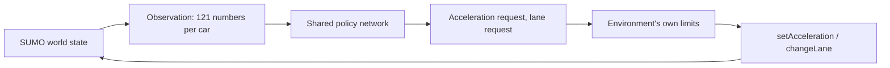

# How the sim cars work

A plain-language walk-through of the highway-merge simulation as of v14
(November 19, 2026): what drives each car, what it sees, how it decides, what limits
it, and how it is rewarded and graded. Every number comes from the code or the
round-19 configuration (`configs/training/highway-flow-rl-v12-round19.json`). Code
references are given as files; the [v14 plan](highway-merge-training-plan-v14.md) and
the earlier plans have the measurements.

## The pieces

| Piece | What it is | Where |
|---|---|---|
| Road | SUMO networks. The primary ones are two LA I-10/I-110 merge corridors cut from the user's 3D model's lane graph. Older I-110 and synthetic ramp networks are also in the validation set | `highway_usd/la_10_110/`, `scenarios/` |
| Background traffic | SUMO's own drivers (IDM car-following), each drawn from three profiles: cautious, balanced, attentive | `traffic/highway_v05_demand.py` |
| Controlled ("sim") cars | Up to 24 cars driven by the learned policy. All of them share one network | `environments/highway_flow_rl_v14_env.py` and its parents |
| Policy | A MAPPO actor-critic: one actor for every car, one centralized critic for training | `policies/highway_flow_v12.py`, `policies/mappo.py` |
| Trainer | PPO with two extra losses that keep requests inside the comfort band | `experiments/run_highway_flow_rl_v12.py` |
| 3D view | Isaac Sim replays of recorded SUMO motion on the LA model. Kinematic only: no physics control | `scripts/render_i110_merge_replay.py` |

SUMO is the world: it moves every car, detects collisions and drives the background
traffic. The policy only drives the controlled cars.

## Who controls what (v14)

Every 0.1 s, for each controlled car:
1. **The policy** turns the car's 121 observation numbers into two outputs:
   - an acceleration request, mapped from [−1, 1] to [−4.5, +2.0] m/s²;
   - a lane choice: right, stay or left.
2. **The environment's own limits** may lower or reshape that request. These are part
   of the car's controller and use only the car's own state, map and neighbors:
   - **Speed ceiling:** never above the lane's legal speed (and never above
     26.82 m/s, 60 mph).
   - **Following ceiling:** keeps a safe gap to the car ahead in its lane.
   - **Lane-end ceiling:** stops before a lane that ends, at up to 4.5 m/s².
   - **Comfort rate limit:** the request can move at most 0.4 m/s² per step from the
     measured acceleration, which is 4 m/s³ of jerk. Hard braking (−4.5) and
     ceilings below the band are exempt.
   - **Lane-change mask.** A lane request is refused when:
     - a lane change is already under way;
     - the last one was under 5 s ago;
     - the gap ahead or behind in the target lane is too small, now or 3.1 s later;
     - the target lane is too short for the 3 s maneuver;
     - (on acceleration-lane merges) the car has not matched the target speed for 4 s.
3. **SUMO executes the result exactly.**
   - Acceleration goes through `setAcceleration`.
   - Lane changes go through `changeLane`, as a 3 s continuous lateral move.

**What changed in v14:** SUMO's own checks are off for controlled cars (speed mode 96,
lane change mode 0).
- Until v13, the cars used speed mode 31, under which SUMO ran its own safe-speed,
  acceleration and right-of-way checks on top of the policy.
- At the LA yield merges, SUMO braked the car to the line and held it there,
  whatever the policy asked for. That happened on 575 of 26,507 decisions in round
  19's validation.
- Now nothing else drives a controlled car during an episode. The runner checks the
  modes at every decision.

Two moments are outside the policy:
- **Insertion.** SUMO inserts each car at the start. The policy commands it from
  the first decision; there is no SUMO warm-up.
- **Drain.** After the scored horizon, cars still on the road are handed back to
  SUMO (speed mode 31) to leave the network. The drain is not scored as anything the
  policy did.

## What the car sees (121 numbers)

Every number is scaled into [−1, 1].
- **Itself (6):** speed, acceleration, lane position, route progress, legal speed,
  last request.
- **Neighbors (18):** the nearest car ahead and behind in its own lane and in each
  side lane. For each: gap (over 120 m), relative speed, present.
- **Road and lanes (9):**
  - whether a left and a right lane exist;
  - lane count;
  - distance to a merge;
  - whether it must merge;
  - lane-change cooldown;
  - which of right/stay/left is currently allowed (the mask).
- **Merge context (12):**
  - target lane and its direction;
  - distance to the merge start;
  - the car ahead of and behind the merge slot (gap, relative speed, present);
  - the acceleration ceiling;
  - the target lane's speed limit.

  At a yield junction, mainline cars are placed by their distance to the merge point
  (the "shared stop-line projection").
- **Its own lateral motion (6):** lateral position and speed, committed direction,
  maneuver in progress, progress through it, time since the last one.
- **Corridor fields (18):**
  - for own/right/left lanes: whether the route is reachable that way, distance to
    the route's end, legal speed, and the expected response to its leader;
  - entry visibility;
  - side cars' lateral drift.
- **Merge target (4, added in v12):**
  - whether a target applies;
  - the target speed;
  - how far the car is from it;
  - whether it is inside the ±1.8 m/s band.
- **Messages (48):** up to 6 nearby controlled cars (within 150 m, under 0.5 s old).
  For each: relative position, whether it must merge, relative speed, acceleration,
  last request, message age, lane intent, present.

Some merge inputs change by at most 1/10 per step ("faded"), so a sudden map change
does not jolt the policy. The limits in step 2 use the unfaded values.

## How the car "thinks"

The actor is a small neural network shared by all controlled cars:
- **Messages:** each of the 6 message slots goes through a 7→16→16 layer. The slots
  are averaged, and the count of present cars is added.
- **Main network:** the car's own 73 numbers plus those 17 go through two 128-unit
  layers to 4 outputs.
- **Output 1:** the mean of the acceleration request. In training a random sample
  is drawn around it; in validation the mean is used.
- **Outputs 2–4:** scores for right/stay/left. Disallowed choices are blocked, and
  the highest score wins in validation.

There is no explicit planner inside the policy: it is a reflex from observation to
action, learned by trial and error. The planning happens in the **merge target**,
which the car gets as an input and is rewarded for following.
1. **Gap plan** (v04, `traffic/highway_flow_rl_v04_rewards.py`):
   - It considers three slots: between the cars ahead and behind, behind the rear
     car, or ahead of the front car.
   - For each slot it tries 17 speeds over 3, 6 and 10 s horizons, at −2 to +1.5 m/s².
   - It keeps the speed whose gaps stay safe and that is fastest and smoothest.
   - "Safe" means v03's required gap: max(2.5 + 1.5·v, 2.5 + 0.3·v + v²/9 − u²/18) m,
     for a follower at v behind a leader at u.
2. **Safety bounds** (v03): the target is then lowered for:
   - the car ahead;
   - lower speed limits ahead;
   - lane ends;
   - a yield line too far away to see.
3. **Yield lines** (v14, `traffic/highway_flow_rl_v14_rewards.py`):
   - At a yield junction the car enters the mainline the moment it crosses the line.
     So each candidate's gaps are also checked from that crossing through 3.1 s
     after it.
   - The target changes by at most +1.5 / −2.0 m/s². A rise starts from the higher
     of the last target and the car's own speed, so a car leaving the line gets a
     target it can reach.

## How it is trained

- **Algorithm:** PPO.
  - Actor learning rate 5e-5, critic 3e-4.
  - Clip 0.2, 10 epochs, minibatch 256, KL limit 0.05.
  - γ = 0.99, GAE λ = 0.95.
  - The first 30,000 decisions of a round train the critic only.
- **Critic:** sees all 24 cars' observations together (24 × 122 = 2,928 numbers).
  It only helps training; driving uses the actor alone.
- **Extra losses:**
  - a "shield" loss (weight 50) for requests outside the comfort band;
  - an "anchor" loss (weight 10) that keeps behavior away from merges close to the
    starting policy.
- **Budget:** a shared ledger caps decisions and wall time across all rounds. A
  round stops early on any collision, on more than 5% interventions at a validation,
  or on a fall in merge speed match.

## How it is rewarded (per car, every 0.1 s)

| Term | Value |
|---|---|
| Progress | +1 per 2.68 m travelled |
| Merge completed / pass completed / arrived | +5 / +2 / +2 |
| Collision | −20 |
| Intervention (a limit changed the request) | −0.2 |
| Lane change | −0.1 each; −0.5 for back-and-forth |
| Unsafe request (above the ceiling) | −0.5 × (request − ceiling) / 4.5 |
| Speed error against the target | up to −0.3 |
| Jerk | Huber, −0.09 scale; excess over 5 m/s³ up to −1.5 |
| Avoidable braking | up to −0.25 |
| Gap preparation (merging cars) | 2 × change in the plan's readiness score |
| Merge tracking | up to −1.0 (−0.25 per 2 m/s off the target, capped at 4) |
| Target band (v12) | 0 inside ±1.8 m/s of the target, down to −4 outside |
| Merge quality | +5 once if the merge passes the quality check, plus up to +5 once graded by speed match and calmness |
| Post-merge override | −1 each, in the 8 s after merging |

## How it is graded (validation gates)

A validation case passes only if all of these hold:
- **Safety:** no collisions, teleports, overspeeding or emergency braking, by any
  car, including SUMO's own cars.
- **Per controlled car:**
  - route completed;
  - peak jerk ≤ 5 m/s³;
  - interventions ≤ 5%;
  - headway ≥ 1.5 s;
  - time to collision ≥ 3 s;
  - requested jerk ≤ 5 m/s³.
- **Merges:** at least 90% of merging cars merge stably and with quality:
  - at most 1 s stopped;
  - jerk ≤ 5;
  - no neighbor braking harder than 3 m/s²;
  - within 2 m/s of the target for 90% of the 8 s after merging.
- **Cruise and passing:** near the legal speed, no avoidable braking, and passing
  cases must pass.

The 14 validation cases are:
- the I-110 merge and following cases;
- a v05 cruise case and a v05 passing case;
- three synthetic ramp-start merges: 2 lanes with a 120 m ramp, and 2 and 4 lanes
  with a 180 m ramp;
- a 60 mph cruise case;
- six LA cases: northbound and southbound merges, each with 8 and with 1 of 16 cars
  controlled, plus dense following and passing.

## Where it stands

- **Best policy:** the round-16 policy (migrated into v12).
- **With SUMO's checks off and no retraining:** 9 of 14 gates. All four LA merges
  fail; one crashes.
- **v14's target** now tells the car to let mainline traffic pass at yield lines.
- **Not yet trained.** Nothing has been trained on v14. Training on it is the next
  step, and has to teach the car to follow that target.
