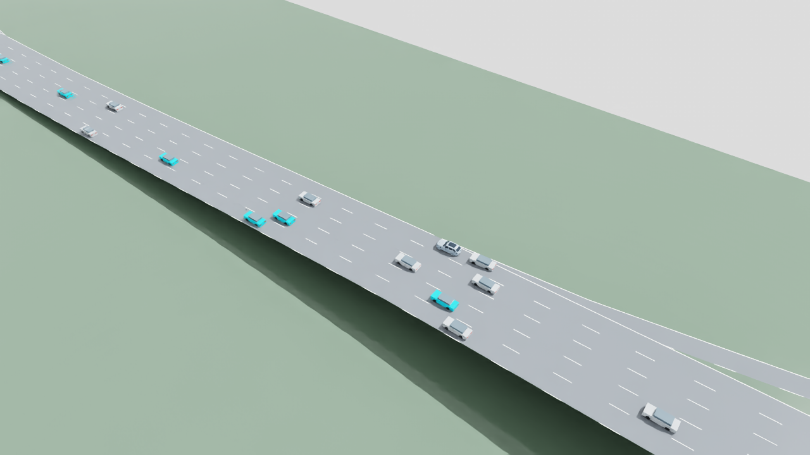
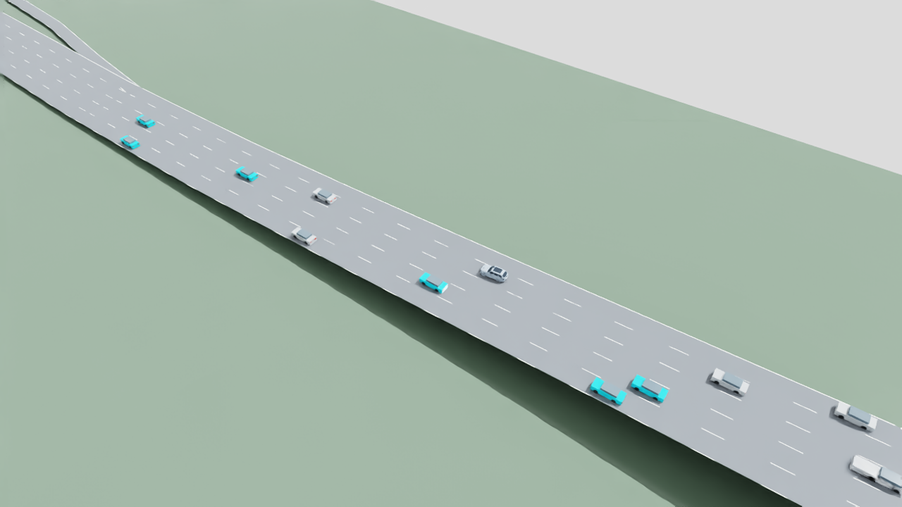
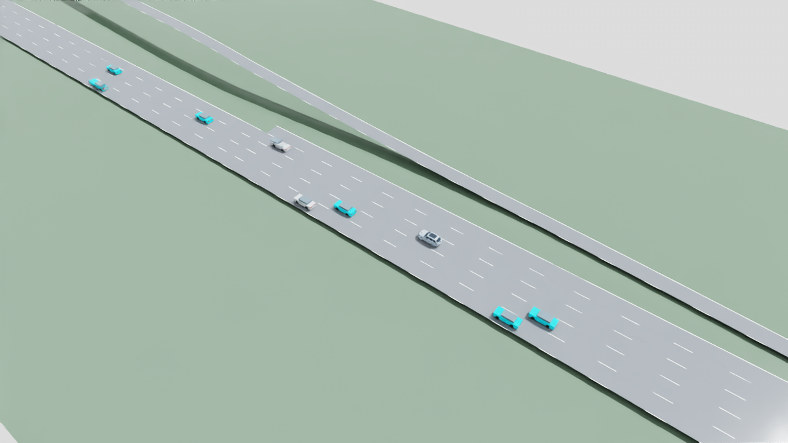

# I-110 merge blocking v01: compiled lane conflicts corrected

November 6, 2026. Frozen-policy diagnosis; no training.

The frozen v05 actor clears the previously blocked I-110 ramp after a scoped
network-compilation correction. In the same seed and byte-identical demand, the
focal car enters the auxiliary lane, completes a policy-requested lateral merge,
passes the unchanged eight-second stability window, and finishes its route.
All 55 vehicles have zero stopped samples in the corrected 80-second recording.
**The candidate remains unaccepted:** its case intervention rate is 8.5196%,
above the unchanged 5% gate. No training or optimizer update occurred.

Evidence is generated from saved native records in
[paired-summary.json](evidence/i110-merge-blocking-v01/paired-summary.json) and
[all-vehicle-audit.json](evidence/i110-merge-blocking-v01/all-vehicle-audit.json).
The [source index](evidence/i110-merge-blocking-v01/source-index.json) preserves
raw local paths and SHA256 hashes. Large trajectories and weights remain in
`outputs/`; this note does not replace or rewrite the
[original v05 results](highway-environment-v05-results.md).

## Matched comparison

Both ordinary recordings use validation row 19, seed `6900019`, eight controlled
vehicles among 16 initial vehicles, sustained native inflow, difficulty 2,
an 18 m/s episode speed ceiling, local communication and zero packet loss.
The complete horizon is 0.1–80.1 simulation seconds: 801 native frames at 0.1 s.

| Measure | Preserved original failure | Corrected network |
| --- | ---: | ---: |
| Controlled steps + native tail | 800 + 0 | 410 + 390 |
| Stable merge targets | 0/1; one pending | 1/1 succeeded |
| Case interventions / decisions | 1,007/3,298 (30.5337%) | 244/2,864 (8.5196%) |
| Focal sampled full-route interventions | 777/800 (97.125%) | 11/370 (2.9730%) |
| Focal observed route progress | 34.456 m | 570.365 m |
| Controlled trips completed | 7/8 | 8/8 |
| All trips completed at horizon | 30/55 | 32/55 |
| Vehicles with a continuous stop of at least 2 s | 4 | 0 |
| Collisions / teleports | 0 / 0 | 0 / 0 |
| Controlled overspeed / measured emergency steps | 0 / 0 | 0 / 0 |
| Native emergency warnings / all warning lines | 0 / 0 | 0 / 0 |

The corrected controlled phase ends at 41.1 s; 390 further native steps retain
all background traffic through 80.1 s. Both reports have
`primary_horizon_complete=true`, `accounting_comparison_valid=true`, and
`partial_control_horizon=false`. The corrected report's `steps=410` describes
the controlled phase, not a shortened evaluation. Twenty-three native vehicles
remain active at the horizon; **32/55 completed does not mean all traffic
finished**. Both raw `sumo-errors.log` files are empty, separately verifying
that the zero emergency-warning count did not hide other warning categories.

Journal decision counts include terminal arrival decisions; the per-car
full-route metric only samples a car while its native state exists. Thus the
corrected focal journal has 371 decisions, while its sampled full-route metric
has 370. The case denominator comes directly from all journal decisions.

## What changed and why

The original compiled `n2` junction made the ramp yield to all five incoming
mainline links. Its ramp request had `response="011111"` and `foes="011111"`;
all four through links also declared a reciprocal ramp conflict. The ramp
actually joins the auxiliary lane. The builder now invokes netconvert with
`--check-lane-foes.all true`, retaining the conflict and yield relationship with
that shared auxiliary successor while removing the unrelated through-lane
conflicts. The corrected ramp bit strings are `000001`. This uses the documented
[lane-specific conflict option](https://sumo.dlr.de/docs/netconvert.html).
The [SUMO 1.27.1 link logic](https://raw.githubusercontent.com/eclipse-sumo/sumo/v1_27_1/src/microsim/MSLink.cpp)
checks predicted overlapping passage windows against declared foe links; the
saved native link plans identify the unrelated through-lane vehicles involved.

The [static comparison](evidence/i110-merge-blocking-v01/network-comparison.json)
verifies byte-identical node, edge and connection inputs, identical non-junction
XML elements, and changes only to the `n2` conflict matrix. The
[network manifest](evidence/i110-merge-blocking-v01/network-manifest.json)
records the native compiler version, command, connector checks and preserved
auxiliary-lane yield. Geometry, speed limits, routes and native safety controls
were not relaxed. The network remains a provisional engineering reconstruction,
without measured demand calibration or physical validation.

The paired ordinary-recording manifests differ in only two snapshotted sources:
the network builder and the recorder's additive telemetry. Environment, actor
and metric source hashes are unchanged. The policy still supplies lane intent;
no scripted lane change, forced speed, car removal or safety-mode bypass was
introduced. The corrected journal records the focal actor's accepted left-lane
requests at post-step times 5.8 and 15.2 s. The first maneuver was issued at
5.7 s and its native lateral motion settled at 10.1 s, an observed **4.4 s** duration despite
the unchanged configured native lane-change duration of 3 s.

## Junction entry, lateral merge and stability are separate

| Corrected event | Simulation time |
| --- | ---: |
| Ramp front bumper reaches internal junction link `:n2_5_0` | 4.2 s |
| Native route join reaches external auxiliary lane `sb2_0` | 4.4 s |
| First through-lane identity observed during lateral motion | 8.6 s |
| Policy-requested auxiliary-to-through maneuver settles | 10.1 s |
| Complete eight-second stable window succeeds | 18.1 s |
| Focal route arrival | 37.2 s |

The historical `entry_events` and stable-merge scores retain their definitions.
New `junction_entry_events` observe the native ramp-to-successor transition,
including background traffic during the native tail; entry into the auxiliary
lane is not relabeled as successful through-lane merging. The auxiliary route
still requires a later lateral merge before its downstream lane ends.
`merge_events` retain their timing and compatibility fields, but claim
`completed_lateral_merge` only when an actual current maneuver completion is
recorded. Other completion mechanisms receive explicit provenance.

The focal stability window contains 81 boundary-inclusive samples over exactly
8 s, with zero interventions, collisions, emergency steps, overspeed steps or
unnecessary reversals. Its minimum observed leader headway is 2.5190 s, minimum
TTC 351.3559 s, and progress ratio 0.89576. Gates remain 1.5 s headway, 3 s TTC,
at most 5% interventions and at least 0.25 progress ratio. Contemporaneous
neighbor braking is logged without assigning causality to the focal actor.

## Full traffic and remaining failure

The audit examines every car in every saved frame. A stop is speed below
0.1 m/s in consecutive samples; its observed duration is the last timestamp
minus the first, without extrapolating missing motion. These are all original
stops lasting at least two seconds, all on `mlk_on_0`:

| Vehicle | Controller | Stopped interval | Observed duration |
| --- | --- | --- | ---: |
| `agent_0` | Frozen actor | 5.0–80.1 s | 75.1 s |
| `ramp_1` | Native | 10.7–80.1 s | 69.4 s |
| `inflow_8` | Native | 49.1–80.1 s | 31.0 s |
| `inflow_17` | Native | 63.8–80.1 s | 16.3 s |

The corrected recording has **zero samples below 0.1 m/s across all 55 distinct
vehicles**, with minimum recorded speed 2.3182 m/s. `ramp_1` joins the auxiliary
lane at 9.1 s and arrives at 45.3 s. `inflow_8` and `inflow_17` join at 47.0 and
62.8 s and continue downstream. Later arrivals `inflow_26` and `inflow_35`
remain on the ramp at 80.1 s, moving at 4.3452 and 13.1979 m/s. Their unfinished
trips are retained; no completion beyond the horizon is inferred. The compact
audit includes lane histories and stop checks for all 55 vehicles in each run.

All 244 remaining case interventions are native realization differences;
policy filtering changes zero commands. `agent_7` accounts for 198 of them,
and `agent_5` for 26. Their native cause remains unattributed. Clearing the
ramp does not resolve these mismatches. The original 24-case pilot still has
the documented pooled intervention regression from 13.3749% to 19.8287%, with
19/24 final cases failing. This single diagnostic is neither a replacement
24-case evaluation nor held-out policy acceptance.

## Failed probes and the diagnostic-query limitation

[Diagnostic history](evidence/i110-merge-blocking-v01/diagnostic-history.json)
preserves the unsuccessful alternatives. Acceleration-command lifetimes of
0.1, 1 and 5 s each left the focal car blocked with 752 stopped samples and no
ramp exit. Returning its longitudinal control to SUMO also failed, with 753
stopped samples. These trials do not justify changing native safety modes.

The saved [getter caveat](evidence/i110-merge-blocking-v01/diagnostic-getter-caveat.json)
documents a SUMO 1.27.1 ACC source audit: `getFollowSpeed` can update native
controller state despite being called as a diagnostic query. The preserved
probe snapshots may contain this call when a leader exists; they are telemetry
investigations, not the definitive replay. The blocked focal had no leader,
so that call was not made there. The current probe removes it and tests the
restriction. Independently, the ordinary recorder uses no such follow-speed or
junction probe calls and reproduces the corrected 244/2,864 result and stable
merge. Matching these aggregates does not prove every probe trajectory was
unaffected. Earlier probe evidence remains intact.

## Provenance and reproduction

| Input | SHA256 |
| --- | --- |
| Frozen actor | `fd639c39f0c514256a458b2b85d35baba242125f44dcc3d9542d767eb2dd46ec` |
| Both raw demand files, 18,535 bytes | `fbde2a92e5a8b5ea73aea7c8fc2cae02d4fbeec4be281c2ae88f0be5cf4897ce` |
| Original network | `a216efd0a451845c19147437284fe0014d503c8015aca1d29bb4b4b8e1ac8623` |
| Corrected `network-v02/network.net.xml` | `ae829282ad98cfaeeba806fba30e44536361ccabf4d0861708c5638fff512836` |
| Diagnostic config | `b37cf31041dbbdabf2d459d46b10f5ec4677ff3ef48faf54ffb322ed15153e55` |
| Corrected complete recording | `d2e4323afe3c3ce9765abff68e6115a55783b6ca8e21ead68ea6971eb4f1a81d` |

Runtime: Python 3.11.9, PyTorch 2.14.0+cpu, SUMO/TraCI 1.27.1. The original
recording references commit `02948d76f16f4d2c56d839ad72c1266777b373c6`; the
corrected recording references `c6c4f5db31183bbad641004e26b503dce0587dbe` plus
its saved scoped diff and exact source snapshots. Those snapshots, rather than
the commit alone, identify the executed code.

The [diagnostic config](../configs/diagnostics/i110-merge-blocking-v01.json)
references the exact existing network artifact at
`outputs/i110-merge-blocking/v01/network-v02/network.net.xml`. It records the
parent config/proof and changed fields, sets `training_authorized=false`, and
sets `readiness=null`. Builder changes correctly invalidate the old training
preflight; no new training-readiness claim is made. The recorder still rejects
malformed or stale readiness when supplied and verifies the actor, network and
source snapshots. Other validation rows are retained for schema compatibility
and were not run by this diagnostic.

After this valid recording, a recorder-only check was hardened to fail closed
on non-monotonic timestamps. The saved source hash remains authoritative for
this run; no motion code changed. The final
[focused checks](evidence/i110-merge-blocking-v01/i110-merge-blocking-v01-final-focused-tests.txt)
passed 18 tests. Broader CPU and USD-runtime logs are retained beside the evidence.

The exact 45 KB [compiled network](evidence/i110-merge-blocking-v01/network-v02.net.xml)
is included in Git so a fresh clone does not depend on local compiler timestamps
or paths reproducing the same file hash. On a clone lacking the output artifact,
create `outputs/i110-merge-blocking/v01/network-v02` and copy that file to
`network.net.xml` there; verify the SHA256 in the table above. Do not overwrite
existing evidence. Building a new version instead uses
`scripts/build_i110_sumo.py --output <fresh-directory>`; record its new byte hash
in a separately versioned inference config.

Run from the checkout root, using a fresh output directory:

```powershell
& .\.venv-traffic\Scripts\python.exe scripts/record_highway_environment_v05.py `
  --policy policies/versions/highway-environment-v05/policy.pt `
  --expected-policy-sha256 fd639c39f0c514256a458b2b85d35baba242125f44dcc3d9542d767eb2dd46ec `
  --config configs/diagnostics/i110-merge-blocking-v01.json `
  --case-index 19 `
  --output outputs/i110-merge-blocking/v01/replay-reproduce-01 `
  --max-wall-seconds 180
```

The completed ordinary recordings are
`outputs/highway-environment/v05/visuals/i110-failure` and
`outputs/i110-merge-blocking/v01/replay-corrected-01`. Rebuild only the compact
saved-data audit, without simulation, using:

```powershell
& .\.venv-traffic\Scripts\python.exe documentation/evidence/i110-merge-blocking-v01/build_evidence.py
```

## Verified SimReady replay

The replay uses the unchanged **Americano v14 SimReady main car** (`agent_0`)
and lightweight background proxies. It shows the same first 25 simulation
seconds as the preserved failure: **251 frames, 1280 × 720, 10 fps**, covering
0.1–25.1 s with 25.1 s of video playback. The
[render report](evidence/i110-merge-blocking-v01/render-report.json) verifies
all decoded frames, zero pose error, no composition errors, unchanged authored
layers and unchanged prepared-vehicle sources. Its seven camera definitions
and five LiDAR mounts remain in the referenced hierarchy; sensors are not
capturing and physics is disabled only in the replay layer. These are actual
renderer screenshots, not predicted or reconstructed historical visuals.

At **10.1 s**, the original car is stopped at the ramp end:



At the same **10.1 s**, the corrected car has completed its through-lane merge:



At **25.1 s**, the corrected traffic continues downstream:



The [initial frame](evidence/i110-merge-blocking-v01/render-before.png) and
[visual artifact hashes](evidence/i110-merge-blocking-v01/visual-artifacts.json)
are also retained. The 4 MB video remains local at
`outputs/i110-merge-blocking/v01/render-corrected-01/i110-merge.mp4`; screenshots
and compact evidence are in Git. The full native metrics cover 80 seconds
independently of this crop. This is SUMO-owned kinematic motion, not physical
closed-loop or camera/LiDAR policy validation. The scene is the provisional
road reconstruction; its markings are illustrative.

Exact render command, choosing a new output name for a rerun:

```powershell
& C:/isaacsim/python.bat scripts/render_i110_merge_replay.py `
  --recording outputs/i110-merge-blocking/v01/replay-corrected-01 `
  --output outputs/i110-merge-blocking/v01/render-reproduce-01 `
  --start-time 0.1 --end-time 25.1 --focal-agent agent_0 `
  --simready-main vehicles/sim_ready/americano-i7-ev/v14/assets/vehicle.usda `
  --highlight-agents agent_0 --camera-mode follow `
  --ffmpeg outputs/i110-merge-visual/v01/encoder/imageio_ffmpeg/binaries/ffmpeg-win-x86_64-v7.1.exe
```

The native render ran serially in Isaac Sim 6.0.1-rc.7; rendering did not run
training or change the controller. The prepared source asset is local-only and
is not redistributed by this change.

## Verification and next action

- The [targeted CPU suite](evidence/i110-merge-blocking-v01/i110-merge-blocking-v01-tests.txt)
  passed **205 tests**; six USD-dependent checks were skipped in the traffic
  environment. The separate [USD suite](evidence/i110-merge-blocking-v01/i110-merge-blocking-v01-usd-tests.txt)
  passed all **11 tests** in the USD environment.
- After the final probe-label and fail-closed timestamp corrections,
  [18 focused checks](evidence/i110-merge-blocking-v01/i110-merge-blocking-v01-final-focused-tests.txt)
  passed. Existing network outputs cannot be overwritten, and removal of the
  true auxiliary-lane yield or introduction of false conflicts fails validation.
- The ordinary native recording and rendered video passed their independent
  integrity checks. Historical runs, false-start probes, actor weights and
  unrelated local work remain preserved.

The blockage fix is verified for this fixed case. The candidate remains
unaccepted. Next, diagnose the dominant remaining acceleration-realization
mismatch on training fixtures and present a new resolved configuration before
any learning. No additional training was started. The Google engineering guide
and its Markdown mirror were updated from a full revision-guarded readback,
preserving all 42 tabs; native document pagination was not inspected.
