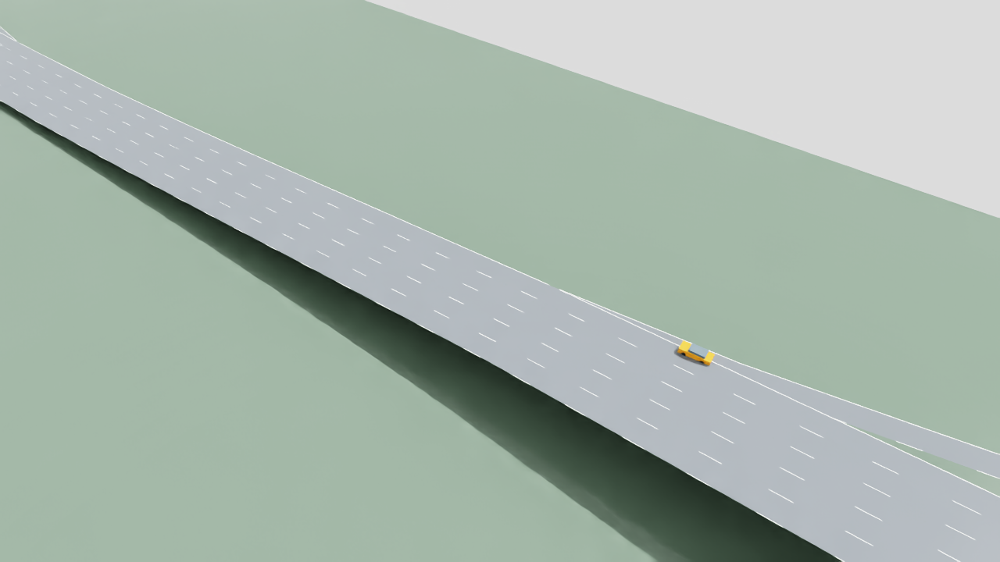
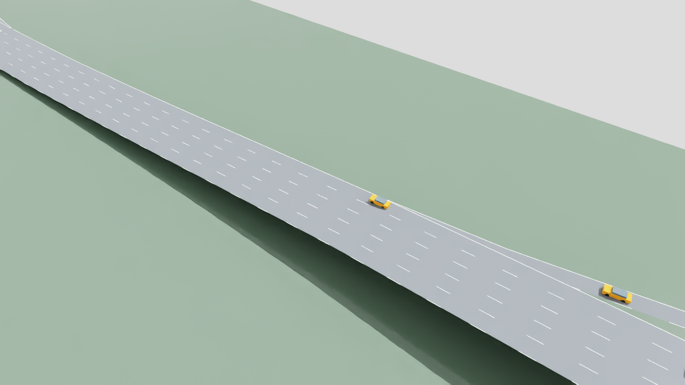
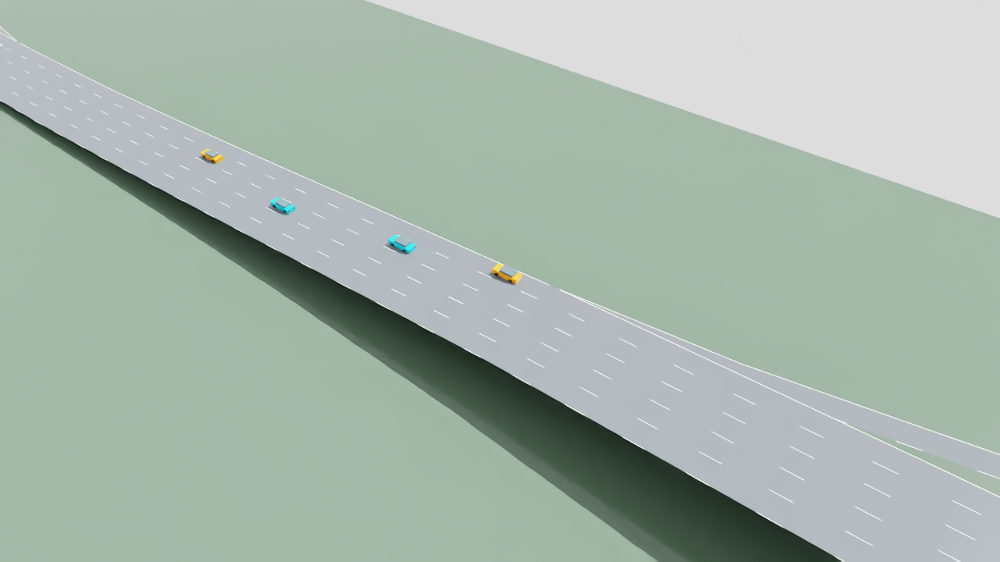

# I-110 merge visual test v01

2026-11-05. **The frozen-policy SUMO rollout and merge-focused 3D replay are complete.** Both controlled ramp cars merged and all four policy cars finished their routes. This is a single fixed-seed engineering replay, not a held-out acceptance result or a new training run.

## Policy choice and frozen fixture

Selected `policies/versions/highway-stage1-v03/policy.pt`, the final retained Stage 1 v03 actor. Among three retained compatible actors, it has the lowest pooled interventions on the same three original validation merge cases while preserving six successful merges out of six targets:

| Retained actor | Merge targets completed | Combined intervention events / active-agent steps | Pooled rate | Worst merge-case rate |
| --- | ---: | ---: | ---: | ---: |
| Stage 1 v02 | 6/6 | 505/9,580 | 5.2714% | 6.0625% |
| Stage 1 v03 phase 0 | 6/6 | 514/9,563 | 5.3749% | 6.7341% |
| Stage 1 v03 final (selected) | 6/6 | 318/9,580 | 3.3194% | 3.9063% |

Sources, per-case counts, hashes and contracts are preserved in [selection.json](evidence/i110-merge-visual-v01/selection.json). The comparison uses five-, two- and four-lane generated-road merge cases with seeds 5210003, 5210007 and 5210011. It does not establish native I-110 performance. Phase 0 remains the stronger overall population-intervention reference; “selected” here means strongest retained merge-specific candidate, not universally best. Phase 1 reports exist but the matching actor was not retained. Population v03/v04 folders contain preflight work, not newer trained actors.

The visual fixture was fixed before observing this rollout: seed **6400019**, `i110-merge`, medium density, four through lanes, 800 steps at 0.1 s, local communication and zero packet loss. The policy controls two mainline cars (`agent_0`, `agent_1`) and two ramp cars (`agent_2`, `agent_3`). The focal vehicle is `agent_2`. The speed ceiling is 26.8224 m/s (60 mph). This pre-existing Stage 1 preflight seed maps to the I-110 training-bank fixture; it was not rerolled for a favorable video.

## Completed rollout

Run: `outputs/i110-merge-visual/v01/20261105T232020Z-0089b54e`.

| Measurement | Recorded result |
| --- | --- |
| Controlled ramp merges | 2/2 |
| `agent_2` merge | 3.0 s, lane `sb2_1` |
| `agent_3` merge | 9.7 s, lane `sb2_1` |
| Controlled routes completed | 4/4, by 33.9 s |
| Full accounting horizon | 80.1 s; completed and comparison-valid |
| All requested trips completed | 36/44; eight background ramp trips remained active |
| Collisions / teleports / overspeed samples | 0 / 0 / 0 |
| Combined intervention events | 131/1,240 active-agent steps = 10.5645% |
| Policy filter changes | 0 |
| Native realization changes | 131; underlying native causes unattributed |
| Native emergency-warning events | 0 controlled, 0 background, 0 unclassified |
| Sampled emergency-braking observations | 0 |
| Mean fraction of speed limit | 0.77414 |
| Minimum measured TTC / headway | 5.746 s / 1.844 s |
| Mean / peak absolute jerk | 0.4885 / 60.2444 m/s³ |
| Lane changes | 4 |
| Delivered / dropped messages | 3,546 / 0 |
| Trajectory recording | 339 frames, monotonically increasing time |
| Training / optimizer steps | false / 0 |

The exact v2 intervention definition is: “Same v1 policy-mode union: lane rejected, |filtered-requested|>1e-4, or measured |realized-filtered|>0.05; denominator active-agent steps”. All 131 counted events in this run were realized-acceleration differences, **not policy-filter changes**. The report does not infer the underlying native SUMO causes, so these counts cannot be called 131 emergency-braking or near-collision events. Native warnings are separately parsed from the warning log; that log was empty. Jerk is the raw discrete realization metric, not a physically validated chassis measurement.

The 10.56% intervention result exceeds the existing 5% Stage 1 limit documented in the [policy card](../policies/versions/highway-stage1-v03/README.md). The chosen policy was already unaccepted overall (five of twelve original validation cases fail that limit; no held-out qualification). Successful merging in this single visual fixture does not change that status. Eight background ramp trips remain unfinished at the full horizon; completion of the four controlled routes must not be presented as completion of all traffic. The full accounting report is separate from any merge-focused video crop.

## Observation and action contract

Frozen CPU TorchScript inference uses `HighwayStage1Env` with **`control_target_version="v2"`**: schema `highway_stage1_graph_messages_v2`, reward `highway_stage1_feasible_acceleration_v2`. The actor takes float32 `[N,93]` and returns `[N,2]`. Inputs comprise 45 local/map/merge/mask fields and six eight-field delayed, presence-masked message slots, with fixed analytic scaling. The original centralized critic uses 376 fields, but is not loaded for actor inference. Observations here are exact current SUMO state/map and delivered messages; camera/LiDAR perception is not part of the controller.

Action 0 is normalized acceleration, mapped by `-4.5 + (a0 + 1) * 3.25` to −4.5…2.0 m/s² before constraints. Action 1 is right/stay/left lane intent (−1/0/+1). SUMO owns longitudinal realization, lane changes and lane centering. This actor does not output physical steering. The newer v3 target has changed merge-field meanings despite the same input width; this replay deliberately uses the matching v2 contract.

## Reproduction and provenance

From the repository root, the exact completed recording command is:

```powershell
.\.venv-traffic\Scripts\python.exe scripts/record_i110_merge_visual.py
```

The script freezes the actor, fixture and deterministic inference settings above, creates a new uniquely named output directory, and records full-horizon accounting after controlled cars finish. It performs no optimization. The completed rollout took 6.594 seconds wall time. Runtime: Python 3.11.9, Torch 2.14.0+cpu, TraCI 1.27.1.

| Artifact | SHA-256 |
| --- | --- |
| Frozen actor `policies/versions/highway-stage1-v03/policy.pt` | `a6d59d3acf58fcca9d7fc33406cb61ca3863d1a3dffad6dd316b195a66c7166f` |
| Original full checkpoint `outputs/highway-stage1/v03/train-20261103T230506Z-04ba1761/selected-00162-80ce2ebf/best.pt` | `b20cf417f79fd500e524bf6d92ef668eed142f94cbffcc36fc1c6efa79ed43e6` |
| Network `outputs/i110-merge/v01/network/network.net.xml` | `a216efd0a451845c19147437284fe0014d503c8015aca1d29bb4b4b8e1ac8623` |
| Saved trajectory `recording.json` | `0216ca92dd799f7aae6ccbb0221f87e1dd9b1615f86a607b586d613dba0ac743` |

Training provenance commit: `cf6ae5096ebac9f165e9811ed3916195227f3146`. Rollout worktree HEAD: `4f976a1dd8b58ff8106ea3b1520469389eb32e46`, **with uncommitted changes**. The recording script was untracked at execution; HEAD alone does not reconstruct the run. Its exact source SHA-256 is `ff19bfb760c9a8c4ef431d33cf2bed9f1c94eb06b092480732bc9897356d6378`; the manifest records hashes of the environment and supporting modules, and the output `source/` directory retains source snapshots. The manifest field named `checkpoint_sha256` is the exported `policy.pt` hash, not the `best.pt` hash.

The recording check confirms the policy and network source were unchanged and frame times were monotonic. Reviewable compact evidence is retained at:

- [Evaluation](evidence/i110-merge-visual-v01/evaluation.json): all measured values and aggregate trip accounting; large per-trip ledgers omitted with source checksum and row counts.
- [Manifest](evidence/i110-merge-visual-v01/manifest.json): exact original copy, including runtime, source checksums and dirty worktree status.
- [Recording check](evidence/i110-merge-visual-v01/recording-check.json): exact original copy.
- [Source artifact hashes](evidence/i110-merge-visual-v01/source-artifacts.json): original output file paths and checksums.
- [Selection evidence](evidence/i110-merge-visual-v01/selection.json): retained-candidate comparison and frozen fixture.

Full trajectories, per-trip ledgers, runtime logs and binary weights remain in their existing output/policy locations; no new weight copy is added to documentation.

## Completed rendering and failed preview

The final `render-01` render passed: **110 frames at 10 fps, 11.0 seconds of video**, covering source simulation timestamps 0.1 through 11.0 s at 1× playback. That 10.9-second timestamp span is 110 sampled frames, each displayed for 0.1 s. Both merge events are included. The fixed merge camera highlights the two policy ramp cars in orange, policy mainline cars in cyan and native background cars in gray. The render is a crop of the recorded episode; the measurements above retain the full accounting horizon.

The [render report](evidence/i110-merge-visual-v01/render-report.json) confirms video decoding of all 110 frames, zero recorded-to-rendered position error, no composition errors and unchanged static USD layers. The motion is replayed without source-pose interpolation. Six renderer regression tests passed; both merge screenshots were visually checked with the viewport grid removed.

Runtime: Isaac Sim **6.0.1-rc.7+release.42383.32955d8d.gl**, Python 3.12.13, USD 25.11 and NumPy 2.3.1. SUMO remains the recorded motion owner. Renderer source SHA-256: `581dfba7a7eb6a3289db96c148f71e59c1282e9551d2f4cdca3301a31112b166`. Video SHA-256: `cf9fb7ec1863d01317ebf2f65710eab7df460acf9856bb7ad0411f99c3695693`.

The exact completed render invocation was:

```powershell
$encoder = (Get-ChildItem -LiteralPath outputs/i110-merge-visual/v01/encoder/imageio_ffmpeg/binaries -Filter '*.exe').FullName
& C:/isaacsim/python.bat scripts/render_i110_merge_replay.py --recording outputs/i110-merge-visual/v01/20261105T232020Z-0089b54e --output outputs/i110-merge-visual/v01/render-01 --ffmpeg $encoder *> logs/i110-merge-visual-v01-render.log
```

The isolated encoder package was installed with `.\.venv-traffic\Scripts\python.exe -m pip install --target outputs/i110-merge-visual/v01/encoder imageio-ffmpeg==0.6.0`. This does not modify Isaac Python dependencies. For a rerun, select a new output directory and log name to preserve these completed artifacts. The renderer source snapshot and package/runtime hashes remain in the output and render report.

The video is retained **locally only** at `outputs/i110-merge-visual/v01/render-01/i110-merge.mp4`. Four original native-rendered screenshots are preserved with the documentation:

| Before (0.1 s) | First merge (3.0 s) |
| --- | --- |
|  |  |

| Second merge (9.7 s) | After (11.0 s) |
| --- | --- |
|  |  |

The first `preview-01` attempt produced a native frame at 3.0 s showing the roadway/merge, but Isaac fast shutdown exited before post-close video encoding and the render report. Exit code 0 did not indicate a completed video. Its frame remains at `outputs/i110-merge-visual/v01/preview-01/frames/00000.png`. The renderer was corrected to flush the report and encode before application shutdown, and the viewport grid was disabled. The completed `render-01` artifacts supersede that incomplete preview; the preview is retained as failure evidence.

The 3D deliverable reconstructs the provisional I-110 engineering geometry and replays the recorded **SUMO-owned** vehicle trajectories. Road markings are illustrative. It is an Omniverse visualization, not a new physically controlled Isaac validation, a camera/LiDAR driving test or a surveyed digital twin. Neither the rollout nor the rendering trains the policy.
