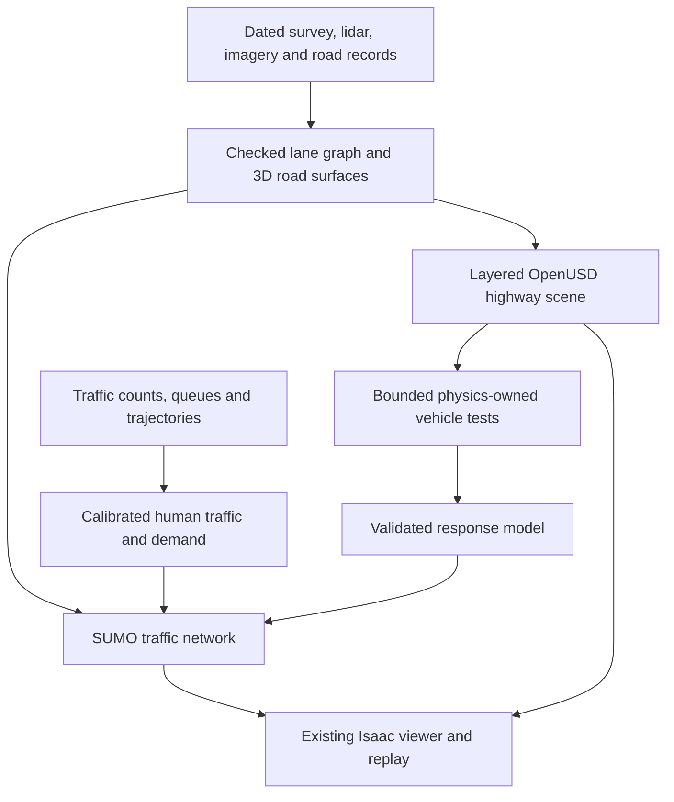

# Los Angeles highway twin: site choice and fidelity strategy

27 October 2026 · Codex for Sam · Research recommendation and qualification plan.

## Direction and recommendation

Sam now prefers an American highway, with Los Angeles as the target because the
team is at USC, and requests a research-backed approach to the highest fidelity
twin for its vehicles. This supersedes Aachen-Brand as the active geographic
priority. Sam has not applied for exiD; that application is no longer the next
task. Preserve earlier evidence and reusable viewer/accounting work.

**Start site screening on I-110 near USC; select a single observable merge only
after checking its congestion mechanism, data coverage and road epoch.** Compare
I-10 and I-405 alternatives using the same requirements. This is a recommended
search order, not a selected ramp or a finding of data sufficiency. Exact bounds,
direction, epoch and observations remain open. Plan a detailed focal road segment
inside a traffic domain large enough to account for queues and downstream supply;
expand the system only after this segment is verified.

Highest fidelity should mean a measured, use-specific agreement with the real
road and traffic, with declared uncertainty. Maximal mesh detail does not specify
traffic behavior, tire response or sensor accuracy. A recognizable LA scene is
an explicit deliverable; its scientific and physical checks remain separate.

## What the congestion evidence supports

Caltrans's retrieved 2025 Q2 District 7 report includes a **2024** bottleneck table.
Its newest D7 listing found today is Q2 2025; this is not a current 2026 ranking.
The report also raises a district detector-health concern, making local quality
checks essential. Sources LA01–03 in the [source ledger](la-highway-sources-2026-10-27.json).

| Candidate search area | Reported 2024 rank / period | Reason to inspect | Unresolved selection risk |
|---|---|---|---|
| I-110 north at Adams | 4 / AM | USC-area congestion lead | HOT terminus and signal constraints; not automatically an isolated merge |
| I-110 south at Vernon | 9 / PM | Second local corridor lead | Exact merge mechanism, influence of adjacent facilities and queue observations unknown |
| I-10 west at Robertson | 7 / AM | LA alternative with reported recurrent delay | Ramp geometry, traffic observations and independent-day support unknown |
| I-405 south at Howard Hughes Parkway | 2 / PM | Busy LA comparison candidate | Complexity, boundaries and asset/data quality unknown |

The 2026 Caltrans HOV plan attributes the north I-110 HOT terminus problem at
Adams to signal-controlled release (LA02, printed p.44). Do not assign this cause
to all adjacent general-purpose traffic without checking. It is a reason to
avoid selecting the Adams terminus itself merely for proximity/severity. The
2023 SCAG connector proposal is not evidence of today's built geometry (LA12).

Engineering inference: recurring near-capacity merging and stop-and-go waves
offer relevant interactions to study, but severe demand alone does not guarantee
a measurable AV benefit. A queue driven by an uncontrolled downstream signal,
closure or supply restriction may persist despite smoother local driving.
Include an observed lower-demand comparison and congestion onset/recovery.
Choose the site and regimes before observing learned-policy outcomes; never
search corridors for a favorable communication result.

FHWA recommends combining local bottleneck measures with corridor travel-time
or speed measures, and calibrating observed travel conditions rather than an
arbitrary average day (LA06–07). CIRCLES provides a closely related precedent for
checked network geometry, calibrated demand and driving behavior in SUMO
(LA08, sections 3.2–3.3); its results do not establish benefits on an LA road.

## The source-to-simulation architecture

Use one versioned geographic road model to generate consistent traffic and
visual/physical representations. Preserve source IDs and one reversible
coordinate transform. This is a proposed engineering design using the existing
stack, not a claim that these conversions are already implemented.

SUMO owns corridor traffic. In a replay, SUMO states drive visible poses. In a
bounded dynamic test, Isaac owns the test vehicle's pose and responds to controls;
its validated response model feeds back into matched traffic comparisons. Two
engines never overwrite the same vehicle state. Shared clocks, units, anchors,
vehicle identities and spawn/exit semantics are part of the contract.

| Fidelity dimension | Proposed construction route | Evidence required to call it accurate |
|---|---|---|
| Lane geometry and road semantics | Dated orthophotos, agency lane/as-built records where obtainable, and hand-checked lane/ramp graph | Independent lane-count, width, connectivity, taper and boundary checks; valid routes and legal merge zones |
| Pavement and structures | Classified lidar plus appropriate survey/engineering references; reconstruct pavement/deck/shoulder surfaces separately | Grade, crossfall, height and clearance checks; withheld control points/cross sections; actual wheel contact |
| Visual LA surroundings | Licensed orthophotos, geometry and materials; reusable barriers/signs/buildings; detailed near field and lighter distant context | Dated reference-view comparisons, resolved textures and assets, measured rendering cost |
| Traffic behavior | Quality-screened mainline/ramp observations and local interactions; calibrate demand, following and merge behavior | Independent-day speed, discharge, queue growth/recovery and gap-opportunity checks; visible failed models |
| Vehicle dynamics | Existing asset/controller with documented mass, tires, friction, actuator response and operating envelope | Held-out braking, acceleration, steering/following and road-contact response; simulated versus real validation clearly distinguished |
| Sensors, when required | Explicit sensor pose, timing, noise, occlusion and nonvisual materials | Compare range/dropout/intensity or camera behavior to suitable measurements; photorealism alone cannot pass this check |

### Real LA geometry inputs

The NOAA/USGS catalog documents LA County lidar acquired in 2023–24, with a
0.5 m ground raster and classified point-cloud/breakline products (LA04). Its
listed CC0 terms make it a promising public starting point, but no selected
road tile has been inspected. USGS specifies that bare-earth DEMs remove bridges
(LA05): use appropriate point returns and engineering evidence for elevated
lanes. Do not drape a highway deck on a ground raster. Resolution is not accuracy.

LARIAC is a high-resolution imagery lead, not an assumed USC entitlement (LA09).
Confirm the particular edition, footprint and offline/derivative rights. ArcGIS
can organize and inspect GIS sources; software access does not grant rights to
every layer. USC's official indexed computing-center information lists ArcGIS
Pro with an account requirement, but Sam's license and source entitlements remain
unverified (LA10). No paid tools or data should be presumed necessary yet.

For each file record acquisition date, publication/revision date, CRS, vertical
datum, units, accuracy evidence and permitted uses. Inspect tile headers rather
than choosing a CRS from an LA assumption; the regional catalog lists multiple
systems. Keep projected precision until translating to a local metre/Z-up USD
frame. Check vehicle centroid/front-bumper offsets and heading conventions.

Prefer a contemporary LA case if geometry and observations can be matched.
Choose the exact epoch from overlapping reliable sources and a construction
change check. Historical US-101 observations may support a separately labeled
2005 case or a behavioral prior; they cannot validate present-day LA traffic.

### Build clean road surfaces before decorating

Create a source-labeled road graph, smooth pavement ribbons and separate deck,
barrier and surroundings assets. Mark each feature measured, inferred or
visual-only. A raw photogrammetric mesh can contain vehicles, holes and noise;
it is a reference/appearance input, not automatically a suitable collider.
Keep collision, render and sensor geometry logically separate but geometrically
consistent. Preserve the established Environment/Vehicles/Lighting/Cameras/
Physics/Debug hierarchy and existing free/follow/overview cameras.

Do not promise centimetre accuracy or select numerical acceptance tolerances
before inspecting source uncertainty and vehicle needs. Define error budgets
for registration, geometry, timing and control response; freeze thresholds before
testing independent references. Test convergence under mesh/time-step refinement
on a small development segment so added detail earns its compute cost.

### Traffic and vehicle credibility

PeMS is the primary LA archive lead for repeated-day flow/speed and supporting
records, with free account registration (LA03). No Sam account or selected-station
coverage is established. Preserve observed/imputed distinctions and metadata;
do not calibrate to unhealthy detectors. Aggregates cannot identify individual
gap decisions. We still need local trajectory/video evidence or a defensible
explicitly limited behavioral source for the merge model.

Plan simultaneous coverage of ramp arrivals, queue tails, mainline entries and
downstream discharge. Track accepted, rejected and ambiguous physical gap
opportunities. Reserve independent calibration/development/factual-audit groups
before analytics. Unknown queue tails remain unknown or bounded. Include all
requested trips, human/ramp burdens and unfinished/external waiting in the
existing fixed-horizon ledger, with the drain reported separately.

Keep the same base driver, demand, safety stack, training budget and CTDE critic
opportunity in local/communicating comparisons. Preserve gap-model uncertainty
and independent training/traffic uncertainty. Hudson's reported 42-state-input,
assisted-braking, two-action/60 Hz controller still lacks accepted full-scene
learned-driver and following/merge evidence. A road rebuild cannot close those
gates. Sensor capability is an extension path, not an added perception-training
requirement; RTX sensor materials require their own validation (LA11).

## Ordered next work and stopping rules

1. **Desktop site dossier:** for the four leads, identify exact carriageway and
   ramp, lane/managed-lane topology, observation epoch, station IDs and health,
   ramp/demand/queue coverage, construction changes, lidar/image tile identifiers
   and rights. Eliminate cases without a supported focal mechanism or boundaries.
   Do not interpret a traffic-report label as a ramp coordinate.
2. **Evidence intake:** verify available account/asset access. With metadata only,
   define independent observation groups and reserve untouched audit records.
   Confirm source overlap and minimum data needed before downloading a site
   subset. No regional archive is necessary for this check.
3. **One development road section:** after source qualification, build a small
   section containing the merge and its relevant grade/structures. Demonstrate
   coordinates, lane topology, vehicle scale/road contact and an inspected render.
   Its length is a development choice, not the final traffic boundary.
4. **Traffic domain and baseline:** extend to observed queues and relevant
   upstream/downstream constraints; calibrate and independently validate before
   drawing intervention conclusions. If neighboring signals or interchanges
   dominate, include justified boundary conditions or choose a cleaner case.
5. **Vehicle response and expansion:** qualify a frozen controller on held-out
   cases, quantify runtime/accuracy, then expand visual surroundings and add
   further network sections through the same checks. Confirmatory training still
   needs the existing protocol/resource gates and Sam's involvement.

The immediate deliverable is an **LA corridor evidence dossier and selected
development footprint**, not a promise of an entire photorealistic LA freeway
network. A longer system can be built from verified segments. If behavioral or
boundary evidence fails, state the limit and seek an explicit claim/scope change;
do not silently substitute synthetic traffic for observed LA validation.

## Evidence status and continuity

Original sources and reading limits are in the companion ledger. This is a
targeted primary-source review, not an exhaustive literature review or a field
survey. The live master and Sam refresher were fetched successfully; they still
show the 22 October checkpoint. Today's direct LA instruction supersedes its
geographic recommendation for Sam, without implying team-wide adoption.

No empirical site, new accuracy metric or protocol field is admitted. No scene
was rebuilt, simulator launched, data account created, application submitted or
training run performed. Source observations/tiles were not downloaded. Shared
Google Doc writes remain held; a local update is prepared. Prior exiD and I-80
reports remain historical evidence. This direction changes the geographic
priority, not the approved matched comparison or bounded Isaac research role.
