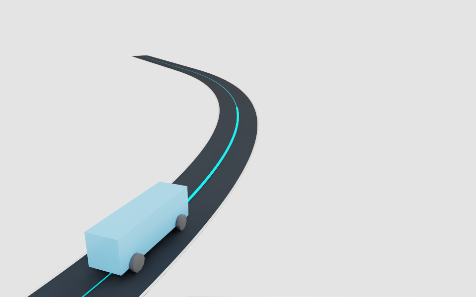
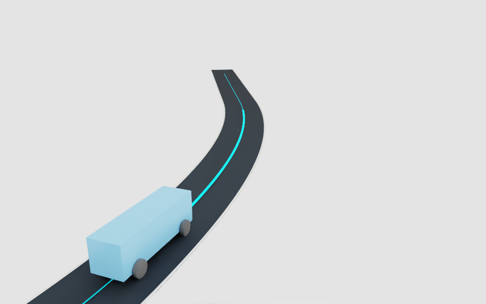
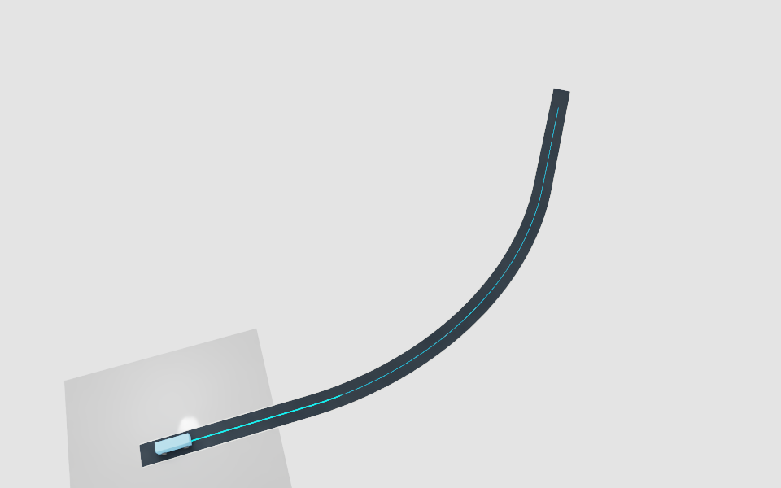
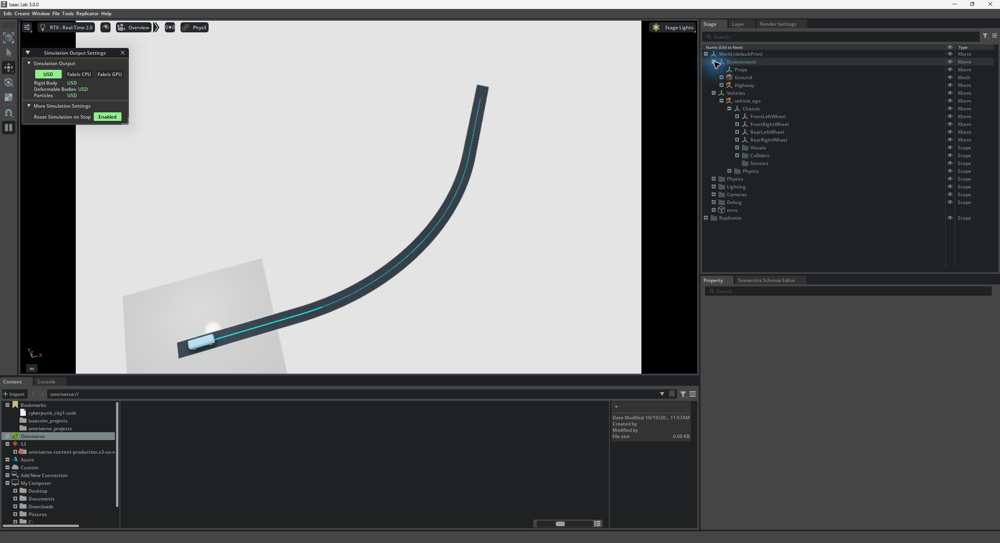
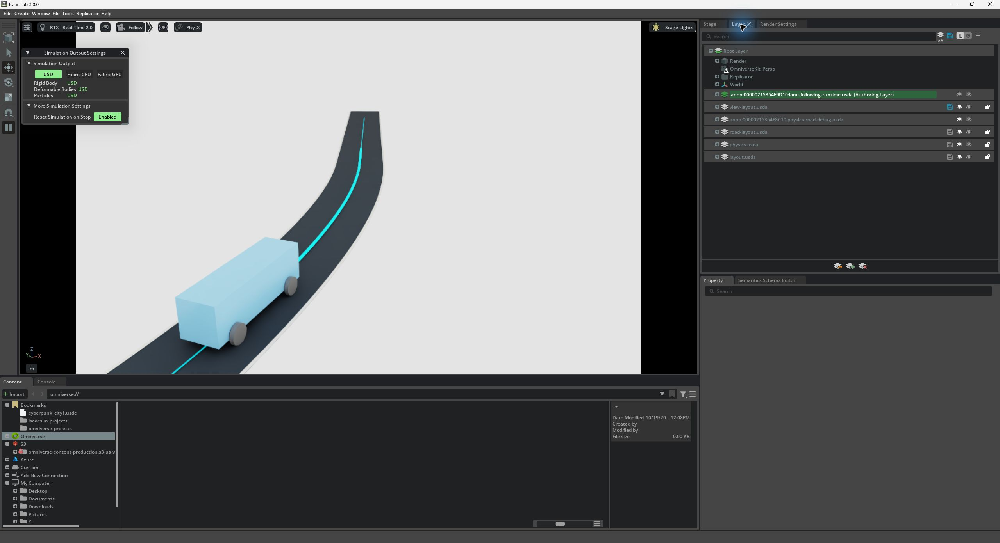

# Isaac Lab lane-following task

Status, October 19, 2026: the corrected native matrix passed **12 of 12 packages**,
covering 16 episodes: 13 successful drive-and-stop episodes and three expected
contact, departure and timeout controls. All three nominal repeat pairs passed.
**Training remains UNAPPROVED and has not started; optimizer steps: zero.**
The [compact evidence](evidence/lab-lane-following-20261019.json) records the
accepted matrix and retained attempts. The proposed setup is in
[the training review](lab-lane-following-training-proposal.md) and its
[resolved proposal](../experiments/lane-follow-ppo-proposal.json).

## Task and scope

The new `LaneFollowingLabEnv` runs one full-size procedural PhysX vehicle in
Isaac Lab `DirectRLEnv`. A controller requests steering, throttle and brake;
PhysX advances the chassis and wheels. Pose/velocity writes occur only during
resets. The existing zero-reward compatibility environment, SUMO demos,
Leatherback policy and showcase are separate and unchanged.

The task drives to station 60 m on the existing 100 m straight, left-curving or
right-curving road. Cruise speed is 3 m/s, with 120 Hz physics and 60 Hz actions.
Each episode has a two-second brake/settling interval and a 35-second total cap.
Initial lateral offset is bounded to ±0.15 m and yaw error to ±0.035 rad.
Stateless seed/episode-derived resets do not depend on case order or global RNG.

Success requires measured progress of at least 59.5 m, an endpoint within 0.5 m
of station 60, and speed at most 0.05 m/s for a complete measured second.
The independent validator also checks all 121 native states spanning that
one-second interval, including drift of at most 0.05 m. This is a new 60 m task;
it does not replace the historical 100 m/five-second-hold lane validation.

Failures terminate on rigid contact, lane-footprint departure, excessive tilt,
unsafe height, sustained wheel-support loss, overspeed/reverse motion, excessive
heading error, endpoint overshoot, stale/fallback commands or impossible state
jumps. Failure takes precedence over success; success takes precedence over a
pure time-limit truncation. No optimizer, policy construction or training launch
exists in the validation commands below.

## Observation, reward and terminal boundary

The 22 observations contain route progress/remaining distance, lateral and
heading error, velocity/height/upright state, current and lookahead curvature,
speed targets, applied controls and episode/settling/hold state. They are
privileged simulator state and a known analytic map, not perception. Suspension,
wheel dynamics and angular velocity are not fully observed.

Actions are steering in ±0.5 rad and throttle/brake in [0,1]. Steering retains
the existing 0.5 rad/s slew limit, and braking suppresses propulsion. Malformed
or nonfinite actions raise before physics advances; finite out-of-range actions
clip. Settling forces full brake. The version-one reward uses signed progress,
time-scaled lateral/heading/speed/steering costs and one terminal bonus/penalty;
its exact proposed weights are in the review configuration. Scalar reward is
never the independent driving acceptance criterion.

Lab automatically resets completed episodes before returning observations. The
task therefore records detached **pre-reset** final observations, reward and
terminal flags in `extras`, while the ordinary observation describes the next
reset. The installed Lab SB3 wrapper copies the ordinary observation into
`terminal_observation`; a project-local wrapper corrects that value without
editing the installed runtime. Timeout-only truncations bootstrap from the
final observation; true success/failure terminations do not. Observation
normalization must apply to the corrected terminal observation exactly once.

## Scene ownership

The environment references reusable vehicle, ground, road and optional diagnostic
barrier assets. Named `Environment`, `Vehicles`, `Lighting`, `Cameras`, `Physics`
and `Debug` branches separate scene responsibilities. Lab owns the sole physics
scene at `/World/Physics/Scene`. Its empty `/World/envs/env_0` container is an
explicit runtime bookkeeping exception; the task does not clone native cars.

Assets are authored on an isolated stage, composed into the fresh Lab stage
before physics initialization, and retained as references. Initial entry stages
are saved as `scene/world.usda`; runtime wheel, camera and debug opinions stay in
anonymous layers. Published file hashes must remain unchanged. Scene tests
check names, model ancestry, units/axes, references, relationship targets,
one body/physics scene and reopening from another working directory/process.
The diagnostic barrier is absent from ordinary driving/training scenes.

The actual visible and contact-control exports also reopened successfully in
fresh OpenUSD processes from another directory: all 13 ordinary-scene and 14
contact-scene static-file hashes matched their native evidence and remained
unchanged. The runtime launcher uses `kit.exe` as its Python executable even for
these plain USD checks. They start no SimulationApp, physics or renderer, but
still count as competing processes under the native isolation rule. Run them
after native jobs close.

The installed Lab physics manager disables contact processing during setup.
The adapter explicitly enables it before vehicle initialization, checks the
setting at every control interval, and records the monitor's stage ID, canonical
chassis path, report API and zero threshold. Closing or failed construction
restores the previous process-local value. The corrected positive control
observed a chassis/barrier contact at tick 543 and terminated at tick 544, with
two events and eight decoded contact points. Asset files and the installed
runtime were not edited to enable reporting.

## Measured native results

The accepted source uses the same frozen task limits in all cases. The 13
successful episodes comprise six nominal/repeat episodes, six signed reset-corner
episodes, and one visible left-curving episode. The diagnostic package separately
checks signed native resets, invalid actions, clipping and brake priority before
running its timeout and departure controls. The numbers below are independently
recomputed from the saved 120 Hz measurements, not inferred from scalar reward.

| Metric across the 13 successful episodes | Observed | Acceptance |
| --- | --- | --- |
| Completion time, including settling and stopped hold | 24.4167–24.4333 simulated s | At most 35 s |
| Measured progress | 59.87698–59.87811 m | At least 59.5 m |
| Final error from station 60 m | 0.12189–0.12302 m | At most 0.5 m |
| Largest driving lateral RMS | 0.043482 m | At most 0.20 m |
| Largest driving lateral error | 0.150409 m | At most 0.50 m |
| Largest full-body lateral bound | 1.190817 m | At most the 1.8 m lane half-width |
| Lowest upright-axis Z | 0.999959759 | At least 0.996194698 |
| Post-settling four-wheel support | 100%; no unsupported gap | At least 99%; no gap above 0.10 s |
| Largest drift during the complete stopped second | 0.006162 m | At most 0.05 m |
| Largest speed during that stopped second | 0.027467 m/s | At most 0.05 m/s |
| Rigid contact events in successful driving | 0 | 0 |

Each straight, left and right nominal pair had maximum recorded position,
speed and yaw differences of zero across 2,930, 2,932 and 2,932 physics samples,
respectively. This is repeatability of these fixtures on this installation;
it does not establish determinism across hardware, versions or other scenes.

The expected mechanisms passed separately: the barrier case terminated with
`rigid_contact` at 4.5333 s; hard steering produced a measured footprint departure
and termination at 3.6833 s; zero drive reached the exact 35 s `time_limit`
truncation. These are successful diagnostic checks, not successful driving
episodes. Their pre-reset final observations and corrected SB3 terminal metadata
were checked against native state.

All accepted packages passed source stability, static-asset integrity, cleanup
and process-isolation checks. They retained the two known startup messages
described below, with no unexpected runtime error or USD reference-count warning.
The full local matrix report is
`outputs/lab_lane_following/review/matrix-report.json`; raw packages remain local.

For the nine headless successful-driving packages, the recorded step path
processed 258.05–318.24 control transitions per wall second; the full episode
loop processed 203.41–247.94. The visible case recorded 77.32 and 63.16,
respectively. These measured scripted-validation rates exclude process startup
and include the probe's recording work; they are not PPO throughput, vectorized
scaling, a display frame-time guarantee or a causal headless/visible comparison.
The visible package's sampled whole-desktop GPU peak was 5,150 MiB.

## Retained attempts and repairs

| Attempt | Result and disposition |
| --- | --- |
| `20261019T185046Z-419c2613` | Failed before episodes: installed Lab `configclass` recursively assigned fields of a frozen task dataclass. Lab configuration now stores its serialized dictionary; the runtime constructs the unchanged frozen contract. |
| `20261019T185241Z-5f10d59b`, `20261019T185305Z-599cb53d` | Preliminary straight and diagnostic packages passed on the earlier source. Preserved, then repeated under the corrected contact-reporting source; excluded from the final matrix. |
| `20261019T185326Z-053b448e` | Contact control failed: the car physically stopped at the barrier, but disabled contact processing yielded no events and the episode timed out. The explicit reporting lifecycle above fixed the integration; no threshold was relaxed. |
| `20261019T190126Z-31b4dcb4` | Both left-route corner episodes passed physical checks, but two concurrent plain-USD audit processes appeared as `kit.exe` at shutdown. The supervisor correctly failed isolation. |
| `20261019T190230Z-06a430fb` | Same left-route corner case rerun after the audit processes exited; physical and isolation checks passed. This is the accepted matrix entry. |

The portability checker did not capture its own PIDs or exact process start/end
times. Its reports were written around 19:01:50 UTC; the native supervisor
recorded the competing PIDs. The original wording and corrected report versions
are retained locally. Additional editor-inspection attempts are distinguished
from the 12-package matrix in the compact evidence. An inspection image does not
add a successful driving trial to the count.

Report postprocessing initially rejected a non-UTF-8 byte (`0x97`) in a native
runtime log. `experiments/report_lane_following_lab.py` now reads that log with
UTF-8 replacement decoding, matching the supervisor, while raw artifact bytes
remain subject to strict hashes. A regression checks that the benign byte is
accepted and an actual error line still fails. This was an evaluator-only text
decoding repair: captured native artifacts, their hashes, the native protocol
and original run pass/fail outcomes were unchanged.

## Original screenshots

These are native captures, not generated illustrations. The first two are
viewport images from the accepted visible package
`20261019T185729Z-b54f88b6`; they show the scripted car on the left-curving route
while the episode was still running. Capture was requested at 12 and 20 simulated
seconds; the metadata records the request tick, not an exact rendered-frame time.





The overview from the same package was requested after automatic reset. It shows
the next episode's start pose, not the completed episode's final stopped pose.



The full-window editor captures expose the composed hierarchy and layer stack.
They document scene organization; numerical safety and success claims come from
the recorded native measurements and independent assessment. The hierarchy image
comes from accepted visible package `20261019T185729Z-b54f88b6`; the layer image
comes from supplemental inspection package `20261019T190802Z-167fa4e1`, outside
the accepted 12-package matrix.





## Validation status

The complete CPU regression finished with **2,037 passed, 187 skipped and 116
subtests passed** in 114.55 s. Skipped checks are not passes. Focused coverage
includes the pure task, adapter hook ordering, terminal metadata, installed Lab
configuration behavior and contact-setting lifecycle. Six separate OpenUSD
composition tests passed without SimulationApp, physics or rendering; the actual
native-package portability checks described above supplement those fixtures.

The final matrix independently recomputes observations, reward components,
termination/truncation decisions and full-body lane containment from raw native
states. It verifies pre-autoreset values through the local SB3 wrapper, complete
episode traces for repeats, decoded chassis/barrier contact identity and all
121 states of the stopped hold. Original native runs and source copies remain
immutable; the compact evidence links the accepted and excluded attempts.

## Reproduction and evidence

Use the isolated traffic environment for the supervisor and CPU tests. The
supervisor discovers the existing Isaac runtime; it installs nothing.

```text
python -m experiments.verify_lane_following_lab --route straight100 --profile nominal --check
python -m experiments.verify_lane_following_lab --route straight100 --profile nominal
python -m experiments.verify_lane_following_lab --route left_r60 --profile perturbed
python -m experiments.verify_lane_following_lab --route straight100 --profile diagnostics
python -m experiments.verify_lane_following_lab --route straight100 --profile contact-control
python -m experiments.verify_lane_following_lab --route left_r60 --profile visible
```

The frozen matrix includes two fresh-process nominal runs per route, both signed
reset corners per route, a zero-drive timeout and hard-steer departure, an
actual barrier-contact positive control, and a separate visible curved run.
Native jobs run serially, refuse a competing Kit process, stop at 90% whole-GPU
memory or a 300-second process deadline, and reject source changes during a run.

Each unique local package in `outputs/lab_lane_following/` contains resolved
settings, source copies/hashes, runtime metadata, every 120 Hz physical sample,
60 Hz transitions, resets, GPU samples, composed assets, logs and summary.
Failed attempts remain separate. A matrix report verifies artifact inventories,
recomputes driving/terminal/reward metrics, and compares matched nominal traces.
Raw outputs are ignored and are not included in a Git clone.

Two exact, previously recorded OmniPlaybackAPI UI startup errors may each occur
once before task readiness. They remain visible in evidence. Any additional or
later error, unresolved reference warning, teardown failure, orphan process or
changed published asset fails validation; this is not an error-free-runtime claim.

The completed milestone validates one CPU-physics car, bounded resets and a
scripted driver using privileged state on three fixed routes. Cloning, learned
control, policy generalization, traffic interaction, perception, vehicle-model
randomization and long-run memory/endurance remain unverified. The next decision
is the user review of the proposed observations, actions, reward, PPO setup,
budget and held-out evaluation. Passing this matrix does not authorize training.
