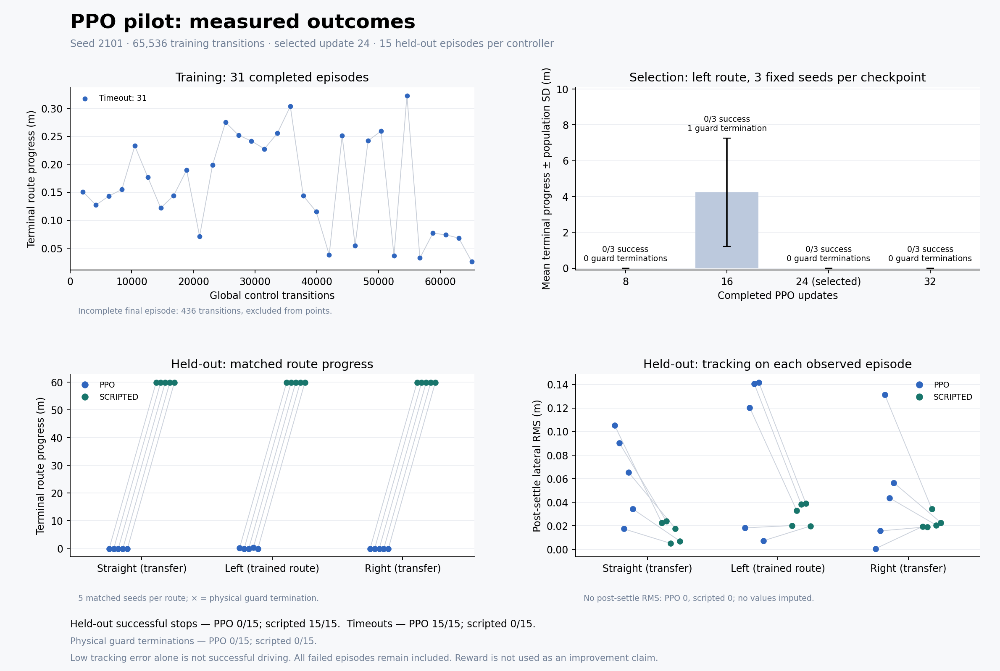
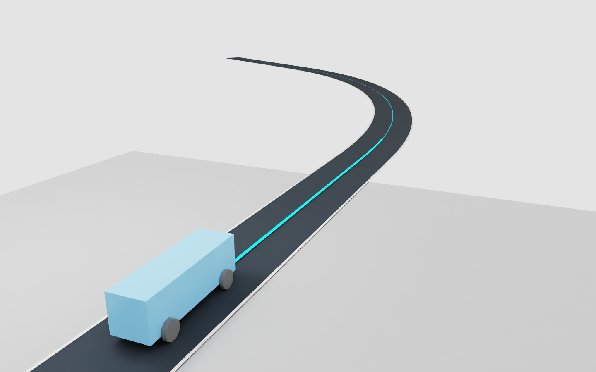
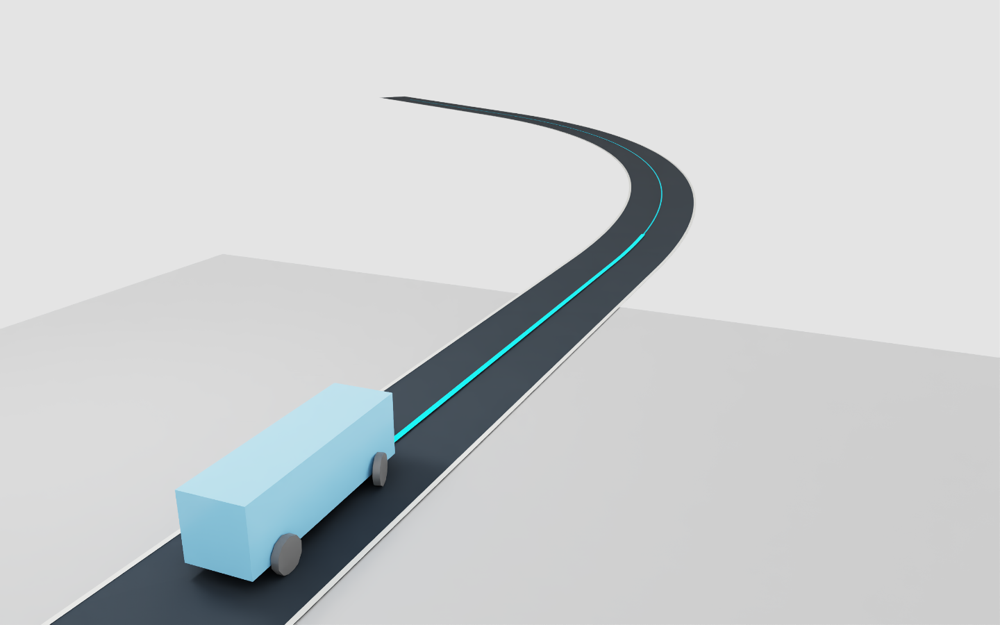
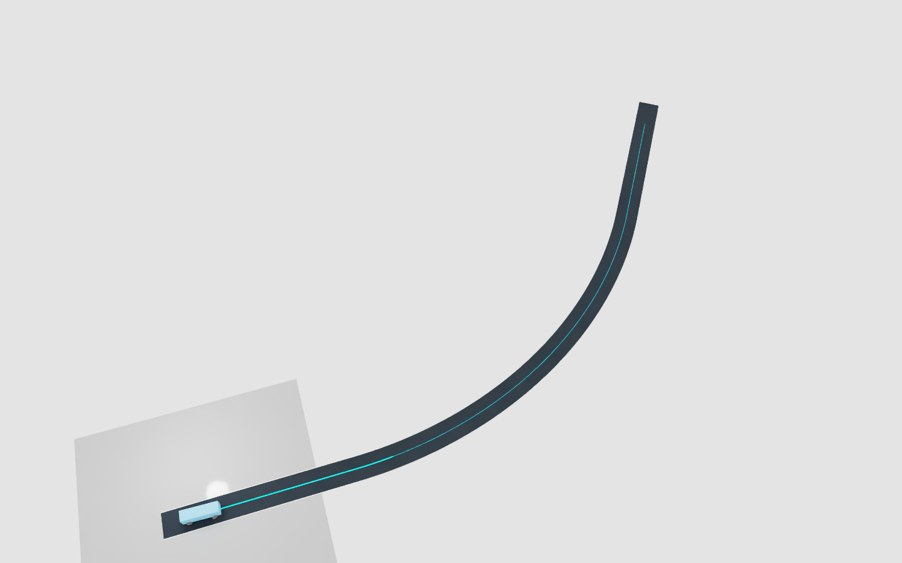

# First one-car Isaac Lab PPO pilot

The user approved this single pilot on October 19, 2026 with “yes start training”.
The immutable [reviewed proposal](../experiments/lane-follow-ppo-proposal.json)
is bound by SHA-256 in the [approval record](../experiments/lane-follow-ppo-pilot.json).
Its historical `UNAPPROVED` field describes the review-stage artifact. The
resolved launch configuration applies the later approval without rewriting it.

The approved training run completed in **385.97 seconds** with exactly **65,536
transitions, 32 updates and 5,120 optimizer calls**. All four checkpoints were
saved. Its 31 complete training episodes timed out; a final 436-step partial
episode is retained separately. This is a completed experiment, not a successful
learned driver. All held-out evaluations are complete: **PPO 0/15 successful
drive-and-stop episodes, scripted controller 15/15**. A separate frozen-policy
replay captured nine original Isaac viewport images without learning. It is
excluded from checkpoint selection and the 30 held-out trials.

The native zero-optimizer smoke passed all eight inference, normalization,
scripted-completion and reload checks. The final local software suite passed
**2,292 tests**, with 187 optional skips and 116 passing subtests. The subsequent
preview-only verification change passed 48 focused tests; the chart-label
correction passed five. Independent
agents reviewed the PPO arithmetic against installed SB3 2.9.0, checkpoint
provenance, raw episode reduction and screenshot completion boundaries.

Both Windows CPU/SUMO clean-clone jobs passed for `fc00d93`
([push](https://github.com/hudsonkaneko/hivemind-traffic/actions/runs/39321055679),
[pull request](https://github.com/hudsonkaneko/hivemind-traffic/actions/runs/39321062217)).
The push job passed **2,313 tests and 116 subtests**, with 188 explicit optional
runtime skips. A final combined local preview/chart check passed all 53 tests.
Native Isaac results are recorded separately from these CPU jobs.

## Approved experiment

| Setting | Frozen value |
|---|---|
| Simulator | One CPU PhysX car in Isaac Lab; physics 120 Hz, control 60 Hz |
| Training road | `left_r60`, target speed 3 m/s, stop at station 60 m |
| Episode | 35 s including 2 s forced-brake settling |
| Reset | Seed 2101; lateral ±0.15 m and yaw ±0.035 rad |
| Observation | 22 privileged simulator/known-map values |
| Action | Steering ±0.5 rad, throttle and brake each [0,1]; existing brake priority |
| Reward and ending | Existing verified task contract, unchanged |
| Algorithm | Stable-Baselines3 2.9.0 PPO on CPU, four Torch threads |
| Networks | Separate [64,64] Tanh actor and critic; initial log standard deviation −1 |
| Optimizer | Learning rate 0.0003; 2,048-step rollouts; batch 128; at most ten epochs |
| PPO | Gamma 0.999; GAE 0.95; clip 0.2; target KL 0.02; entropy coefficient 0 |
| Normalization | Observations only, clip 10, epsilon 1e−8; corrected terminal observations |
| Budget | One run, 65,536 control transitions, 32 updates, at most 5,120 optimizer calls |
| Limits | One-hour training process cap; stop at 90% whole-GPU memory |
| Checkpoints | After completed updates 8, 16, 24 and 32 |

The checkpoints contain actor, critic, optimizer state, observation normalization,
random-generator states, counters and configuration/provenance. They do not claim
exact restoration of a native PhysX episode in progress. A durable exclusive claim
prevents a second training run, and each native worker consumes its run once.
Failures and partial records remain in their original output package.

## Selection and evaluation

All four checkpoints receive three deterministic `left_r60` episodes using seeds
3101–3103. Rank by most driving successes, fewest physical failures, greatest mean
progress, lowest mean lateral RMS, then earliest update. This decision uses no
held-out result.

The selected checkpoint and the existing scripted controller each receive seeds
4101–4105 on `straight100`, `left_r60` and `right_r60`: 15 episodes per controller,
with identical seeded initial conditions. Observation statistics are frozen.
Every episode is retained, including early failures. Evaluation package success
means evidence and execution are valid; it does **not** mean the car drove well.

All 12 selection episodes completed with valid evidence: zero successful drives,
11 timeouts and one lane departure. The declared rule selected **update 24**.
It had no physical failures and mean progress of just **0.001234 m**. Update 16
averaged 4.242 m but had one lane departure, so it ranked below the three
candidates with no physical failures. Selecting an almost stationary candidate
is a consequence of the fixed failure-first rule, not evidence of learned lane
following. The rule was not changed after seeing these results.

## Measured held-out result

| Metric | Selected PPO, update 24 | Scripted controller |
|---|---:|---:|
| Successful drive and stop | 0/15 | 15/15 |
| Timeouts | 15/15 | 0/15 |
| Physical guard terminations | 0/15 | 0/15 |
| Mean terminal route progress | 0.039996 m | 59.877281 m |
| Maximum episode progress | 0.327546 m | 59.877975 m |
| Mean post-settling lateral RMS | 0.065985 m | 0.022962 m |

Each controller used all five held-out seeds on each of the three routes. No
episode was replaced. Every matched initial native state passed the comparison,
all evaluation packages remained frozen with zero optimizer steps, and all
30 raw episode reductions passed. Each scripted route achieved 5/5 successes;
each PPO route produced 5/5 timeouts. A small lateral error while nearly stationary
does not establish lane-following ability.

During stochastic training, the 31 completed episodes averaged 0.161617 m
progress, with a maximum of 0.322898 m. There were 53,512 transitions with at least
one clipped action and 15,680 simultaneous throttle/brake requests handled by
the existing brake-priority rule. These counts include the 3,840 settling-action
transitions. They describe this run and suggest an action/exploration problem;
they do not by themselves establish its cause.

The next proposed experiment should first address longitudinal action design:
one signed acceleration/braking action would avoid mutually conflicting throttle
and brake requests. A separate scripted-action warm start is another candidate.
Choose and review one intervention, its budget and evaluation protocol before
launching more training. This pilot was not extended, reseeded or resumed.

The independent reducer replays native guard decisions, two physics substeps per
control, rewards, terminal-state handling and resets. It reports progress,
tracking error, stopping, contact and other failures, action clipping, brake
priority and steering slew. Acceleration and jerk are finite differences of
scalar planar speed at 120 Hz; they are not comfort certification.

## Original results and screenshots



All complete episodes are included. Error bars in the selection panel are
population standard deviations over three seeds. A timeout is a failed task,
even when no physical guard terminated the episode. The 436-step incomplete
training episode is excluded from the completed-episode plot and retained raw.



Original Isaac viewport capture requested at the initial reset, before policy
steps: selected update 24, `left_r60`, seed 4101. The cyan line is the known route
reference, not a sensed lane or the vehicle's traveled path.



Capture requested at 30 simulated seconds. The car remains near the start;
the complete episode timed out at 35 s after 0.272389 m of progress. These are
asynchronously completed native images, with camera/state metadata recorded at
the request; they are not claims of exact exposure timestamps.



This overview was captured **after automatic reset**, not at the failed episode's
terminal state. The requested 35 s follow view was deliberately skipped because
the task had already reset. All nine originals, capture metadata and completion
checks remain in the local replay package.

The replay passed execution, source immutability, composed-scene, frozen-policy
and cleanup checks, with zero optimizer steps and no remaining Kit process.
Its original diagnostic reported observation differences at all 2,100 steps:
the in-memory observation was a tuple, while the reference loaded from JSON was
a list. Independent comparison of both durable JSON traces found exact equality
for all 14 selected fields, including observations, native states, actions and
rewards; the reset also matched. The original diagnostic is preserved unchanged.
This is a representation difference, not a claim that the whole files are byte
identical or that one replay establishes broader determinism.

## Reproduction and evidence

Run from the repository root using the traffic environment. The supervisor starts
the configured Isaac runtime in a separate process; do not install traffic
dependencies into Isaac Python.

```powershell
python -m experiments.run_lane_follow_ppo --mode train --check
python -m experiments.run_lane_follow_ppo --mode smoke
python -m experiments.run_lane_follow_ppo --mode train --smoke-evidence outputs/lab_lane_ppo/<passing-smoke> --approved-config-sha256 <approval-file-sha256>
python -m experiments.run_lane_follow_ppo --mode evaluate --stage selection --checkpoint outputs/lab_lane_ppo/<training-run>/checkpoints/update-08
python -m experiments.run_lane_follow_ppo --mode evaluate --stage heldout --route straight100 --checkpoint outputs/lab_lane_ppo/<training-run>/checkpoints/<selected-update>
python -m experiments.run_lane_follow_ppo --mode evaluate --stage heldout --route straight100 --controller scripted
```

The train command consumes the one-run authorization. Do not rerun it to obtain a
different seed, replace a failed run, extend the budget or resume a checkpoint.
Run native jobs serially. Repeat selection for the other three declared updates
and held-out evaluation for all three declared routes.

Raw trajectories, checkpoints and frozen run packages live under
`outputs/lab_lane_ppo/`; runtime logs live under `logs/lab_lane_ppo/`. These ignored
local artifacts are not included in a Git clone. Public documentation contains
compact evidence and actual rendered screenshots, with raw artifact hashes and
source identities. Failed driving remains visible in the results.

The [compact evidence](evidence/lab-lane-ppo-pilot-20261019.json) records run IDs,
source and artifact hashes, all checkpoint identities, selection ranks, matched
held-out results and screenshot provenance. The original training implementation
is published in `267c451e6ea4127e0ae596555c136bab8bc23ee3`; the preview-only
cross-Python verification fix is `fc00d932ef3caee805ec5b340118dcca4c6e197b`.
Strict numerical report reconstruction runs in the project Python 3.11.9.
Native preview Python 3.12.13 checks those bound bytes and checkpoint identities
without repeating version-sensitive floating-point reductions. No tolerances
or trial outcomes were changed.

| Evidence | Local package or report |
|---|---|
| Native compatibility smoke | `outputs/lab_lane_ppo/20261019T201817Z-7f24b357` |
| Single approved training | `outputs/lab_lane_ppo/20261019T201853Z-b6ac4cb8` |
| Fixed selection | `outputs/lab_lane_ppo/reports/selection.json` |
| Matched held-out trials | `outputs/lab_lane_ppo/reports/heldout.json` |
| Illustrative native replay | `outputs/lab_lane_ppo_preview/20261019T203832Z-84dbf806` |

Independent audits checked every training transition, all 32 updates and 5,120
optimizer records, and 674 artifact hashes across ten evaluation packages.
Training and evaluation retained the exact known baseline OmniPlaybackAPI
startup messages; no unexpected runtime errors or USD reference warnings were
observed. The replay had no such startup errors. The training process peaked at
2,757 MiB GPU memory; the visible replay peaked at 5,000 MiB. These are whole-GPU
observations on this workstation, not portable capacity estimates.

Checkpoint loading verifies the entire completed training package and all 36
captured source files before deserializing a model. `.gitattributes` pins each
file's checkout line endings; an isolated checkout with `core.autocrlf=false`
matched all 36 recorded hashes. These are hashes of checked-out source bytes,
not Git's normalized blob representation. Original proposal and prior evidence
contents remain unchanged.

This pilot measures low-speed physical control with privileged state. Broader
training, sensor-based driving, vehicle cloning, traffic coordination and highway
speed remain outside its scope.
