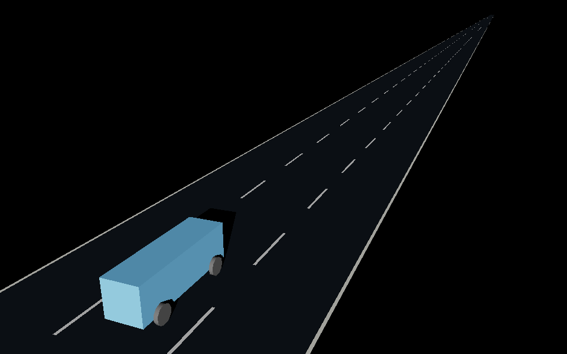
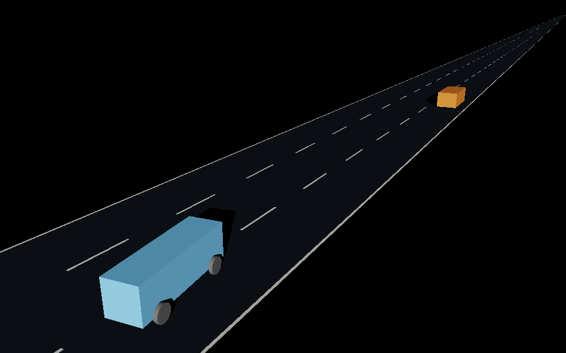

# Frozen MAPPO physical control adapter v01

November 5, 2026 (America/Los_Angeles). Implementation and bounded calibration;
**no policy training**. The adapter passes bounded physical tracking checks;
the frozen actor drives and passes a slower car but fails its intervention gate.
This milestone does not promote the reference policy.

## Purpose and unchanged baseline

Translate the best saved Stage 1 reference's acceleration and lane intent into
wheel steering, throttle and braking on the existing full-size PhysX Factory
surrogate. PhysX remains the sole motion authority. The adapter never writes
vehicle positions or velocities during driving. The prepared sensor-vehicle
assets, existing loop demos and SUMO trainer remain unchanged.

The selected actor is `policies/versions/highway-stage1-v03-phase0/policy.pt`,
SHA-256 `8526f6134b7eae90d3370bd12cc0487926a6ec4356c6c6ea2dd231e8aa8b1bb8`.
It is the best current reference for this contract, **not an accepted highway
policy**. Its original 93-field v2 observation contract is used without a
semantic migration. Population v03 training remains disabled.

The Robot Modeling and RL skill guided explicit interfaces, fixed-weight
evaluation, calibration on recorded responses, independent validation and
retained failure evidence. Installed skill SHA-256:
`2db48172420a2b785fa3873eccba53bbdd3ee097ecfd0cbd1695e23bf6819891`.
Sub-agents implemented/reviewed the low-level adapter, policy bridge and native
runner. The primary agent owns serial execution, evidence and publication.

## Runtime contract

| Boundary | Contract |
| --- | --- |
| Policy | Frozen CPU TorchScript MAPPO actor, deterministic inference at 10 Hz; no optimizer |
| Observation | 45 local fields + six eight-field message slots; original analytic normalization, no running statistics |
| Sources | Privileged PhysX ego odometry, known straight map and explicitly scripted background truth; no camera/LiDAR estimates |
| Communications | One autonomous ego; absent V2V slots mean no transmitting peers in this fixture |
| High-level action | Acceleration −4.5 to +2 m/s²; lane delta −1/right, 0/hold, +1/left |
| Adapter | 60 Hz; acceleration feedforward from identified response plus bounded feedback; smooth quintic lateral path and pure-pursuit steering |
| Low-level command | Road-wheel angle, mutually exclusive throttle/brake; existing gate supplies steering slew and command expiry |
| Physics | Existing 120 Hz native PhysX vehicle, 700 Nm per driven front wheel and 1,500 Nm per braked wheel |
| Frames | Metres, X forward, Y left, Z up; chassis-center state converted explicitly for bumper-gap/road-station semantics |
| Scope | Parallel straight lanes only; curves, ramps, merges and multiple learned physical cars remain unqualified |

A zero lane request holds the selected destination. A committed maneuver must
finish before another is accepted. Upstream lane-gap permission is required;
new lane changes are masked during an active physical transition. That extra
mask is an explicit physical execution constraint. State and intent timestamps,
identities and expiry are checked. Missing/stale/invalid input triggers braking.
Reset clears pending commands, maneuver state and acceleration history.

All observation fields are constructed with named semantics. Inactive merge
context is legitimate on the declared straight road; it is not a substitute for
implementing a merge estimator. These privileged-state tests do not establish
sensor-driven deployment. The actor's traffic guards and physical restrictions
must be reported separately from raw policy decisions.

## Calibration and qualification procedure

Fit the local ordinary-pedal response model
`acceleration = throttle_gain * throttle - brake_gain * brake - coast - speed_gain * speed`
from native measured velocity changes, with brake fractions at most 0.5. Full
braking is grip limited and is measured separately. The adapter caps ordinary
brake inversion at 0.5; full stop/fallback commands remain available, with no
false linear-model prediction. Use physically bounded coefficients and
separate validation command phases. Preserve requested, filtered, applied,
predicted and realized quantities. This identifies a simulator/controller
response; it is not identification of a real road vehicle.

Run bounded scripted acceleration/braking and left/right lane-change probes,
then the unchanged actor in cruise and slower-car passing fixtures. Retain
checkpoint hashes before/after, complete configurations and source snapshots,
per-tick traces, screenshots, native logs and failed attempts. Thresholds are
declared in the [configuration](../experiments/configs/mappo_physical_adapter_v01.json)
before native execution. Do not relax them to make a result pass.

The supervisor allows at most 900 wall seconds for one native attempt and
serializes native jobs. This task's implementation/debug allocation is at most
three attempts (45 minutes total), with a specific diagnosis before a retry.
No training process is launched by either script.

## Commands and artifacts

From the checkout in the existing traffic environment:

```text
python scripts/run_mappo_physical_calibration.py --check
python scripts/run_mappo_physical_calibration.py
```

The portable launcher finds the existing isolated Isaac installation through
local configuration. It does not install or modify that runtime. Native outputs
are stored in `outputs/mappo-physical-adapter/v01/<unique-run>/`; runtime logs in
`logs/mappo-physical-adapter/`. Raw traces, simulator logs and generated scenes
remain local. Compact summaries and selected screenshots belong in
`documentation/evidence/mappo-physical-adapter-v01/` for review.

## Measured results

Two native attempts used **189.88 process-wall seconds** in total. The first
completed 38 simulation seconds and correctly stopped before actor evaluation:
including full braking in the linear fit produced **0.66694 m/s²** validation
RMSE, above the unchanged 0.5 gate. Full braking measured about −6.87 m/s²,
while quarter/half braking measured −2.40/−4.74 m/s²: grip saturation invalidated
the full-range linear assumption. That failed run and its exact source/config
snapshot are preserved.

The second run restricts the ordinary fit to unsaturated braking, retains the
full-brake saturation probe, and adds a **new 0.4-brake confirmation phase**
excluded from fitting. Twenty prior validation windows produce **0.02131 m/s²**
RMSE, versus **1.03254 m/s²** for the provisional gains on the same measurements.
Seven fresh confirmation windows produce **0.01634 m/s²** RMSE. This is a
response-prediction comparison; there was no separate uncalibrated driving run.
The old validation was inspected during model revision, so only the new command
level is fresh confirmation, not a broad untouched reliability test.

Identified gains: throttle **2.152887 m/s²**, brake **9.282740 m/s²**, constant
coasting resistance **0**, speed-dependent resistance **0.00462044 s⁻¹**.
Ordinary prediction supports throttle [0,1], brake [0,0.5], never simultaneous;
moving calibration windows cover 2.16–19.93 m/s. Full-brake saturation in the
second run averages −6.85 m/s². Low-speed stopping is explicitly handled by the
controller; no fitted low-speed tire-friction claim is made.

| Physical scripted validation | Acceleration RMSE | Worst settled lane-center error | Result |
| --- | --- | --- | --- |
| 6 m/s (13.4 mph) | 0.01170 m/s² | 0.06473 m | Passed left change, return, cruise and stop |
| 12 m/s (26.8 mph) | 0.01486 m/s² | 0.00945 m | Passed left change, return, cruise and stop |
| 18 m/s (40.3 mph) | 0.02708 m/s² | 0.00971 m | Passed left change, return, cruise and stop |

Acceleration RMSE uses 0.2-second mean errors while moving above 2 m/s;
settled lane error uses the predeclared post-maneuver windows. These numbers
are not worst instantaneous errors over the full lane transition.

| Unchanged learned actor | Task outcome | Safety overrides | Acceptance |
| --- | --- | --- | --- |
| Cruise, 12 m/s limit | Reached 100.00% of target in the final 10 seconds | 312/380 = **82.11%** | Failed ≤5% intervention gate |
| Pass, 18 m/s limit; scripted lead at 8 m/s | One learned left-lane request at 12.4 s, completed maneuver and pass; final speed 99.79% of target | 161/580 = **27.76%** | Failed ≤5% intervention gate |

All logged actor corrections were speed-ceiling interventions. Cruise median
correction is about **0.944 m/s²**; 312 cruise and 146 passing decisions require
more than 0.05 m/s² correction. These are substantial residual actor errors,
not a floating-point counting artifact. The final passing clearance is 382.10 m
after the full 60-second fixture, not a close-following distance or minimum
clearance claim. The passing background is an analytic, nonreactive visual car;
footprint overlap is checked independently. Cooperation and reactive traffic
are not validated here.

The second run completed **269 simulation seconds** with zero rigid contacts,
analytic overlaps, local-limit overspeed ticks (0.3 m/s tolerance), adapter
fallbacks or driver-gate fallbacks. Intentional stopped holding uses full brake
and is counted separately. All six scenes preserved their static files and
reopened from a different working directory in plain OpenUSD 0.26.8 with no
composition, dependency, required-prim or relationship errors. Native Isaac
runtime errors and USD reference warnings were zero; peak whole-GPU use was
4,152 MiB, including the desktop. The run used Isaac Sim 6.0.1-rc.7 and Python
3.12.13; the manifest records the exact installed build, driver and Factory hash.

**209 targeted CPU tests passed** after the calibration correction, including
complete observation parity, checkpoint immutability, expiry/reset behavior,
calibration split isolation, maneuver sampling and intervention accounting.
The existing TorchScript deprecation warning is retained; this milestone does
not migrate the checkpoint format. Weights remained byte-identical and zero
optimizer steps ran.

Actual native screenshots (unmodified):





The blue car is the physical Factory surrogate. The orange car is scripted
lightweight traffic; these are simulator captures, not a sensor-equipped
production vehicle or camera/LiDAR perception results.

## Evidence and next gate

[Compact measurements and provenance](evidence/mappo-physical-adapter-v01/summary.json),
[case table](evidence/mappo-physical-adapter-v01/results.csv),
[executed configuration](evidence/mappo-physical-adapter-v01/resolved-config.json)
and [offline derivation](evidence/mappo-physical-adapter-v01/derive.py) are published
with this note. Full local runs:

- `outputs/mappo-physical-adapter/v01/20261105T204440Z-e1a2ab4f/`: failed full-range fit.
- `outputs/mappo-physical-adapter/v01/20261105T204908Z-32331979/`: corrected calibration,
  all scripted physical gates passed, frozen-actor intervention gates failed.

Keep the reference actor frozen. The next policy improvement is to address its
near-limit acceleration requests in the reviewed SUMO training plan, then repeat
matched physical validation. **No training is authorized or started by this
report.** Curves, merges, reactive/multiple learned physical cars, 60 mph,
sensor-estimated observations and native stale-input braking trials remain open.
The adapter's fallback/reset logic has CPU evidence, not a physical fault-injection
qualification. The existing surrogate's mass, tire and suspension parameters
remain provisional; no CAD, hardware selection, BOM or physical dimensions changed.
