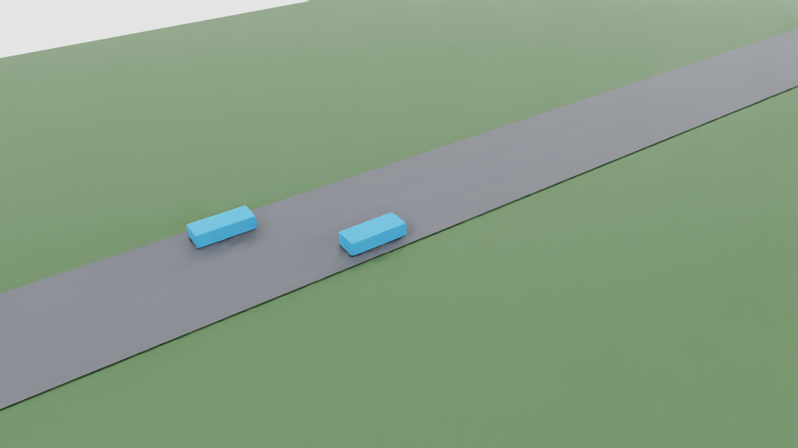

# MAPPO v02: recorded 3D validation

October 27, 2026. Frozen actor, no training or optimizer updates.

## Result and scope

Ran the accepted v02 actor for 60 seconds in SUMO using held-out seed 410001,
then replayed the recorded traffic in Isaac Sim with reusable proxy vehicles.
The episode metrics exactly match the original evaluation for this seed.
This is kinematic visualization of SUMO-controlled traffic, not a policy driving
physical Isaac vehicles. It adds no new evidence for merging, communication,
wave suppression, or generalization beyond the existing evaluation.

| Measure | Result |
| --- | ---: |
| Controlled cars | 4 |
| Steps / agent transitions | 600 / 2,400 |
| Collisions / overspeed steps / safety overrides | 0 / 0 / 0 |
| Mean progress per controlled car | 1,450.739 m |
| Mean speed inferred from progress | 24.179 m/s (54.09 mph) |
| Peak speed | 25.646 m/s (57.37 mph) |
| Minimum TTC | 21.600 s |
| Team reward | 490.748 |
| Peak background vehicles | 83 |
| Unique recorded vehicles | 87 |
| Replay position checks / maximum error | 29,097 / 0 m |
| Export endpoint checks | 174 |

All controlled agents reached the nominal time limit. The policy retains the
27-feature observation and scalar longitudinal action contract of v02; lanes
are fixed. It is not the newer, untrained communication configuration.

## Retained evidence

Full local package: `outputs/sumo_recordings/mappo-v02-3d-20261027/`.
It includes resolved configuration, policy/config/source hashes, runtime versions,
per-step compressed action records, trajectories, portable USD layers, screenshots,
3D checks, timing, and all six unsuccessful preview attempts. Runtime logs are
`logs/mappo-v02-3d-20261027*.log`. Bulk artifacts and weights remain local.
Compact metrics and two real simulator screenshots are committed in
[`evidence/mappo-v02-3d/`](evidence/mappo-v02-3d/).

Policy run: `train-20261026T190003Z-9d133a8c`.
Policy SHA256: `6ec2167aa2c769ec41c9221b77382fe74658430ce852703ce32568d089e591fd`.
Training source commit: `c06e45eaa79698eda85d01a65fa6ae5a6811b6d7`.
Canonical config SHA256: `172171c4eaf04105c616b8ab430176eb6b6df61d5a8a5a9034151f35de9be0b8`.

Four-car inference averaged 0.293 ms per batch (p95 0.288 ms; maximum
82.224 ms includes startup). Final headless replay took 8.708 seconds for
59.9 seconds between recorded endpoints; startup took 11.326 seconds.
Frame iteration mean/p95 were 14.314/18.365 ms. These are diagnostic timings,
not a controlled GPU benchmark: another project used Isaac during the session.
The report's historical `paced_frame_ms` field measures unpaced iterations in
headless mode. It does not measure policy or traffic simulation throughput.

## Implementation and visual checks

The recorder accepts an explicit configuration and exports actual TraCI headings,
dimensions and positions. Structured export separates Environment, Vehicles and
Lighting, references a reusable vehicle asset, and keeps road and motion layers
separate. The viewer adds a session-only camera and pose overrides. Static and
motion layer hashes remained unchanged; composition checks passed. Runtime-owned
`/Render` and `/OmniverseKit_Persp` namespaces are documented exceptions.

Early previews showed empty road despite passing numeric checks; two subsequent
attempts crashed in the graphics driver. These were retained as failures. The
final attempt uses noninstanced references, explicit session poses, the USD
rendering delegate and an 18 mm camera centered on the ego vehicle. Midpoint and
final screenshots were manually inspected and show visible vehicles. The proxy
geometry is intentionally simple; this is not a finished visual scene.



## Reproduce

Run from the checkout root with traffic dependencies isolated from Isaac.
Choose a fresh output name to preserve prior results; the viewer refuses existing
preview/report evidence. The original frozen checkpoint must be present locally.

```powershell
.\.venv-traffic\Scripts\python.exe scripts/record_sumo_mappo.py --config experiments/configs/sumo_mappo_v2.json --policy outputs/sumo_mappo/v01/train-20261026T190003Z-9d133a8c/policy.pt --output outputs/sumo_recordings/mappo-v02-3d-new --seconds 60 --seed 410001 --export-3d
C:\isaacsim\python.bat scripts/mappo_replay_3d.py --recording outputs/sumo_recordings/mappo-v02-3d-new/3d
```

Add `--gui` for paced interactive viewing; the final accepted capture was headless.
The four existing config/environment/runner/rollout test modules passed 75 tests.
All three changed scripts compiled. Final post-run edits only add evidence-overwrite
protection and remove an unused import; no further simulator run was required.

Google engineering guide synchronization for this milestone is pending. Its
generated Markdown mirror was not hand-edited. Physical closed-loop transfer
remains a separate validation gate.
