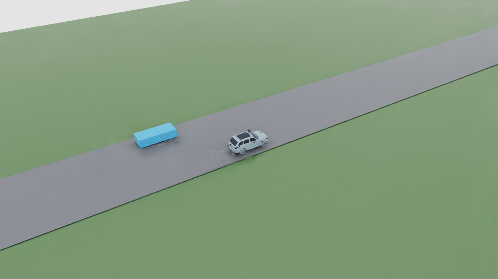
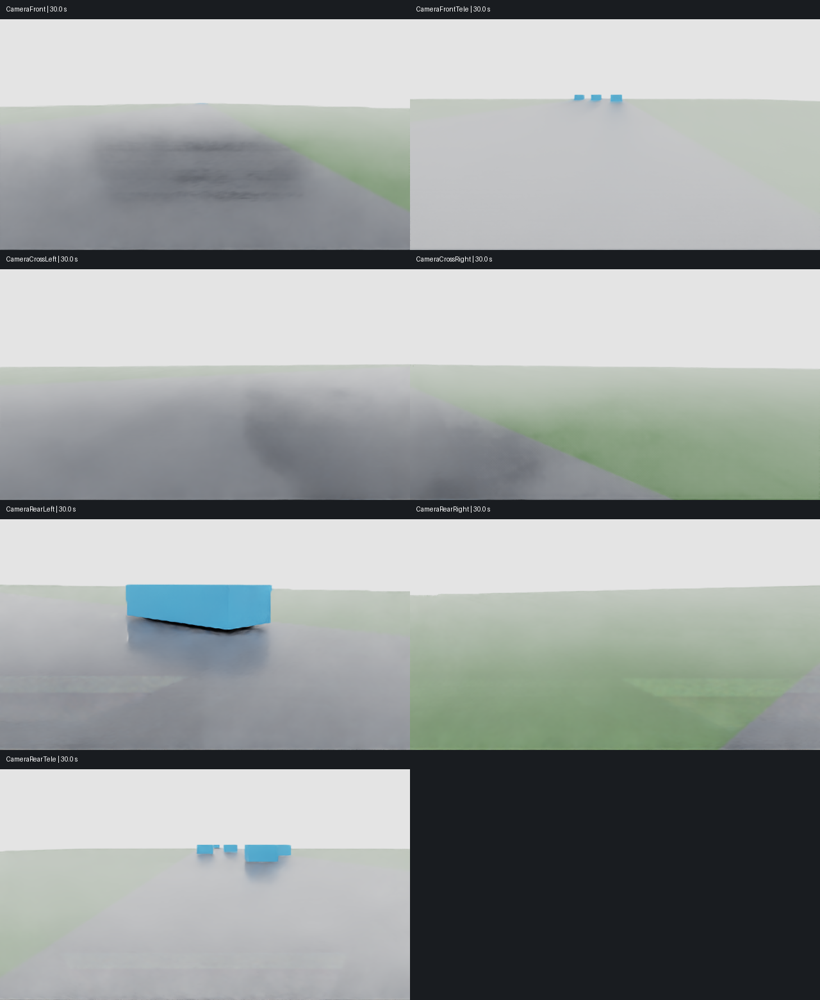
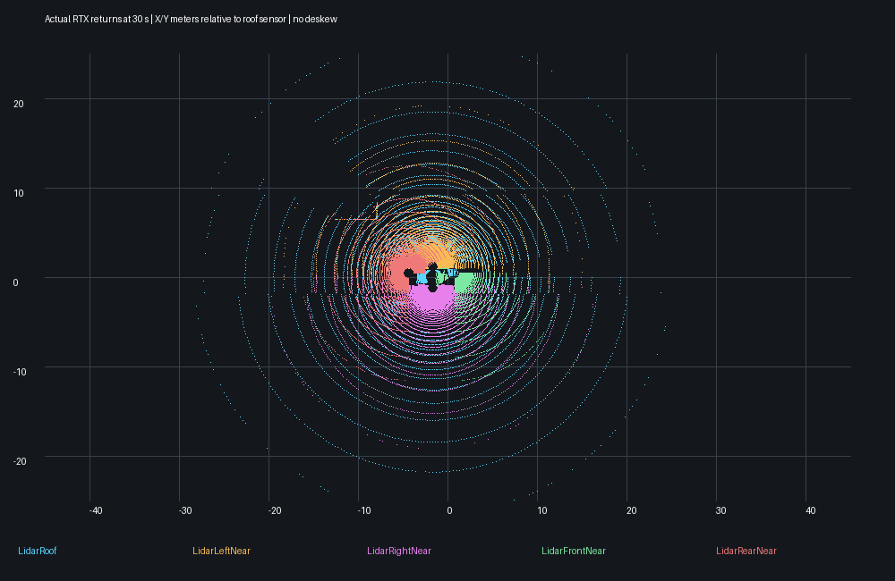

# MAPPO v02 replay with the prepared sensor car

October 27, 2026. Completed a 60-second replay of seed 410001 using the local
Americano i7 EV v14 as agent_0. All other traffic uses lightweight referenced
proxy geometry. No training or optimizer updates occurred.

## Verified result

| Measurement | Result |
| --- | ---: |
| Recorded traffic steps | 600 |
| Camera views | 7 |
| LiDAR scanners | 5 |
| Saved capture sets | 120 at 2 Hz |
| RGB images | 840 at 640×360 |
| Saved complete scans | 600 |
| Unique images per camera | 120 |
| Minimum successful hits in any saved scan | 4,982 |
| Replay root position error | 0 m |
| Replay plus capture wall time | 96.944 s |
| Startup and warmup | 15.047 s |
| Per traffic-step wall time, mean / p95 | 161.572 / 288.504 ms |
| LiDAR frame-end age at capture | 66.667 ms |

All 840 PNGs decode at the expected dimensions. All 600 saved scans have aligned
XYZ/flag/time-offset arrays and finite successful returns. Seven camera views,
the overview and the actual-return point-cloud plot were visually inspected.
Source vehicle hashes and saved static layers are unchanged. A fresh process
opened the composed scene from a different directory with eight layers, no
missing dependencies or composition errors, eight cameras including overview,
and zero rigid bodies. The existing sensor tests passed **94 tests**.

This reuses the prior frozen actor trajectory, whose seed metrics had zero
collisions, overrides and overspeed steps. These are retained SUMO results;
rendering sensors does not provide new physical collision or driving evidence.
See [the original v02 run](mappo-v02-3d.md).

## Motion and sensor contract

SUMO recordings own all poses. The prepared car references its visual and sensor
layers without vehicle physics. A front-bumper-to-chassis offset of approximately
2.408 m preserves the source chassis frame; the vehicle is not rescaled to the
proxy dimensions. Cameras and all scanners inherit the moving chassis transform.
The copied source geometry, optics and sensor mounts are unchanged.

The renderer runs at 20 Hz, cameras retain their source 10 Hz configuration, and
camera images and complete LiDAR packets are saved at 2 Hz. Traffic poses are
held at their recorded 10 Hz cadence. Five generic simulated 64-beam scanners
use the existing roof-near-field-v1 profile, not a calibrated commercial model.

Camera capture time, per-camera world transforms, LiDAR acquisition/frame-end
timestamps, delivery tick, scanner world position and per-ray offsets are saved.
LiDAR is WORLD/NONCOMPENSATED with measured 66.7 ms lag. The files are therefore
not a perfectly simultaneous fused sensor sample, and no moving-object deskew,
tracking or perception accuracy is claimed. v02 still consumes structured state,
not these images or point clouds. The simple road has no lane markings; proxy
traffic and render artifacts limit use as a perception-training dataset.

## Artifacts and reproduction

Local package: `outputs/sumo_recordings/mappo-v02-sensors-20261027/` (approximately
133 MB at audit). It contains per-camera PNG folders, per-set LiDAR NPZ files,
`captures.json`, `result.json`, `resolved-config.json`, `capture-audit.json`,
`scene-audit.json`, copied driving metrics, source snapshots/hashes, and a
portable composed scene with local-only vehicle dependencies. The complete
camera/scan audit contains file checksums. Bulk captures and vehicle assets are
not included in Git. Compact metrics and previews are in
[`evidence/mappo-v02-sensors/`](evidence/mappo-v02-sensors/).

Run from the checkout root, choosing a fresh output name:

```powershell
C:\isaacsim\python.bat scripts/mappo_sensor_replay.py --recording outputs/sumo_recordings/mappo-v02-3d-20261027/3d --output outputs/sumo_recordings/mappo-v02-sensors-new --seconds 60
```

Requires the local v14 asset and original recorded trajectory; a fresh clone
does not contain them. The integration reuses the existing locally prepared
multi-camera identity and multi-LiDAR profile/writer-isolation changes, now
included with their tests as dependencies of this replay. Unrelated sensor asset
generators and other work remain untouched.

Pilot01 failed sensor readiness because headless viewport updates were disabled.
Pilot02 explicitly caught viewport readiness. Pilot03 passed two seconds after
enabling viewport updates. All pilot folders and logs remain saved. The final
run aligned reads with render boundaries and checked LiDAR clock age. No source
asset was changed. Final post-run edits only reject invalid replay durations.

Google engineering-guide synchronization remains pending; its generated mirror
was not edited. Physical policy integration remains a separate gate.






