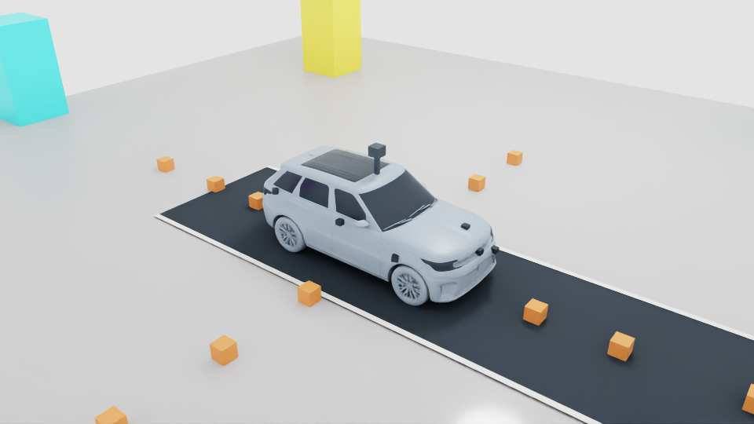
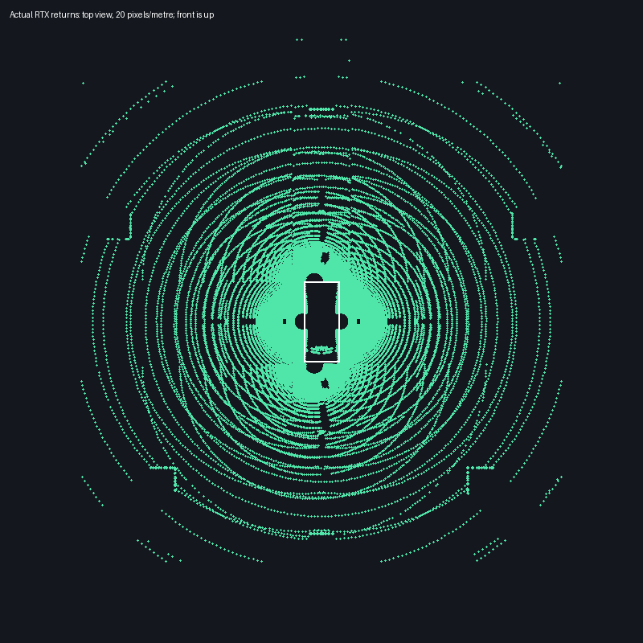
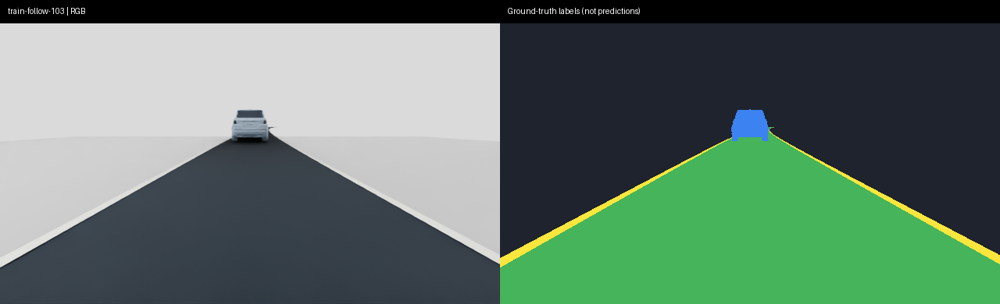
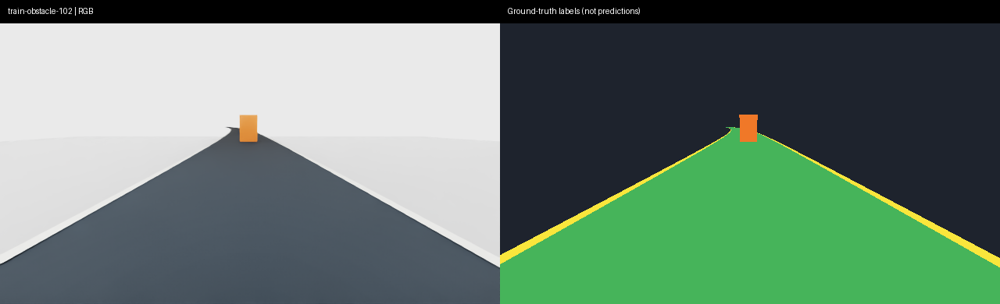

# Perception preparation v01: near-field sensing and labeled data

October 26, 2026. First sensor/data stages only. No perception or policy training
has started; the proposed segmentation configuration remains disabled.

## Vehicle source and measured coverage

The current local reusable source is
`vehicles/sim_ready/americano-i7-ev/v14/assets/vehicle.usda`. All seven v11
body-mounted camera poses and optics are preserved. Source additions are
versioned; original geometry, mass and collision configuration are unchanged.
Sensor housings are visual only. Source geometry remains private/local.

| Version | Change | Native outcome |
| --- | --- | --- |
| v12 | Roof profile widened to 64 beams, −65°…+10° elevation | Detected side targets at 6 m; body occlusion still hid 2/4 m targets |
| v13 | Compact left/right near-field LiDARs | All six side targets detected; expanded front/rear checks exposed further gaps |
| v14 | Compact front/rear near-field LiDARs | All 12 measured small targets and six tall surrounding targets detected |

Each scanner uses the opt-in generic simulated `roof-near-field-v1` profile:
64 uniform elevation beams, 20 Hz scan/tick, 7,200 Hz pattern firing, zero
azimuth offsets, WORLD/NONCOMPENSATED output. This is not a calibrated commercial
sensor. Legacy profiles/default callers are unchanged. Concurrent scanners now
use independent writer registrations, packet identities and cleanup handles.

| Scanner | Chassis-relative XYZ (m) |
| --- | --- |
| LidarRoof | 0, 0, 1.45 |
| LidarLeftNear / LidarRightNear | 0, ±1.18, 0.25 |
| LidarFrontNear | 2.45, 0.45, -0.20 |
| LidarRearNear | -2.68, 0.45, -0.20 |

All mounts are children of the physical chassis. Published source layers hold
mounts/profile contracts; runtime owns each `Scan` child and `/Render` content.
Source hashes, actual optics and preparation metadata remain in unique run
packages and source preparation manifests under `outputs/`.

Final run **20261026T212758Z-d9729274** passed a six-second combined test:

- 119 complete scans per scanner, 595 total; 59 valid frames per camera.
- Positive above-ground returns on 30 cm cubes at lateral distances 2/4/6 m
  and longitudinal distances 3.5/5/7 m on both sides/ends (distances from the
  initial vehicle center, not bumper clearances). Ground returns below 5 cm
  are explicitly excluded from these target counts.
- All tall surrounding targets and camera target checks passed; 0.6299 m
  physical travel, stable camera mounts, zero contacts and unchanged source.
- Saved scene reopens without composition errors. 141 CPU packet/profile/data
  tests and 28 USD source/composition tests passed.

This closes the **tested** gaps, not every possible blind spot. Minimum range,
small-object visibility between sampled bearings, fast moving scenes, weather,
hardware fidelity and moving-object deskew remain unverified. Roof-region
self returns remain (683 in the diagnostic region). No learned perception,
avoidance, full safety-system behavior or driving generalization is implied.

The failed roof-only run `20261026T212110Z-086f1a30`, side-coverage run
`20261026T212302Z-529c356e`, and expanded front/rear failure
`20261026T212543Z-0e410af4` are preserved. The acceptance set was expanded after
side gaps closed; no target was removed to obtain the final pass.

[Sensor metrics and hashes](evidence/perception-preparation-v01/sensor-result.json).

## Dataset preparation

`python -m experiments.prepare_perception_dataset` launches six short capture
processes sequentially using the isolated Isaac runtime, never a learner.
`configs/perception/dataset_smoke_v01.json` fixes the scenes/seeds/splits before
capture: four training scenes, one validation scene and one test scene, ten
front-wide frames each. The one-scene plumbing pilot is preserved separately.

Each sample stores RGB PNG, integer semantic NPY, separate raw LiDAR NPZ and
evaluation-label/timing JSON. Simulator labels are supervision/evaluation only,
not actor inputs. Depth is not supplied to a camera-based actor. LiDAR retains
world coordinates, per-ray offsets and explicit acquisition/delivery timing;
it has not been transformed into a deployable localization/fusion pipeline.
The revised capture also records USD camera/chassis local-to-world matrices at
RGB capture, each scanner's frame-end position/time and the row-vector camera
coordinate convention. These are evaluation metadata, not policy observations.
Scans are not deskewed; asynchronous moving-object fusion remains unverified.
Unsupported capture settings fail before launching Isaac rather than silently
producing data that disagree with the resolved configuration.

Labels are obtained from the native semantic annotator, remapped to fixed IDs:
background 0, drivable 1, lane 2, vehicle 3, pedestrian 4, obstacle 5. The lead
car uses the real reusable visual geometry without physics; the crossing box
is explicitly an **obstacle proxy**, never a pedestrian. No pedestrian asset is
present, so pedestrian training readiness must remain blocked.

Road curvature, lighting and obstacle placement vary by seeded scene. These
short, simple scenes test the data pipeline; they are not a diverse 20,000-frame
training corpus. Identical frame pairs across splits, reused scene/seed groups,
missing/corrupted files, unknown class IDs and dimension mismatches are rejected.
Manifests include hashes and class pixel counts. Each scene starts a fresh
process: this validates fresh-scene isolation, not in-process reset support.

The initial six-scene sample `20261026T212838Z-95a708e3` passed all 60 frame
checks (40 train, 10 validation, 10 test). It lacks per-frame transforms, so its
LiDAR is diagnostic-only. It is preserved rather than overwritten. A review
identified this limitation and prompted the revised capture above. Four additional
configuration tests passed alongside the 12 dataset tests.

Final revised sample **20261026T213519Z-2a6badc2** passed all 60 frames and six
scenes with unchanged capture sources. Every frame records the added transforms
and five scanner poses. Counts remain 40/10/10; pedestrian pixels are zero.
Road/lane/vehicle/obstacle labels were visually inspected in the actual samples
below. This is pipeline acceptance only; full training readiness remains blocked.

[Final dataset metrics](evidence/perception-preparation-v01/dataset-result.json).

## Proposed training configuration

See `configs/perception/segmentation_pilot_v01.json`. It proposes offline RGB
semantic segmentation, not a driving policy or object detector:

- DeepLabV3 MobileNetV3, pretrained initialization with a new six-class head.
  Weights have not been downloaded and the training runtime is not yet verified.
- 640×360 front-wide RGB; future 20,000-frame corpus, split 16,000/2,000/2,000
  by entire scenes/seeds, with held-out road layouts.
- AdamW, learning rate 0.0001, weight decay 0.0001, batch 8, mixed precision,
  cross-entropy, maximum 20 epochs, validation each epoch, patience 4.
- Select by validation mean IoU; use test data once after selection. Report
  per-class IoU/recall and inference latency. Missing classes are not evaluated.
- `best.pt` and `last.pt` under `outputs/perception-training/segmentation-pilot-v01/<run>`.

Before starting: review the samples, supply realistic pedestrian/vehicle and
appearance diversity, generate the full corpus, implement/verify the isolated
training entrypoint and measure throughput/memory to set a hard wall-time cap.
The smoke dataset is not silently substituted for the proposed corpus. The
user must review and approve the resolved training configuration before launch.
