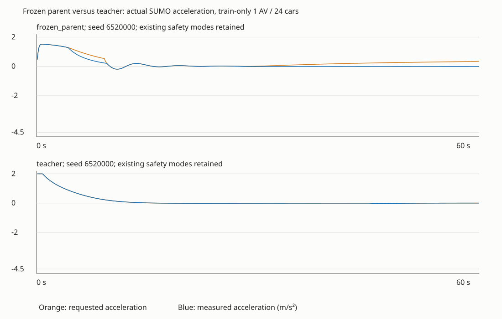
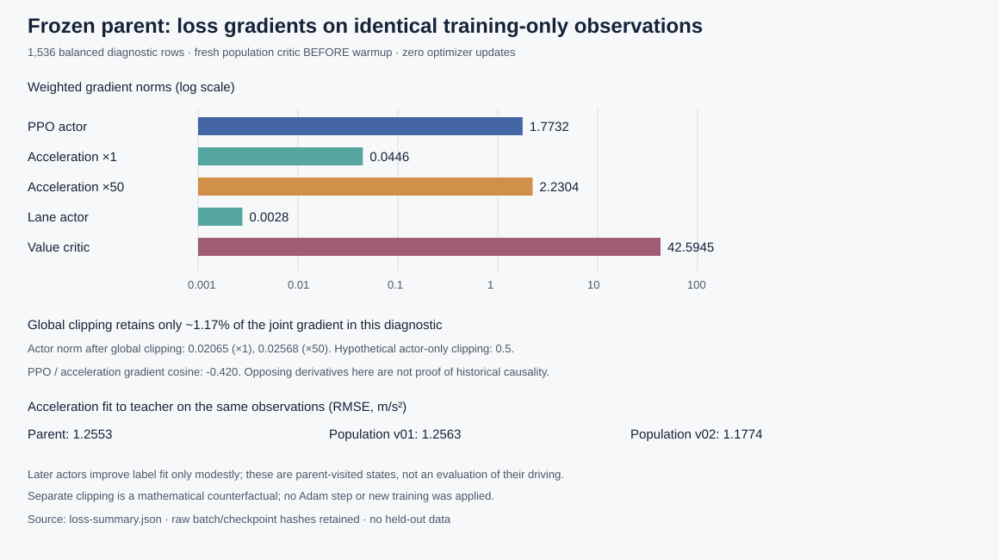

# Frozen population-policy control and loss diagnostics

November 4, 2026, America/Los_Angeles. Investigation of steps 1 and 2 from the [AV comparison](policy-baseline-av-comparison.md). No learning is authorized or performed by this study.

## Protocol

Use the retained Stage 1 v03 phase-0 actor, SHA-256 `8526f6134b7eae90d3370bd12cc0487926a6ec4356c6c6ea2dd231e8aa8b1bb8`, as the reference. Its original full checkpoint hash is `b77f55ae7262178ce0fa15729fe844e18693cd168905eea8b1bbd579c6913ab1`. Preserve all existing weights and runtime training/environment code.

The calibration study uses training-only layouts and fixed diagnostic seeds from 6520000. It compares frozen-parent and scripted control, then bounded command/duration probes with the existing analytical guards and native safety modes. Retain before/after timestamps, speed, velocity-derived acceleration, reported acceleration, commands and native response queries where available. Attribute only mechanisms established by those measurements and the pinned SUMO source/API. Parse native emergency warnings separately from sampled counters.

The loss study reconstructs a fixed, training-only diagnostic observation/rollout set with seeds from 6530000; completed checkpoints do not retain full historical batches. Collect with the frozen parent, then compare actor fit on identical observations. Compute gradients without applying them. PPO gradients use the collecting parent's actions, latent samples, log probabilities and frozen advantages. Critic provenance and target definitions must distinguish fresh population critics, learned population critics and the original incompatible four-agent critic. Measure weighted actor/critic contributions, gradient cosines, clipping factors and explained variance. Parameter hashes before/after and zero optimizer updates establish the no-learning boundary.

Each collection is capped at six minutes and limited to declared diagnostic cases. These are short controlled probes, not full driving acceptance, repeated-seed training, held-out evaluation or real-world calibration. Independent SUMO processes use separate outputs; wall times are operational records, not comparative throughput benchmarks. No Isaac/Omniverse or GPU runs are needed.

## Acceleration calibration results

The fourteen no-learning episodes completed in **53.77 seconds**, with **7,200 active-agent decisions**. The four parent/teacher comparisons each used one controlled car, a fixed training-only seed, and 600 steps (60 simulated seconds). Three constant-command cases compared 0.1-second and 0.5-second command durations for 400 steps each; both refreshed the guarded command every 0.1 second. This isolates duration without leaving a command unattended.

**No tested timing or acceleration-unit bug was found.** Native reported acceleration and synchronized `(speed_after - speed_before) / dt` agreed within **2.57e-13 m/s²**. All three duration comparisons produced identical timestamps, speeds, requested, filtered and realized accelerations over **1,200 paired decisions**. This rules out those explanations for these probes, not every possible simulator configuration.

In the free-cruise constant-request probe, SUMO realized the guarded acceleration accurately, including its speed-limit taper. In dense following, a constant **2.0 m/s²** request passed the analytical guard unchanged but produced a mean **0.2156 m/s²** response, with native differences on all 400 decisions. The interface works; the request is often above what the native following behavior permits.

| Training-only case | Parent overrides | Teacher overrides | Parent speed / limit | Teacher speed / limit |
| --- | ---: | ---: | ---: | ---: |
| Cruise, 1 AV / 24 cars | 56.50% | 0.00% | 0.8937 | 0.8934 |
| Following, 1 AV / 24 cars | 18.50% | 0.00% | 0.9059 | 0.9091 |
| Passing, 1 AV / 16 cars | 10.00% | 0.67% | 0.9043 | 0.9188 |
| Merge, 1 AV / 16 cars | 26.00% | 2.17% | 0.6759 | 0.6766 |

For cruise, the parent requested **0.2846 m/s²** on average but realized **0.1507**. The teacher requested/realized **0.1485/0.1485** with nearly identical speed. All 339 parent native mismatches were below the command and matched SUMO's stored native-speed counterfactual. This supports native response saturation in that case; it does not identify every internal constraint. The merge's low speed remains a limitation even when overrides decrease. These are short diagnostic windows with different controller trajectories, not a newly accepted policy or a fair replacement for the prior sixteen-case evaluation.



Speed ratios above use the environment report's current, post-step speed limit. The raw calibration CSV's `speed_ratio` uses the pre-step limit and differs slightly when crossing a merge seam; it is a labeled diagnostic column, not the official performance metric.

Speed mode **31**, lane-change mode **512**, the 60 mph ceiling, headway/stopping guards and override thresholds were retained. There were zero collisions, teleports, native emergency warnings and sampled emergency steps in these fourteen probes; that does not erase earlier warnings.

**The earlier emergency-event accounting gap is confirmed.** Offline reconciliation of population v02 found **12 unique native lane-end emergency-stop warnings, all involving controlled cars**: nine in training, one in initial validation and two in final validation. The sampled acceleration-below--4.55 counter recorded none. At the warning timestamps, eleven sampled accelerations were about -4.5 m/s² and one was +0.147; the following samples were zero. Native warnings reported a different internal deceleration/position correction. Consequently, a zero sampled acceleration counter cannot stand in for zero native emergencies. The diagnostic parser now distinguishes both emergency-braking and lane-end emergency-stop messages, deduplicating by episode, vehicle and time. [Retained historical reconciliation](evidence/population-diagnostics-v01/acceleration-historical-emergencies.json). Existing historical results are preserved; their safety limitations are explicit.

The SUMO API documents acceleration as the previous step's measurement and permits safety checks to constrain acceleration commands. The pinned implementation converts `setAcceleration` into a speed timeline. We record the stored `getSpeedWithoutTraCI` value only as a diagnostic counterfactual. We deliberately avoid `getFollowSpeed`: the pinned ACC implementation can use stateful mode handling, making it unsuitable as a guaranteed non-mutating measurement for this experiment. Sources: [retrieval API](https://sumo.dlr.de/docs/TraCI/Vehicle_Value_Retrieval.html), [command API](https://sumo.dlr.de/docs/TraCI/Change_Vehicle_State.html), [SUMO 1.27.1 vehicle implementation](https://raw.githubusercontent.com/eclipse-sumo/sumo/v1_27_1/src/libsumo/Vehicle.cpp), [ACC implementation](https://raw.githubusercontent.com/eclipse-sumo/sumo/v1_27_1/src/microsim/cfmodels/MSCFModel_ACC.cpp).

The existing pure ACC estimate already matches ordinary following to numerical precision in these fixtures. Residual errors remain near the speed limit and on merge approaches: the parent has 31 near-limit passing residuals and 47 ending-lane merge residuals above 0.05 m/s² after that predictor. The teacher retains 13 merge residuals. Some missing-leader cases may involve traffic beyond the 120 m local observation range; the saved data does not establish the specific native limiter. [Detailed strata and remaining calibration gaps](evidence/population-diagnostics-v01/acceleration-findings.md) preserve this distinction. No fitted scale factor is justified by the results.

## Training-loss diagnosis

Twelve frozen-parent stochastic rollouts collected **10,400 active-agent transitions** in **31.343 seconds**. Each task (cruise, following, passing, merge) was represented at 1, 4 and 8 AVs with declared demand/channel assignments. The sealed dataset contains **1,536 rows**, sampled equally (128 per case) after normalizing advantages over each full active rollout. This equal-case batch is diagnostic; the real trainer uses 256-row minibatches. No held-out scenarios were used and no optimizer step was applied.

The parent actor was imported into a reproducibly initialized **eight-agent population critic**, exactly the architecture used to start the population pilot. Its old four-agent critic was not mislabeled as compatible. The following gradients are **before critic warm-up**, not a reconstruction of the previous training run after its 4,096-decision critic warm-up.

| Weighted gradient contribution | Acceleration weight 1 | Acceleration weight 50 |
| --- | ---: | ---: |
| PPO actor norm | 1.7732 | 1.7732 |
| Acceleration imitation actor norm | 0.0446 | 2.2304 |
| Lane imitation actor norm | 0.0028 | 0.0028 |
| Value critic norm | 42.5945 | 42.5945 |
| Global clipping multiplier (threshold 0.5) | 0.01173 | 0.01172 |
| Actor norm after that global clipping | 0.02065 | 0.02568 |

Three issues are now measurable:

1. **Shared clipping couples actor updates to critic scale.** Here the critic dominates the joint norm, retaining about 1.17% of the gradient. Clipping the actor separately would leave an actor norm of approximately 0.5 on these derivatives. That is a mathematical counterfactual, not an applied update or a prediction of Adam's step size. It motivates separate telemetry and a controlled clipping experiment; it does not establish the historical regression's cause.
2. **Stronger imitation can conflict with PPO.** PPO versus acceleration-imitation gradient cosine is **-0.420** on the same batch. At weight 50 the acceleration term is larger than the PPO actor gradient, whereas at weight 1 it is much smaller. Another arbitrary increase is not justified. Ordinary PPO/imitation disagreement is not by itself an implementation bug.
3. **Teacher labels and reward acceleration targets differ.** Their mean absolute difference is **0.3002 m/s²** on the same observations. The teacher uses extra speed/following buffers and merge-slot logic; the reward uses a different following target. Both share an ACC response estimate, but they do not optimize an identical longitudinal reference. This is a design inconsistency to resolve deliberately, preserving conservative merge/headway behavior.



| Same parent-visited observations | Teacher acceleration RMSE (m/s²) | Lane agreement | Critic explained variance* |
| --- | ---: | ---: | ---: |
| Parent actor + fresh population critic | 1.2553 | 99.74% | 0.0156 |
| Population v01 | 1.2563 | 99.48% | 0.3226 |
| Population v02 | 1.1774 | 99.80% | 0.1718 |

*All critics are compared against the same parent-policy GAE targets bootstrapped using the fresh critic. These are cross-fit diagnostics, not true values or on-policy value-quality measurements for the later actors. Their MSE is also retained (99.30, 685.19 and 580.84 respectively); explained variance alone can hide a value offset. The teacher-fit improvement in v02 is modest and does not contradict its worse closed-loop interventions. Later actors are not used for invalid on-policy PPO gradient comparisons on parent data.

## Retained evidence and reproduction

- [Acceleration measurements](evidence/population-diagnostics-v01/acceleration-summary.json), measured curves and residual analysis.
- [Loss summary](evidence/population-diagnostics-v01/loss-summary.json), [case protocol](evidence/population-diagnostics-v01/loss-protocol.json), gradient figure and provenance supplement.
- Raw calibration run: `outputs/highway-population-diagnostics/v01/acceleration-20261105T051936Z-5526457f/` (per-decision CSVs, native logs and scenario records).
- Raw loss run: `outputs/population-diagnostics/v01/loss-20261105T051756Z-0530a0b0/` (full rollouts and sealed fixed observations). Dataset SHA-256: `cc87b5739a24af1310f43224492884099f54a6fc53e0619cacce0d8c19d0a60d`.

Raw datasets/logs remain local under ignored `outputs/`; Git contains compact evidence and runnable diagnostic tools. Both studies used Python 3.11.9, Torch 2.14.0+cpu, NumPy 2.4.6 and SUMO 1.27.1 in the traffic environment; no Isaac/GPU process was launched. Checkpoint/model and relevant runtime source hashes were unchanged. Provenance supplements explicitly label metadata captured after execution. The diagnostic warning parser was broadened after inspecting old logs, then existing traces were reprocessed without new simulation. Independent review checked action units/timing and the loss reconstruction against the existing trainer.

**Verification:** 28 focused diagnostic/teacher tests passed. The [verification record](evidence/population-diagnostics-v01/verification.json) retains the command, output, source hashes and review scope. The [offline derivation](evidence/population-diagnostics-v01/derive_acceleration.py) reproduces acceleration residuals and historical warning events in a new output directory. Google guide native readback preserved all 42 tabs; the generated Markdown mirror passed its check. Native document pagination was not inspected.

From the repository root, the following commands recreate bounded diagnostics only:

```powershell
.venv-traffic/Scripts/python.exe -m experiments.diagnose_population_acceleration --max-wall-seconds 360
.venv-traffic/Scripts/python.exe -m experiments.diagnose_population_losses --max-seconds 360
```

Each command creates a unique run directory. Later checkpoint fit comparisons require the retained local v01/v02 full checkpoints; a clean clone does not contain those bulk artifacts.

## Decision before any more training

Keep the phase-0 checkpoint frozen. There is no evidence here for changing the command duration, acceleration units, safety thresholds or native safety modes. The next implementation proposal should:

1. Resolve near-limit and merge-response gaps, then define one explicitly buffered longitudinal target for ordinary teacher supervision and the acceleration reward. Retain named merge exceptions and verify the resulting teacher in closed loop before treating its labels as correct.
2. Add actor/critic gradient norms, clipping factors, gradient conflict and on-policy critic explained variance to training telemetry, including after critic warm-up. Compare separate actor/critic clipping with the current behavior as one controlled change; do not simultaneously increase imitation weight or redesign the actor.
3. Keep native warning-event counts alongside sampled acceleration counters. Require cruise efficiency, passing/merging and per-case overrides to improve together; low override rate alone cannot promote a slow controller.

These are proposed corrections, not an approved new training configuration or a completed fix to the learned policy. No optimizer update, training launch, policy replacement or production environment change occurred in this milestone.
