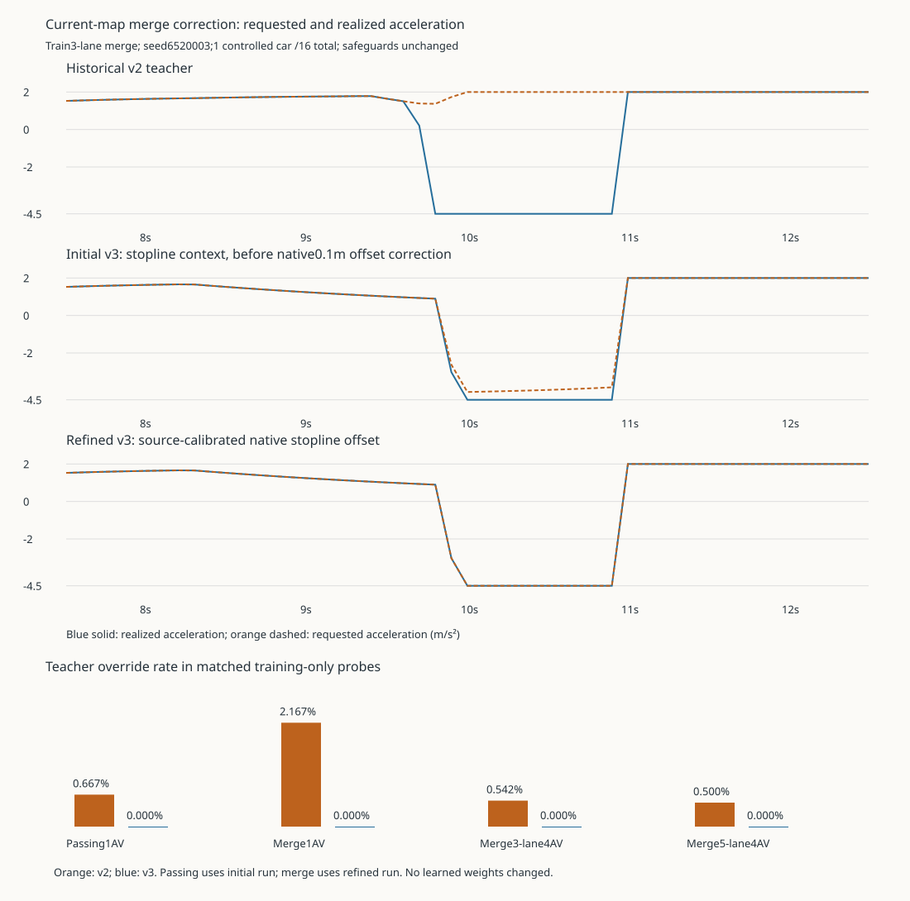

# Population v03: aligned control targets and objective telemetry

November 4, 2026, America/Los_Angeles. Implementation of the corrections proposed by the [frozen diagnostics](population-control-diagnostics-v01.md). **Training is disabled.** The phase-0 actor remains the initialization reference; no new policy competence is claimed.

## Scope fixed before validation

- Version the near-limit and merge-context correction as opt-in `control_target_version: v3`; preserve historical v2 behavior. Use only the actor's current observation/map/nearby-car data for teacher labels and reward targets. Keep native speed mode 31, lane-change mode 512, the 60 mph ceiling, 1.5 s headway and existing override thresholds.
- Share a single pure longitudinal target between v3 teacher supervision and reward. Do not use a hidden native preferred speed or future traffic state as an actor input. Keep any changed merge-field meaning explicit even though the observation width stays 93.
- Add opt-in actual actor/critic gradient norms, clipping factors and fixed-return value diagnostics, including critic warm-up. Sample expensive component derivatives once per update. Preserve the original optimizer, loss arithmetic and global clipping for the proposed first pilot.
- Count native emergency warnings separately from sampled acceleration. Missing native evidence must not pass v3 safety accounting. Preserve the historical twelve-event reconciliation rather than changing its results.
- Test with synthetic tensors and bounded train-only scripted/frozen-policy SUMO probes. Save unique raw runs, failures, configuration/source hashes and before/after metrics. No experiment optimization, held-out qualification, Isaac/GPU run or training launch is authorized here.

## Proposed pilot configuration

The final prepared configuration is [highway_population_v3.json](../experiments/configs/highway_population_v3.json). Its no-learning preflight passed. Training remains disabled pending user review. Canonical configuration SHA-256: `a0e05bb0e9c3ae303385e4101b0f1fa0ead07c8a5f6352b59f3e49f4970fe543`.

| Setting | Candidate value |
| --- | --- |
| Algorithm/runtime | Shared-actor MAPPO, centralized masked critic; headless SUMO, CPU, one worker/thread |
| Initialization | Frozen Stage 1 v03 phase-0 actor and log standard deviation; fresh population critic/optimizer |
| Observation / critic state | 93 actor fields / 752 critic fields; explicit v3 merge semantics |
| Actions | Acceleration [-4.5, 2] m/s² and masked lane delta -1/0/+1 at 10 Hz |
| Training population | 1, 2, 4, 6, 8 controlled cars; total traffic 8, 16, 24 |
| Channel conditions | No messages; local messages; local with 30% packet loss |
| Tasks | Cruise, following, passing, merge |
| Maximum training allocation | 100,000 active-agent decisions or 1,800 seconds, including 4,096 critic-warm-up decisions; 600-second final-evaluation reserve |
| Actor / critic learning rate | 0.0001 / 0.0003 |
| PPO | 4 epochs, 256-row minibatches, clip 0.2, value clip 0.2, KL limit 0.02 |
| Loss coefficients | Value 0.5; entropy 0.001; imitation 0.04; acceleration relative weight 1; lane-change relative weight 10 |
| Gradient handling | Existing global norm limit 0.5; separate measurements enabled, no clipping-mode change |
| Validation | Same sixteen full-horizon initial/final cases; controlled counts 1, 3, 5, 7, 8; no held-out selection |
| Future artifacts | `outputs/highway-population/v03/train-<unique-id>/` |
| Launch status | `training_authorized: false`; readiness and reviewed configuration checksum required |

Training seed is **9207**, with scenario seeds **6500000–6500999**. The episode control horizon is **800 steps / 80 seconds**. Existing finite-cohort accounting continues beyond the control window as documented; this does not implement continuous inflow or live slider reassignment. Safety-event logs cover the whole episode, including accounting continuation, and are not automatically attributed solely to the actor.

Reward weights remain progress 1, merge 5, passing 2, arrival 2, collision 20, intervention 0.2, jerk 0.01, lane change 0.1, feasible acceleration 0.25, unsafe request 0.5 and cooperation 0.1. The feasible-acceleration target changes, not these weights or the existing guards. Message settings remain six slots, 150 m range, 0.1 s delay and 0.5 s expiry. The exact actor input/action description and all road hashes are in the full JSON.

This is a correction pilot based on the original population optimizer settings. It removes the rejected v02 acceleration weight of 50 and adds diagnostics, rather than claiming the high weight fixed closed-loop control. Changed target/context semantics make comparison with old runs a new treatment, not identical reward/observation training. Only the initial and final evaluations within the new protocol will be directly matched.

## Verification and findings

**The target-generation defects are corrected in the tested fixtures; the learned policy is still unaccepted.** The teacher's near-limit passing and merge overrides reached zero with task completion retained. The unchanged actor improves with the new merge information but still exceeds the 5% gate, so this is a prepared training setup, not newly trained driving capability.

| Matched training fixture | Teacher override decisions, v2 → v3 | Mean speed / limit, v2 → v3 | Outcome |
| --- | ---: | ---: | --- |
| Passing, 3 lanes, 1 AV / 16 cars | 4/600 → 0/600 | 0.918770 → 0.918737 | One pass retained |
| Merge, 3 lanes, 1 AV / 16 cars | 13/600 → 0/600 | 0.676589 → 0.676461 | One merge retained |
| Merge, 3 lanes, 4 AVs / 24 cars | 13/2400 → 0/2400 | 0.781274 → 0.781404 | One merge retained |
| Merge, 5 lanes, 4 AVs / 24 cars | 12/2400 → 0/2400 | 0.926204 → 0.924081 | One merge retained |

Lane counts refer to through lanes; ramp/auxiliary lanes are additional.

Cruise/following teacher overrides remain zero in the matched probes. The frozen actor's single-car merge improves **156/600 → 67/600 overrides (26% → 11.17%)**, with mean speed/limit **0.675850 → 0.690554** and its merge retained. That does not pass the unchanged intervention gate. The low average merge speeds in some fixtures remain visible rather than being hidden behind zero teacher overrides.

Across the initial and refined comparisons: **32,400 decisions**, **190.454 seconds**, no recorded collisions, teleports, overspeed or native emergency warnings. The refined merge comparison covers three seeds, two lane counts and one/four AVs; it is not broad held-out qualification. Deterministic repeats matched complete recorded traces exactly. Teacher/reward targets now agree within **9.63e-8 m/s²** in the refined traces, attributable to float32 action encoding. Shared targets remove the previous longitudinal-label disagreement; PPO may still have competing objectives from its other rewards.

The [control findings](evidence/population-control-v03/control-findings.md), [compact evidence](evidence/population-control-v03/control-summary.json) and [offline derivation](evidence/population-control-v03/control-derive.py) retain both development attempts and exact provenance. The initial attempt omitted a native 0.1 m stop-line offset and retained eleven teacher differences. The refined attempt added the source-defined offset, rather than fitting a constant to scores. The initial runner-snapshot limitation and the subsequent static map-guard addition are explicitly recorded; historical evidence was not overwritten.

### Versioned control and target changes

- **Near-limit taper:** cap the shared target by current speed error even when no front car is visible within the local 120 m range. An absent local slot does not establish that native ACC sees no farther traffic.
- **First merge conflict:** expose the actual shared ramp-entry successor and conflict neighbors before the later auxiliary-to-through lane change. On the ramp, field 36 now describes the physical stop line, and projected lateral delta remains zero. Once on an auxiliary lane the ordinary adjacent-lane meaning resumes; internal-ramp context is marked unknown. No illegal cross-edge lane change is introduced.
- **Current-map approach model:** use the pinned SUMO 1.27.1 Euler stop-speed rule with its 0.1 m minimum stop offset and 0.001 m numerical margin. This supports 4.5 m minor-link visibility/default stop offsets; unsupported visibility and larger lane/edge offsets fail explicitly. The pinned vehicle type has no larger vehicle-specific offset. Arbitrary junction variants require a new declared contract.
- **One target:** both teacher acceleration and the reward use `longitudinal_target_v3(obs)`, based only on the actor-visible current observation. This also retains a gradual ending-lane speed target. The native safety modes and analytical guards remain unchanged.

Observation width remains **93**, but the changed merge meanings are versioned as `highway_graph_entry_and_lane_merge_v3`. Reward version is `highway_stage1_shared_longitudinal_target_v3`. Importing the old phase-0 actor is explicit initialization transfer, not proof of semantic interchangeability. Configuration, runtime reports, warm-start metadata and export contracts record this distinction. Default v2 controls, target behavior and evaluation thresholds remain available; new v3 evaluations additionally require complete native emergency logs and zero native emergency events. Legacy reruns expose the new counts without silently rewriting their original gate definition.

Native implementation references and scope are in the [control note](evidence/population-control-v03/control-findings.md#retained-revisions-and-limitations). No native preferred-speed query, future traffic trajectory or hidden simulator mode enters the actor target.

### Separate diagnostics without changing optimization

`gradient_diagnostics: true` records actor (including exploration) and critic norms before/after each actual gradient clipping step, the clipping factor and clip frequency. Once per update, the first accepted minibatch records weighted PPO, acceleration imitation, lane imitation, entropy and value derivatives plus actor-gradient cosines. It is labeled as one minibatch, not an average over all optimizer steps.

Critic MSE and explained variance use the same detached active-rollout GAE returns before/after each update. Padding is excluded and zero-variance explained variance is JSON `null`. Critic warm-up has its own phase, actor-frozen verification and critic-only clipping telemetry; its loss remains 0.5 × MSE without PPO's value coefficient. Post-warm-up PPO records actual separate actor/critic measurements. Global clipping remains 0.5 in this pilot; a later clipping ablation can use this evidence.

Tests verify that enabling diagnostics preserves weights, optimizer state, gradients and random-number state bit for bit on synthetic updates. The no-step preflight diagnostic also preserves existing gradients and RNG. No saved policy was optimized.

### Final preflight and retained artifacts

**150 CPU tests passed.** Final runtime preflight completed in **32.719 seconds**, with PettingZoo API/seed checks, exact teacher repeat, finite collection, actor export equivalence and unchanged model parameters. Its 128-row gradient sample used the frozen parent and fresh population critic; it is explicitly before warm-up, not evidence about a trained critic. The [preflight summary](evidence/population-control-v03/preflight-summary.json), [gradient measurements](evidence/population-control-v03/frozen-gradient-diagnostics.json), [test record](evidence/population-control-v03/cpu-tests.json) and [resolved configuration](evidence/population-control-v03/resolved-training-config.json) are retained. Independent review checked control-source equations, all 12,600 refined control rows, native logs, source/trace hashes and gradient instrumentation.

Raw runs remain local, not included in a Git clone:

- `outputs/population-control-v03/verify-20261105T053939Z-7e23d78b/`: initial comparison, retained unchanged.
- `outputs/population-control-v03/verify-20261105T054418Z-b5f89825/`: refined merge comparison, retained unchanged.
- `outputs/highway-population/v03/preflight-20261105T054700Z-02eee46e/`: final runtime/config preflight, source snapshots, native logs and diagnostics.

The primary actor SHA-256 remains `8526f6134b7eae90d3370bd12cc0487926a6ec4356c6c6ea2dd231e8aa8b1bb8`; parent full checkpoint SHA-256 remains `b77f55ae7262178ce0fa15729fe844e18693cd168905eea8b1bbd579c6913ab1`. No experiment training, held-out qualification, sensor/physical validation or policy promotion occurred.

After a separately authorized launch, the runner will save `last.pt`, exported `policy.pt`, per-update optimization diagnostics, native warning counts, initial/final validation, coverage and comparison JSON under the unique v03 training folder. It runs to the declared bound and produces a completion/failure summary; no assistant monitoring is necessary while it trains. Failures and resumes remain charged to the existing budget, and source/configuration changes require a new reviewed preparation rather than a silent incompatible resume.

Engineering guide synchronization and feature-branch publication are recorded with this milestone's changelog. The Google native content is read back before generating its Markdown mirror; native page layout is not a claimed validation.
