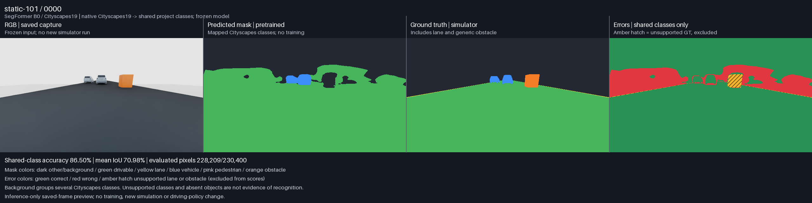
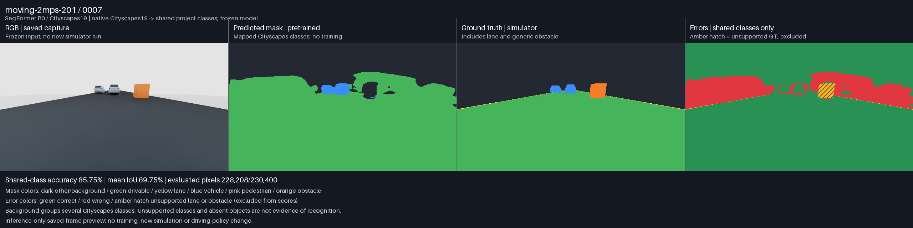
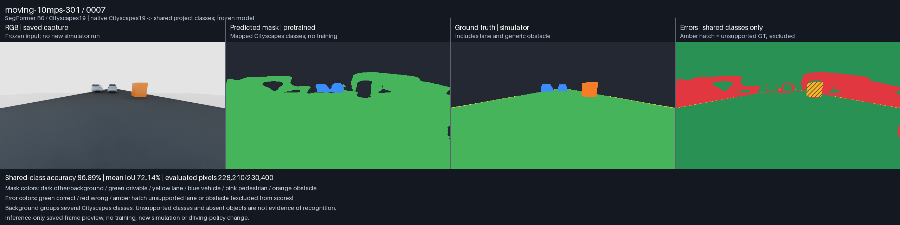

# Pretrained segmentation preview v01

October 30, 2026. Frozen RGB-only inference on the 24 existing captures from
semantic/LiDAR run `20261030T223941Z-65f18896`. **No training, new simulator run,
policy change or predicted-mask-to-LiDAR integration was performed.**

## What the preview shows

Each saved image has four full-resolution panels: original RGB, pretrained
prediction mapped to project colors, simulator ground truth, and errors.
Green error pixels match; red pixels disagree. Amber hatching identifies
ground-truth lane markings and generic obstacles that this model cannot emit.
Those pixels are counted and excluded from the shared-class score, never
reported as correctly recognized. The original 19-class prediction and mapped
mask are both retained as integer arrays.







The model detects most car pixels, but its masks extend outside the cars and
it labels substantial surrounding/background area as road. The pictures show
the actual uncorrected predictions. No thresholds, masks or model choices were
tuned after seeing these results.

## Frozen model and label contract

The model is [NVIDIA SegFormer B0 fine-tuned on Cityscapes](https://huggingface.co/nvidia/segformer-b0-finetuned-cityscapes-1024-1024),
revision **`21b3847fae21ddee674abd31129307b6a1235bd9`**. Its trained 19-class head
is loaded strictly and retained; it is not replaced with a random six-class
head. The 14,957,601-byte weight file SHA-256 is
`027ed78d8ff9c535df5a66361c92b9673cca3cb923cbeb8c5802385b6b93194c`.

| Native Cityscapes prediction | Comparison/display class |
| --- | --- |
| Road (0) | Drivable (1) |
| Person (11) | Pedestrian (4) |
| Car, truck, bus, train, motorcycle, bicycle (13–18) | Vehicle (3) |
| All remaining categories, including rider (12) | Collapsed other/background (0) |
| No native equivalent | Lane (2), generic obstacle (5): unsupported |

The background category is a comparison convenience, not a native Cityscapes
background class. Person is supported by the model but absent from these
captures, so pedestrian quality is **not evaluated**. Lane/obstacle exclusions
mean that shared-class metrics do not establish obstacle recognition.

The [pinned processor](https://huggingface.co/nvidia/segformer-b0-finetuned-cityscapes-1024-1024/blob/21b3847fae21ddee674abd31129307b6a1235bd9/preprocessor_config.json)
actually uses 512×512 input, despite the repository's 1024 name. This preview
keeps that default: bilinear square resize of 640×360 RGB, 1/255 rescaling and
ImageNet normalization. It therefore stretches the aspect ratio. Output logits
are resized back to 360×640 with bilinear interpolation (`align_corners=False`)
before argmax. No ground truth, depth, LiDAR or simulator identity enters the
model. Legacy processor-field warnings were checked: actual
`do_reduce_labels=False` matches the saved processor contract.

Weights remain local. The model card references the
[NVIDIA SegFormer license](https://github.com/NVlabs/SegFormer/blob/master/LICENSE)
for noncommercial research/evaluation; no weights are redistributed here.
Attribution: Xie et al., [SegFormer: Simple and Efficient Design for Semantic
Segmentation with Transformers](https://arxiv.org/abs/2105.15203), 2021.

## Measured results

Inference run **`20261031T020708Z-69f78dab`** completed all 24 images. Execution
checks pass; **model quality is not accepted for driving**. Scores pool pixel
counts, not averages of frame percentages. Mean IoU uses classes with nonzero
prediction/ground-truth union; only background, drivable and vehicle qualify.

| Saved capture group | Images | Shared-class accuracy | Mean IoU |
| --- | ---: | ---: | ---: |
| Static | 8 | 87.29% | 71.77% |
| Lead 2 m/s | 8 | 86.51% | 70.25% |
| Lead 10 m/s | 8 | 86.89% | 72.58% |
| All images | 24 | **86.89%** | **71.52%** |

| Shared class | IoU | Pixel recall | Pixel precision |
| --- | ---: | ---: | ---: |
| Other/background | 70.28% | 70.35% | 99.85% |
| Drivable | 81.18% | 99.64% | 81.42% |
| Vehicle | 63.11% | 99.39% | 63.36% |

The model captures nearly all GT vehicle pixels, but vehicle precision is much
lower because of extra predicted vehicle area. Road/background dominance also
makes overall accuracy an incomplete quality measure. Exactly 52,586 of
5,529,600 pixels (0.951%) are unsupported GT: 9,362 lane and 43,224 obstacle
pixels. All per-frame counts, exclusions and confusion matrices are preserved
in [compact results](evidence/pretrained-segmentation-preview-v01/results.json).

Excluding unsupported regions also removes some false vehicle predictions from
the shared-class precision denominator. A separate all-image diagnostic gives
**59.94% vehicle precision**. On GT obstacle pixels, predictions are 83.02%
collapsed other, 10.20% road and 6.79% vehicle; 97.87% of GT lane pixels become
road. Those outcomes are explicitly retained and are not obstacle/lane detection.

The full execution took 11.99 s, including loading and rendering previews.
CPU preprocessing/forward/resize/argmax latency was 220 ms median and 246 ms p95
per image on this workstation; these are offline timings, not a real-time
driving guarantee. The environment is isolated Python 3.11, PyTorch 2.9.1+cpu,
Transformers 4.57.1, Pillow 11.3.0 and NumPy 2.2.6, with two intra-op CPU threads
and one inter-op thread. No CUDA inference was used.

Validation: **26 focused tests pass**. Independent review verified all 105
output hashes, 48 RGB/GT input hashes, five source hashes and three model-file
hashes/sizes. All 24 frame metrics and all 96 panels were independently checked
against their saved source arrays. The first image produced identical predictions on a repeat.
Strict weight loading reports no missing/unexpected keys; evaluation mode,
disabled gradients and unchanged source weights are recorded. Original captures
and existing policy/training files remain unchanged. The run records base commit
`9641d92` plus the exact new-source snapshots and hashes.
The 26 tests also pass from a fresh archive of committed source `c98ca34`,
without unrelated untracked workspace tools. The clean-source verification log
is retained under `outputs/validation/segmentation-preview-clean-c98ca34/`.

## Reproduce without training or a simulator

The existing capture run must be present under the relative path in
[`pretrained_segmentation_preview_v01.json`](../configs/perception/pretrained_segmentation_preview_v01.json).
Raw captures and weights are not included in a Git clone. From the project root,
create an isolated environment if needed; do not install these packages into
the SUMO/traffic or Isaac runtimes:

```powershell
py -3.11 -m venv runtimes/perception-preview/venv
./runtimes/perception-preview/venv/Scripts/python.exe -m pip install -r environments/requirements-perception-preview.lock.txt
./runtimes/perception-preview/venv/Scripts/python.exe scripts/fetch_segmentation_preview_model.py --check
./runtimes/perception-preview/venv/Scripts/python.exe -m experiments.preview_pretrained_segmentation --check
./runtimes/perception-preview/venv/Scripts/python.exe -m experiments.preview_pretrained_segmentation
```

The first inference invocation downloads only the three pinned model files if
they are absent. Existing caches must match their checksums; corrupt or partial
caches fail without being overwritten. Restricted `torch.load(weights_only=True)`
and strict loading use local built-in model code. No remote model code executes.

Each fresh run saves model/source/input hashes, exact package versions, processor
settings, native and mapped masks, 24 four-panel previews, confusion matrices,
per-image timings, a repeat check and an immutable manifest. This run lives at
`outputs/perception-preview/v01/20261031T020708Z-69f78dab/`; the console log is
`logs/pretrained-segmentation-preview-20261031T020707Z.log`.

## Limits and next decision

These are 24 correlated frames from three short synthetic fixtures, with a
parked ego and simple scenery. They are not an independent road-driving test
set. No pedestrian sample, learned lane-marking or generic-obstacle prediction,
prediction-to-LiDAR evaluation, temporal tracking or policy integration is
established. A future comparison should measure class boundaries and false
drivable space across more varied saved scenes before using predicted masks
as driving observations. Any new data capture or training remains a separate
decision; this preview performs neither.
