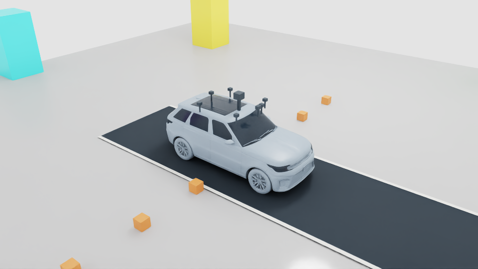
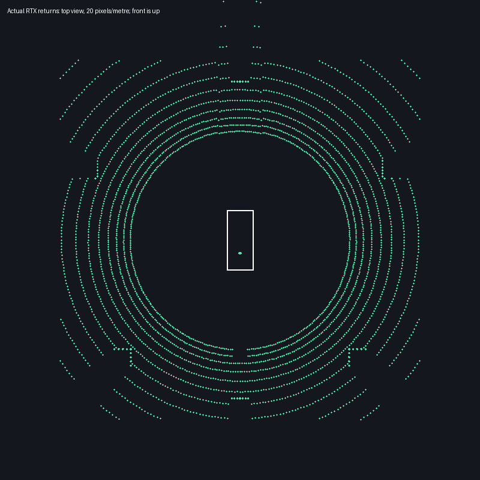

# Roof LiDAR v01: combined seven-camera validation

October 26, 2026. Source version v10; no training or new learned controller.

The reusable local source is `vehicles/sim_ready/americano-i7-ev/v10/assets/vehicle.usda`.
Its sensor layer migrates `LidarFront` to `LidarRoof`, with the runtime scanner at
`Chassis/Sensors/LidarRoof/Scan`. The mount is centered at chassis XYZ
`(0, 0, 1.45)` m, 20 cm above v09's already roof-mounted LiDAR. Its housing and
support were adjusted in the actual source layer. All seven cameras remain.
Vehicle mass/collisions are unchanged; housings/supports are visual only.
v08/v09 and frozen demonstrations retain their historical paths and results.

`usd/roof_lidar_rig.py` prepares a new source version from v09.
`sensor_paths(chassis, lidar_name='LidarRoof')` selects the new path explicitly;
the legacy default remains for earlier sources. The runtime handle and v10
metadata use the new path. This is not a global rename of old checkpoints or
sensor packet contracts. Private source geometry remains local and ignored.

## Results

Run `python -m experiments.verify_roof_lidar` in the traffic environment to
launch the isolated Isaac runtime. It refuses a competing Kit process and
records a unique run. PhysX is the sole vehicle motion owner; the bounded
scripted throttle/brake test does not load or train a policy.

Native run **20261026T192146Z-40b994ce** passed the combined-capture gates:

- Six simulated seconds; 720 physics steps, 120 renders, 21.69 wall seconds
  including startup. This is not a real-time throughput benchmark.
- 119 complete LiDAR scans and 59 valid images from each of seven cameras.
- LiDAR returns on all six 1.6×1.6×3 m targets at 14 m radius, headings
  0°, ±65°, ±135°, 180°. Every camera also saw its assigned target.
- 0.6299 m vehicle travel, stable camera mounts, zero contacts, unchanged source
  hashes, and no saved-scene composition errors. `/Render` is runtime-owned.
- 94 CPU capture/LiDAR tests and 22 USD source/composition tests passed.

Source bounds confirm all camera housings/supports are below the LiDAR origin.
This geometric check does not prove every downward beam clears the hardware:
1,666 returns fell in a broad vehicle-roof region across the run. That metric
does not identify which body or sensor component caused each return.

**Near-field limitation:** none of the six 30 cm cubes at lateral distances
2, 4 and 6 m were detected. These were diagnostic measurements, not passing
acceptance gates. The retained Example_Rotary low-speed profile has 32 emitter
elevations from −15° to +10°, 20 Hz scans and a configured 0–360° azimuth span.
The raised origin and shallow downward beams leave a substantial near-ground
blind area. Detecting large targets around the vehicle is not proof of complete
360° obstacle coverage. A short-range/perimeter sensor or a separately validated
wider vertical profile is still needed for those cases. No such sensor was
silently added, and the existing profile was not broadened to pass this test.

Depth, exact target positions and raw world-coordinate LiDAR returns are used
only by the evaluator. Actor observations are unchanged. Motion compensation,
highway-speed sensing, learned fusion and close-range obstacle avoidance are
not validated here. No new training was started.

## Actual evidence

The point plot is a projection of actual recorded returns, not a generated
illustration. White rectangle indicates the approximate car footprint.
[Full metrics, profile readback and source hashes](evidence/roof-lidar-v01/result.json).
Raw run data is under `outputs/roof-lidar/v01/20261026T192146Z-40b994ce`;
the runtime log is under `logs/roof-lidar/`.
