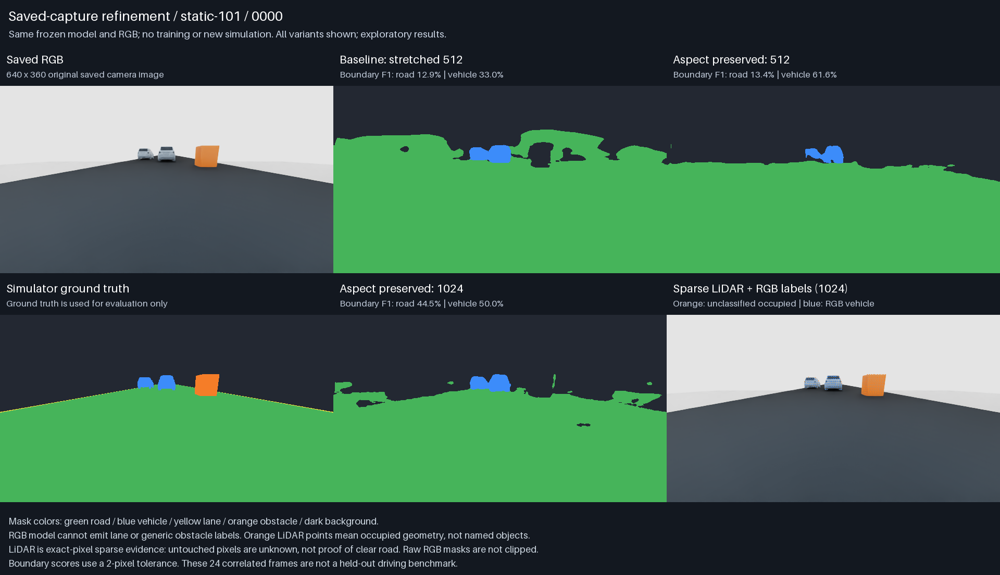
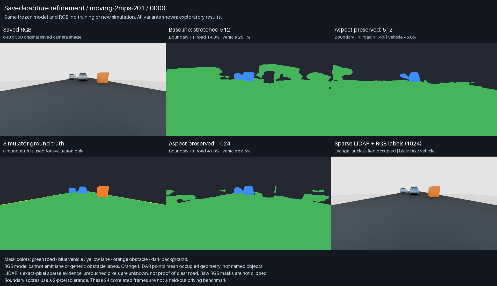
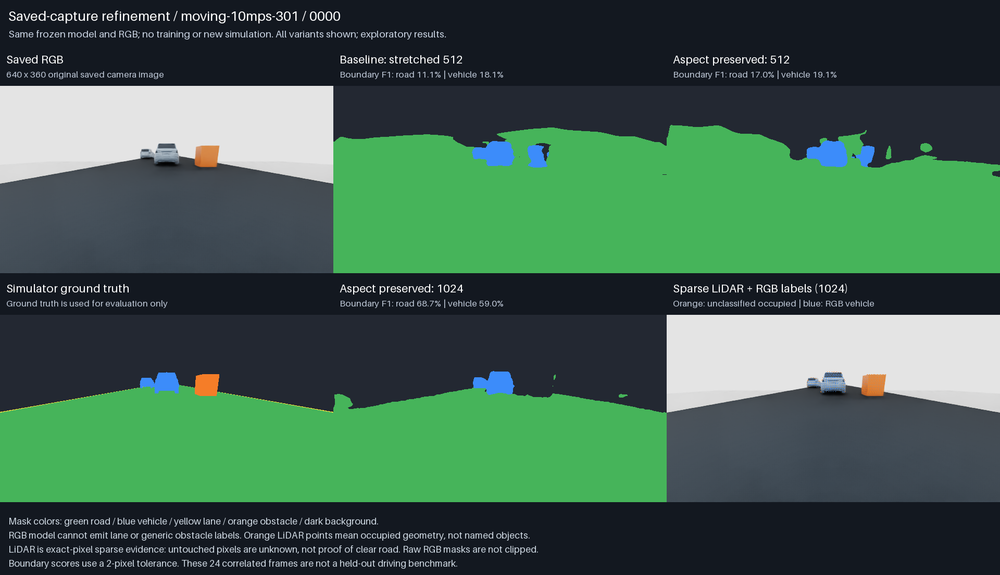
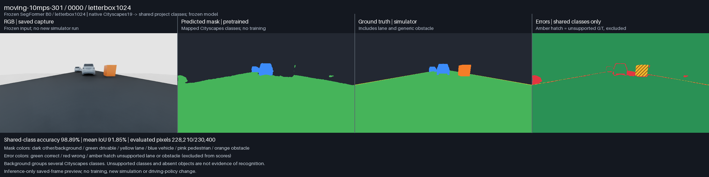

# Saved-capture segmentation refinement v02

October 31, 2026. Three sub-agents implemented/reviewed preprocessing and boundary
metrics, LiDAR geometry, and a disabled training proposal. **No training, new
simulator runs, scene edits or MAPPO changes occurred.** The same frozen
Cityscapes SegFormer B0 was evaluated on the 24 existing static/2/10 m/s captures.

## What improved

| Metric (24 frames pooled) | Stretched 512 baseline | Aspect-preserving 512 | Aspect-preserving 1024 |
| --- | ---: | ---: | ---: |
| Shared-class mean IoU | 71.52% | 84.56% | 86.06% |
| Road pixel precision, shared classes | 81.42% | 94.77% | 95.19% |
| Vehicle pixel precision, shared classes | 63.36% | 74.50% | 70.79% |
| Vehicle pixel recall | 99.39% | 88.52% | 99.57% |
| Road boundary F1, 2 px | 12.46% | 22.63% | 46.27% |
| Vehicle boundary F1, 2 px | 29.94% | 53.20% | 50.68% |
| Non-road GT pixels falsely called road | 28.48% | 6.80% | 6.25% |
| GT obstacle pixels falsely called road | 10.20% | 0.0046% | 0.146% |
| CPU median inference | 218 ms | 232 ms | 508 ms |

Preserving aspect ratio reduces spillover considerably. The 1024 variant retains
car recall and gives the highest shared-class IoU and road-boundary score; 512
has better vehicle precision/boundary F1 but misses more vehicle pixels. Neither
has accurate enough boundaries to call this solved. Both still classify the
orange obstacle primarily as other/background, not as an obstacle. This is an
exploratory comparison on already-inspected correlated frames, not independent
test performance or a deployment decision.

Shared-class metrics retain the v01 exclusions: GT lane and generic-obstacle
pixels are excluded and counted. All-image vehicle precision, including those
regions as negatives, is 59.94%, 72.70%, and 70.73% respectively. The new
false-drivable measure includes obstacles: numerator is predicted road on GT
non-road/non-lane pixels, denominator is all GT non-road/non-lane pixels.
Raw counts and the alternative predicted-road denominator are retained.

## Actual screenshots

Each grid contains saved RGB, the three actual predictions, simulator GT and
exact-pixel LiDAR occupancy with RGB labels. No GT clipping, mask erosion,
dilation, cleanup or prediction retouching was performed.







Four-panel RGB/prediction/GT/error views are saved for every frame and variant.
Green means shared-class correct, red wrong, amber unsupported lane/obstacle.



## Frozen model and preprocessing

Model, revision, original trained 19-class head and license remain as recorded
in [v01](pretrained-segmentation-preview-v01.md). Restricted weights-only loading,
strict state matching, eval mode, disabled gradients, CPU-only inference and
unchanged weight checksums are retained. GT and oracle IDs enter only after RGB
prediction and geometric processing, for evaluation.

- `square512`: 640x360 stretched to 512x512, exactly reproducing v01.
- `letterbox512`: resize to 512x288, pad 112 pixels above/below to 512x512.
- `letterbox1024`: resize to 1024x576, with no padding needed for these inputs.

Padding uses rounded ImageNet-mean RGB (approximately zero after normalization).
Normalization remains the pretrained processor's; its second resize is disabled.
Logits are bilinearly restored before argmax. For padded images, resize logits
to the input canvas, crop padding, then resize to the original image. The 1024
variant changes both resolution and padding context, so this is not a pure
resolution ablation. Upscaling does not create new sensor detail.

Boundary metrics use foreground-side internal four-neighbor edges with a
two-original-pixel Euclidean tolerance, independently in both directions.
Frame borders alone are not edges. GT road extent includes lane markings to
avoid treating paint as the external road boundary. Vehicle boundaries include
all image classes as negatives. Empty denominators are null; counts are pooled.

## Independent LiDAR occupancy

Geometry uses only measured WORLD XYZ, valid-return flags, saved intrinsics and
camera pose, and timestamps. A deterministic 128-trial RANSAC fit uses at most
4,096 sampled timely returns, favors approximately horizontal ground, and must
have 30% support and sufficient spatial extent. The plane is inferred from
measurements, not simulator road coordinates. Points 0.15–3 m above the plane
and within 60 m are occupied candidates. Ground fit failure abstains.

Projection applies the existing 50 ms age/future rejection, image/depth-range
checks and sparse z-buffer occlusion check. Semantic assignment additionally
uses a two-pixel mask-boundary margin. RGB masks stay unchanged: occupied points
receive a vehicle/pedestrian label only when supported by RGB; otherwise they
are displayed as orange **unclassified occupancy**. Missing samples are unknown.

Across 24 frames, geometry is identical for all RGB variants:

- 10,437 true occupied points, zero false positives, 741 missed positive points
  among visible/timely samples: **100% point precision, 93.37% point recall**.
- Generic-obstacle occupancy: **4,540/5,085 eligible points (89.28%)**, or
  **4,540/5,106 projectable points (88.92%)** including rejected samples.
- Vehicle occupancy: 5,897/6,093 eligible points (96.78%). No pedestrians present.
- No plane failures or invalid occupied timestamps; ages 0.128–49.993 ms.

These are point-level occupancy results on simple fixtures, not object detection,
dense obstacle segmentation or general safety performance. Ground contact points
below 0.15 m are intentionally omitted. Sparse occlusion cannot detect every
camera-visible foreground surface; ego motion, deskew, slopes and complex
multi-level roads remain unverified.
An evaluation-only rendered-depth audit found 163/10,289 occupied points with
valid depth (1.58%) behind the camera-visible surface; 148 occupied points had
no valid depth reference. Rendered depth never enters inference.

Actual predicted semantic labels projected onto LiDAR are **89.93%, 92.29%,
93.74% accurate** for baseline/512/1024, with assignment coverage 95.31%, 93.03%,
92.91%. This evaluator counts unsupported obstacle/lane labels as wrong, unlike
the RGB shared-class metric. Generic-obstacle semantic recall is still zero.
The earlier GT-mask cloud was 99.95% accurate at 92.90% coverage; its near-perfect
score cannot be claimed for predicted masks. Geometric occupancy's 100% precision
is also not semantic accuracy.

## Reproduction and evidence

Run: **`20261031T211308Z-4e1fb1a4`**, under
`outputs/perception-refinement/v02/`. It finished in 41.01 seconds and preserves
72 predictions, transforms, per-frame metrics, per-point arrays, 72 four-panel
screenshots, 72 occupancy overlays and three comparison grids. Console log:
`logs/segmentation-refinement-preview-v02-20261031.log`.

```powershell
./runtimes/perception-preview/venv/Scripts/python.exe -m experiments.preview_segmentation_refinement --check
./runtimes/perception-preview/venv/Scripts/python.exe -m experiments.preview_segmentation_refinement
```

The isolated environment remains Python 3.11, PyTorch 2.9.1+cpu, Transformers
4.57.1, Pillow 11.3.0 and NumPy 2.2.6, with two CPU inference threads. Raw captures
and model weights remain local/ignored, not included in a Git clone.

Independent audit verified all 12 runtime-source hashes, 96 input hashes and
450 output hashes, recomputed all 72 metrics, and checked 306 screenshot panels
against saved arrays. All 24 baseline masks are bit-identical to v01. First-frame
repeat checks pass for all variants. Source/input/weights remained unchanged.
The compact [results](evidence/segmentation-refinement-preview-v02/results.json)
include the independent audits. Actual grids and error PNGs were inspected.
The combined focused suite passes **98 tests**, covering preprocessing parity,
padding restoration, boundaries, geometric abstention, occlusion/timestamps,
source contracts and the existing fusion/preview behavior.

## Proposed training, not started

See [the proposed specification](segmentation-refinement-training-proposal.md)
and [disabled JSON](../configs/perception/segmentation_refinement_training_v02.proposed.json).
It proposes six-class SegFormer B0 fine-tuning on 3,600 future images, with whole
scene/asset-family splits, weighted CE + Dice + boundary loss, effective batch
16 and a maximum 20 epochs / 3,600 updates / two-hour budget. The 640x384 padded
training input is a proposed memory-conscious choice, not a measured variant in
this comparison. Its actual preflight still needs to be evaluated.

The dataset, trainer, six-class evaluator and CUDA perception environment are
not ready. The existing 24 frames remain regression-only. No training launch
command exists for this proposal and all launch flags are disabled. New data
capture and training are separate future decisions. MAPPO observations and
accepted policies remain unchanged.
