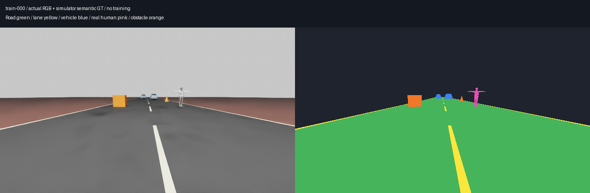
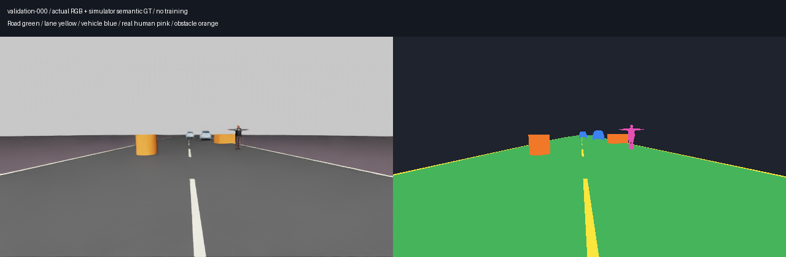
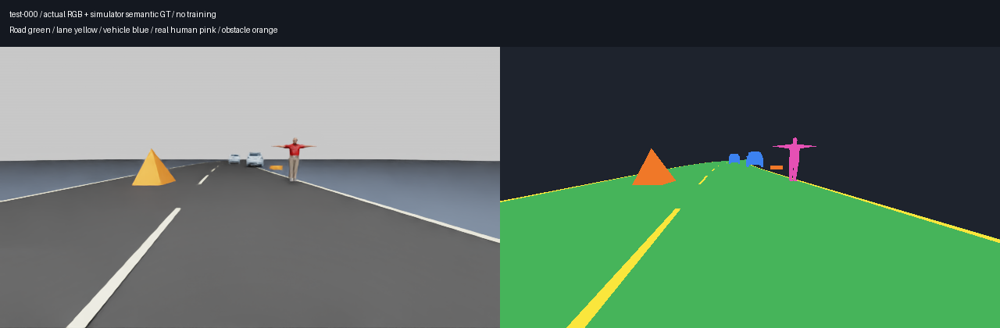
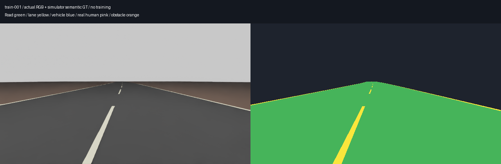

# Segmentation training preparation v02

October 31, 2026 (local Pacific date; artifact IDs use UTC). This milestone
prepares supervised RGB segmentation, not MAPPO. Three sub-agents implemented
the dataset capture, trainer and isolated CUDA preflight. Full training remains
disabled pending review of the final configuration.

## Dataset and scope

The captured corpus has 3,600 native RTX images, semantic masks, instance IDs,
evaluation-only depth and camera metadata: 180 whole scene groups with 20 frames
each, split into 144/18/18 groups (2,880/360/360 images). All prior 24-frame
previews and 60-frame smoke data are excluded. No learned model labels the data.

The six labels are background, road, lane marking, vehicle, pedestrian and
obstacle. The camera has the front sensor's 640x360 resolution and pinhole
intrinsics, with varied camera height/pitch. These are scripted visual scenes,
not physical driving or sensor-to-policy validation. RGB is the only model input;
semantic labels are supervised targets. Depth and instance metadata are for
future evaluation, never RGB model inputs.

Whole road families, obstacle families and pedestrian identities are reserved
before capture. Training uses constant-curvature roads and boxes/cones;
validation uses slow S-bends and cylinders/barriers; test uses tighter S-bends
and pyramids/low cylinders. One prepared Americano vehicle visual is shared
across splits, so this does not test unseen vehicle identity. Every sixth scene
is an empty-road negative. Every sixth scene at a different index guarantees
foreground class coverage; the remaining scenes vary distances and occlusion.

The three real NVIDIA Isaac 6.0 human assets are `female_adult_police_02`,
`male_adult_construction_03` and `male_adult_police_04`, assigned respectively to
train, validation and test. Their measured source heights are about 1.84, 1.94
and 1.92 m. They remain in static rigged rest poses. This is not walking-person
coverage, photoreal highway diversity or real-world perception evidence.
Riders, bicycles and motorcycles are excluded. Vendor assets remain local;
the checked-in asset manifest records official URLs, hashes and license context.

Scene composition separates Environment, Vehicles, Cameras and Lighting,
references reusable road/prop/vehicle/human components and records transient
pose/visibility opinions separately. Saved stages retain composition and
portable paths. Runtime `/Render` and `/Replicator` namespaces are documented
exceptions. Published source assets are checked for changes.

The manifest validator checks all file hashes, dimensions, class IDs, exact RGB
duplicates, per-group frame inventory, fixed family/identity assignments and
all-six-class support in each split. An 8x8 perceptual-hash diagnostic flags
similar road silhouettes for review; it is not proof of duplication. A reviewed
manifest must bind both the reported pair list and the complete frame inventory.
Original capture evidence is retained rather than overwritten by that review.

## Actual preparation results

Full native run `20261101T005956Z-51a9fc5b` captured all 3,600 frames in 180 scenes.
Native capture took 452.4 seconds; launcher and finalization took 476.01 seconds.
All six classes occur in every split. Independent verification passed 18,757 output
hashes, seven captured source hashes, 18 original asset hashes, all frame metadata
and all 180 composed-scene checks. Three split stages also reopened from a different
working directory. Plain USD cannot resolve the runtime-provided `OmniPBR.mdl`;
the native Isaac captures resolved that material dependency.

The original manifest remains unchanged with only `near_duplicate_review_pending`.
The separate `reviewed-dataset-manifest.json` passes readiness and is hash-bound in
the final training config. No exact duplicate RGB images or RGB/mask pairs occurred.
The first 100 low-resolution perceptual-hash matches had actual RGB mean absolute
differences of 9.60–27.65/255. Six representative pairs and four supplemental
cross-split pairs were visually reviewed: different layouts/foreground objects
share a similar horizon. This is a bounded review, not an exhaustive visual audit
or evidence of real-world generalization. Whole scene/family checks cover the full
inventory. See [dataset evidence](evidence/segmentation-training-preparation-v02/dataset-evidence.json).

Three smoke attempts are retained under `outputs/segmentation-dataset/v02/`:
`20261101T005403Z-dbef8b40` captured 12 frames but finalization lacked Pillow;
`20261101T005700Z-a3078590` completed the pipeline but missed pedestrian support
in validation; `20261101T005839Z-cbcffc9c` passed all six classes after correcting
foreground occlusion and human semantic labeling. The full run uses those fixes.

Actual capture screenshots (left RGB, right simulator ground truth):









These are ground-truth data checks, not predictions from a trained six-class model.
The new corpus has no LiDAR or motion vectors. Prior 24-frame LiDAR regression
captures stay separate and cannot substitute for fresh-corpus fusion evaluation.

## Trainer

`experiments.train_segmentation` provides a no-learning `--check`, a guarded
training path, resumable atomic `last.pt`/`best.pt`, and frozen checkpoint
evaluation. Training requires both authorization flags, reviewed dataset gates
and verified CUDA readiness. It refuses competing known Isaac/compute processes;
ordinary desktop graphics are recorded rather than treated as a training job.

The original 19-class pretrained state is checksum-verified and loaded strictly,
then only the final classifier is replaced with a six-class head. That head is
untrained and has no meaningful recognition result yet. Inputs are normalized
before exact-zero padding to 640x384; logits are resized and unpadded to the
original 640x360 label resolution.

Loss is weighted cross entropy + 0.5 foreground soft Dice + 0.2 boundary Dice.
Class weights come only from training pixels. Ignored pixels and their boundary
neighborhoods are excluded. Six-class evaluation counts lane/obstacle predictions
and ground truth, unlike the earlier shared-class preview. Road boundary extent
merges road and lane; false-drivable area excludes GT road/lane/ignore from its
denominator and includes vehicles, pedestrians, obstacles and background.

Checkpoints retain model, optimizer, scheduler, scaler, RNG, epoch permutation
and cursor, update count, accumulated wall time and config/data identity. A failed
partial accumulation group never overwrites a completed-update checkpoint.
Validation alone selects the best checkpoint. Frozen test evaluation requires a
validation-selected checkpoint and cannot choose a training checkpoint.

Instance-object matching, distance/size stratification and motion-compensated
temporal flicker remain follow-up evaluation gates. The trainer reports their
absence rather than presenting six-class pixel metrics as full driving acceptance.
Confidence export and validation-calibrated abstention are also deferred; current
evaluation uses six-class argmax. Scene-bootstrap intervals and matched fresh-corpus
frozen-model/LiDAR comparisons are not implemented in this milestone.

## GPU preflight

Run `20261101T011205Z-5456aadf` passed in the isolated perception-training runtime:
Python 3.11, PyTorch 2.9.1+cu128/CUDA 12.8, Transformers 4.57.1, NumPy 2.2.6 and
Pillow 11.3.0. Hardware was RTX 5070 (12,227 MiB), driver 621.01, native sm_120.
Isaac capture had exited before this run. Isaac's native Python 3.12.13 and the
traffic runtime were not modified; installed Isaac version is 6.0.1-rc.7.

Four train-mode forward/backward microbatches of four images produced finite
losses and gradients (gradient norm 14.3906 before clipping). AdamW moment tensors
were allocated to include their storage, but **zero optimizer steps** ran. Parameter
hashes match before/after; three changed BatchNorm buffers were restored and the
full-state hash also matches. The original pretrained weight file is unchanged.

Peak allocated memory was **1,475.64 MiB**, reserved **1,754 MiB**. First-use kernel
warmup took 18.89 seconds; later resident-input forward/backward microbatches took
48–56 ms. The 39.79-second compute-only epoch extrapolation excludes loading,
augmentation, optimizer steps, checkpointing and contention, so it is not a runtime
promise. Eval forwards reused the same training inputs; no held-out scoring occurred.
See [preflight results](evidence/segmentation-training-preparation-v02/gpu-preflight.json).

The final config retains microbatch four, accumulation four and scaler 128. Its
readiness metadata was updated after the successful preflight; actual model/loss/
batch hyperparameters are unchanged. Subsequent trainer-only fixes reject a missing
or checksum-mismatched dataset manifest before constructing a model. No trained
checkpoint or new model-quality claim is produced by this milestone.

## Verification and retained evidence

The focused segmentation, dataset, preview and LiDAR regression suite passes
**139 CPU tests**, including 29 trainer tests, seven preflight tests and five new
dataset tests. The same 139 tests also pass from a clean archive of commit
`81cf626`, without copying generated data or runtimes into that archive. Missing or changed reviewed manifests are rejected before model
construction. The final no-learning trainer check revalidates the real dataset.
Raw captures, full manifests, logs, CUDA runtime and weights stay local under
ignored `outputs/`, `logs/` and `runtimes/`; GitHub contains source, pinned setup,
compact evidence and actual screenshots. A clone does not include the dataset.

## Proposed launch configuration

The resolved [configuration](../configs/perception/segmentation_training_v02.json)
keeps `launch_enabled=false` and `training_authorized=false`.

| Setting | Value |
| --- | --- |
| Model | SegFormer B0, pinned Cityscapes initialization, new six-class classifier |
| Input | RGB 640x360, zero-padded after normalization to 640x384 |
| Optimizer | AdamW, encoder LR 3e-5, decoder/head LR 3e-4, weight decay 0.01 |
| Batch | Microbatch 4, accumulation 4, effective batch 16 |
| Precision | FP16 autocast, FP32 loss, GradScaler initial scale 128 |
| Schedule | 180-update warmup, cosine decay through update 3,600 |
| Seed | 20261102, one initial training seed |
| Budget | At most 20 epochs, 3,600 updates or two hours including validation |
| Early stopping | Five validation epochs without 0.001 score improvement |
| Selection | Half six-class mean IoU + half mean road/vehicle boundary F1 at 2 px |
| Checkpoints | `outputs/perception-training/segmentation-refinement-v02/<run>/best.pt` and `last.pt` |

These are pilot limits, not an achieved quality level. The two-hour cumulative
training/validation-loop budget is checked between optimizer updates and validation
batches. It excludes initial dataset QA/model loading and allows one in-flight unit
plus checkpoint-save overshoot; it is not a promise to finish all epochs. Research targets remain provisional
and do not establish real-world safety or real-time suitability.

## Reproduce preparation

Keep perception dependencies separate from Isaac and traffic Python. The CUDA
runtime is pinned in `environments/requirements-perception-training.lock.txt`;
the CPU preview runtime can launch data preparation and validation.

```powershell
./runtimes/perception-preview/venv/Scripts/python.exe scripts/fetch_segmentation_dataset_assets.py --check
./runtimes/perception-preview/venv/Scripts/python.exe -m experiments.prepare_segmentation_dataset_v02 --check
./runtimes/perception-preview/venv/Scripts/python.exe -m experiments.train_segmentation --check
```

Actual capture is a separate no-learning invocation of the preparation module;
GPU preflight is `experiments.preflight_segmentation` in the isolated CUDA runtime.
The trainer's ordinary invocation is deliberately blocked until final review and
explicit training authorization. No trained six-class checkpoint is produced by
this preparation milestone.
