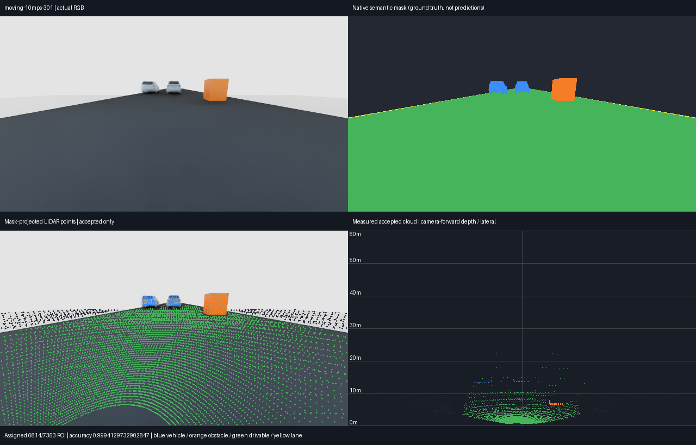

# Semantic mask and LiDAR fusion v01

October 30, 2026. Scope: implement calibrated semantic-mask projection onto
actual RTX LiDAR returns, validate static captures before moving traffic, and
retain screenshots and metrics. No model optimization or driving-policy change
is authorized or performed by this work.

## Measurement contract

The prepared v14 vehicle retains its front pinhole camera and five RTX scanners.
CameraFront is a 640×360 perspective camera with a 120-degree horizontal field
of view, not a fisheye projection. Intrinsics are read from the live USD camera
attributes. The USD camera-to-world matrix uses row vectors, -Z forward and +Y
up; world coordinates use metres and Z-up. LiDAR XYZ is already in WORLD space
and must not receive a second sensor-to-world transform.

The pure NumPy fusion module projects each successful finite return into the
image at its recorded capture pose and samples the integer semantic mask.
It rejects invalid returns, future/stale timestamps, points outside the clipping
range or image, sparse LiDAR depth occlusion, ambiguous semantic boundaries,
unknown labels and low supplied confidence. Rejected points remain explicitly
unassigned (-1), separate from valid background class 0. Every input point
retains its projected position, selected class, time difference and reason.

Current masks are native simulator ground truth. The implementation accepts
predicted class masks/confidence in the same calibrated interface, but no
segmentation model has been trained or validated here. RTX object IDs are
resolved to semantic ancestor labels in a separate evaluation writer. They
never determine fused labels. Rendered camera depth likewise stays evaluation
only and measures remaining camera-visibility errors.

## Protocol and acceptance

[`semantic_lidar_fusion_v01.json`](../configs/perception/semantic_lidar_fusion_v01.json)
declares eight frames per fixture, captured at 10 Hz after at least 1.2 s warm-up. A parked,
braked PhysX ego vehicle observes reusable scripted traffic and a stationary
obstacle. The static fixture must pass before 2 m/s and 10 m/s traffic cases
are attempted. Ego motion is not commanded; this is a sensing fixture, not
physical policy validation. Each capture runs in a fresh isolated Isaac process
with a 180-second wall budget and writes only inside the project.

Fusion uses a 50 ms maximum timestamp difference, a 2-pixel sparse depth cell,
0.15 m depth tolerance and 2-pixel semantic boundary margin. Future returns
more than 10 microseconds beyond image time are rejected. This is time gating,
not moving-object deskewing. The native camera uses a synchronous render-barrier
caller timestamp; its annotator does not guarantee an independent acquisition
clock. Moving tests must show changing RGB/mask buffers and increasing LiDAR
timestamps.

Rendering aligns with the absolute 20 Hz native sensor clock; captures align
with the 10 Hz camera clock, accounting for startup physics ticks. A bounded
render-only barrier drains pending sensor outputs at the unchanged simulation
time. It requires current scan ends before reading the image, and records each
extra render, eligible return count and actual age. Timestamps are never shifted
to make stale packets pass. The prepared asset's `car` semantic is explicitly
mapped to the shared `vehicle` class in both native mask and oracle decoding.

Declared gates: assigned-point class accuracy at least 97% static / 95% moving,
vehicle and obstacle accuracy at least 90% with at least 20 evaluated points
per class, at least four frames containing assigned vehicle returns, at least
20% coverage of all successful finite in-image points before rejection, and
at least 98% independent oracle coverage. Rejected points and class-specific
coverage are reported to prevent high accuracy from hiding low assignment.
Rendered-depth occlusion errors are reported separately. Negative controls
check stale timestamps and incorrect camera calibration.

Moving acceptance additionally requires each of the two traffic actors to have
at least 20 assigned returns across four frames, at least 90% correctly labeled
vehicle returns, and nonzero displacement from its captured composed USD pose.
Evaluation-only object IDs identify each actor by prim ancestry. This is an
independent support check, not learned tracking or a complete object-recall test.
The stale-time control is a required rejection gate; the incorrect-calibration
and rendered-depth comparisons are diagnostics rather than pass/fail gates.

## Reproducibility and artifacts

Run from the project root in the traffic environment:

```powershell
.\.venv-traffic\Scripts\python.exe -m experiments.verify_semantic_lidar_fusion --phase static
.\.venv-traffic\Scripts\python.exe -m experiments.verify_semantic_lidar_fusion --phase all
```

The launcher uses the configured external Isaac runtime and refuses to overlap
an active Isaac/Kit process. Prepared v14 assets are a local prerequisite; they
are not embedded in this feature's Git changes. The original sensor preparation
work, old captures and trained MAPPO actors remain intact. New code does not
import the uncommitted dataset-preparation tools.

Each unique `outputs/semantic-lidar-fusion/v01/` run saves source/config hashes,
logs, actual RGB and semantic images, evaluation-only depth, all raw returns and
object IDs, per-ray timestamps, per-frame camera calibration/transforms,
fused point clouds, rejection/coverage/accuracy metrics and rendered evidence.
Scene assets remain referenced; traffic motion is authored in a separate live
layer. Saved initial scenes retain composition. Runtime-owned `/Render` and
sensor graph namespaces are exceptions, not authored asset hierarchy changes.

Sparse LiDAR depth cannot resolve foreground visible only to the camera.
Moving-object deskew, inferred poses, camera model uncertainty, weather,
perception errors and integration into the MAPPO observation adapter remain
separate work. A clean simulator label projection does not establish those
capabilities or authorize training.

## Verified results

Run **`20261030T223941Z-65f18896`** passes all three declared fixtures, in static,
2 m/s and 10 m/s order. Each contains eight actual captures at absolute native
times 1.3–2.0 s. The whole validation took 99.39 s wall time, including three
fresh simulator startups and offline analysis. **44 focused offline tests pass.**
No training ran and no MAPPO actor or observation contract changed.

| Fixture | Assigned-label accuracy | In-image return coverage | Vehicle accuracy | Vehicle coverage | Result |
| --- | ---: | ---: | ---: | ---: | --- |
| Static | 99.9545% | 93.1699% | 100% | 71.72% | Pass |
| Lead 2 m/s, adjacent -0.8 m/s | 99.9544% | 92.9647% | 100% | 66.67% | Pass |
| Lead 10 m/s, adjacent -4 m/s | 99.9525% | 92.5769% | 100% | 59.48% | Pass |

Accuracy is conditional on assignment; coverage includes rejected returns in
its denominator. The road dominates the overall point count. In the fast
fixture, the lead car has 901 correct assigned returns across all eight frames
and travels 7 m; the adjacent car has 442 across eight frames and travels 2.8 m.
The opposite linear motions deliberately test changing relative geometry;
these are scripted visual fixtures, not traffic-controller behavior or a
physical driving-policy validation. The numeric seed fields identify fixed
fixtures; this is not randomized or held-out traffic testing.

Independent object-ID coverage is 100%. The stale-image negative control assigns
zero returns in every case. A deliberately incorrect camera translation lowers
the static first-frame accuracy to 79.10%, demonstrating sensitivity to
calibration. Neither oracle IDs nor rendered camera depth enter fusion.

Thin lane markings are largely rejected by the two-pixel boundary margin;
pedestrians are not present. The independent depth diagnostic still finds
1.70–1.72% of assigned points behind the camera-visible surface. Correct class
labels do not prove perfect visibility or point alignment, particularly when
one vehicle occludes another. These limitations, ego motion, high-speed sensing
and learned segmentation remain open work.

Native logs identify RTX extension 1.4.6 and NVIDIA driver 621.01 on the RTX 5070.
The installed Isaac version file read after the run is
`6.0.1-rc.7+release.42383.32955d8d.gl`. Each saved composed scene reopens with
15 local dependency layers, zero composition errors and no missing assets.
All prepared source-vehicle hashes remain unchanged. The run records base commit
`749f4e2` plus the exact dirty source snapshot/hashes; no source changed while it
ran. The final committed source can be checked against those hashes.
Independent review verified all 238 recorded artifact hashes, 13 source hashes
and 10 source-vehicle hashes. All 24 barriers needed one extra render-only
update; assigned-point ages range from 0.128388 to 50 ms, with no future returns.
The 44 tests also pass from a fresh archive of committed source `39df28f`,
without the workspace's unrelated untracked preparation tools. The local
check is retained in `outputs/validation/semantic-lidar-clean-39df28f/verification.log`.

[Compact metrics and provenance](evidence/semantic-lidar-fusion-v01/results.json)
are committed alongside these actual sensor screenshots:




Full raw captures, per-point labels/reasons, calibration, timestamps, source
snapshots, manifests and evaluation JSON remain locally under
`outputs/semantic-lidar-fusion/v01/20261030T223941Z-65f18896/`; logs are in
`logs/semantic-lidar-fusion/`. Those bulk artifacts are ignored, not included in
a Git clone. No source vehicle assets are redistributed.

### Preserved development failures

| Run | Observed failure | Correction |
| --- | --- | --- |
| `20261030T221925Z-f48d4323` | Headless viewport wait failed before physics | Use direct sensor render products |
| `20261030T223020Z-03e06b78` | Empty camera buffers | Bounded native render warm-up/readiness |
| `20261030T223256Z-8d397428` | Prepared asset used `car` semantics | Explicit `car` → `vehicle` taxonomy mapping |
| `20261030T223411Z-af1866cc` | All returns exceeded 50 ms age | Drain asynchronous rendering without advancing physics |
| `20261030T223638Z-01d85c50` | Startup-clock offset made obstacle returns stale | Align scheduling to absolute camera/LiDAR ticks |

All attempts retain their original artifacts. A separate timing-bypassed static
diagnostic helped isolate geometry; it is labeled **not acceptance evidence**.
The accepted run uses the original 50 ms age, accuracy and coverage thresholds.
