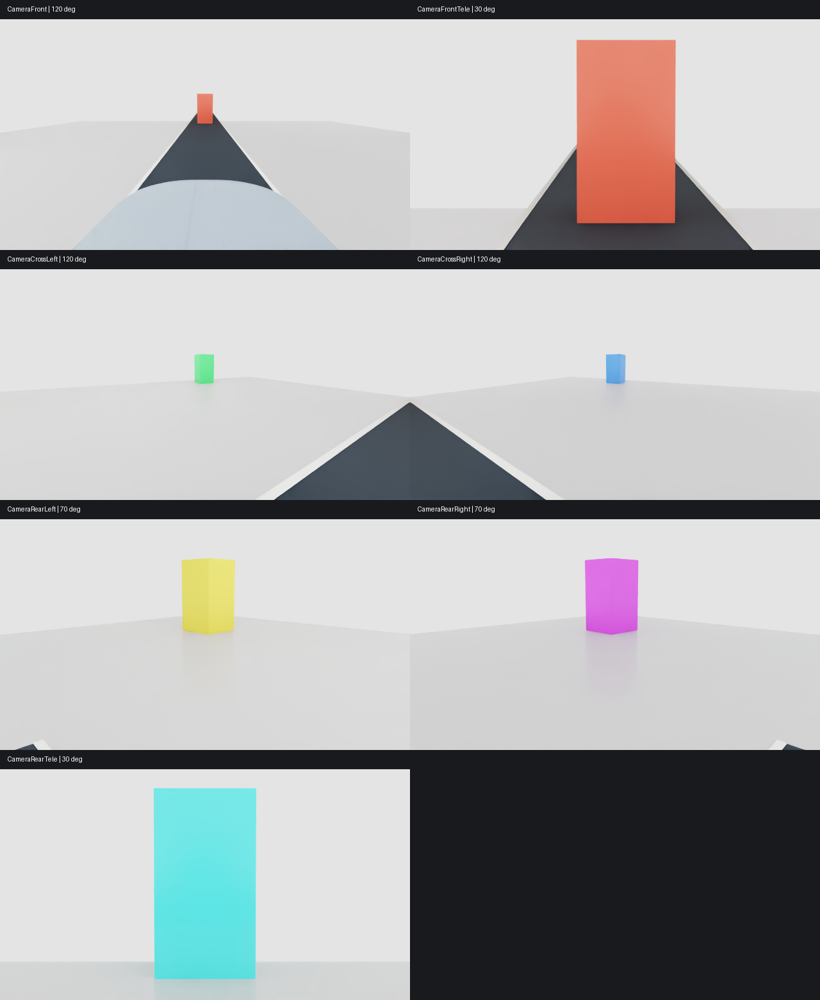
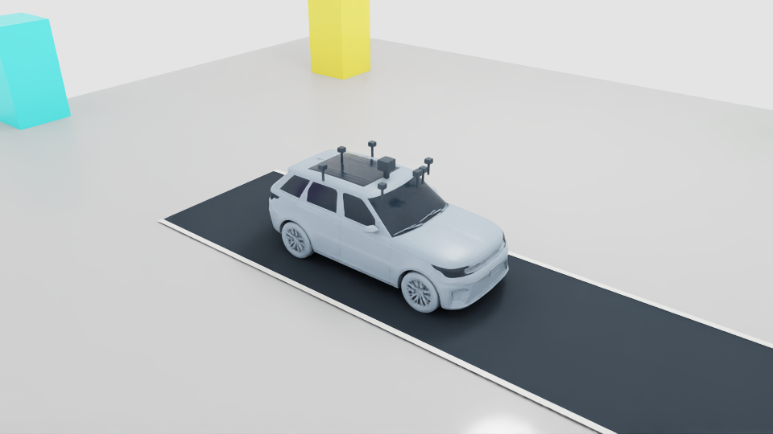

# Seven-camera vehicle rig v01

October 26, 2026. Camera capture milestone; no policy training or learned surround perception.

## Source asset and interface

The actual reusable local source is now
`vehicles/sim_ready/americano-i7-ev/v09/assets/vehicle.usda`, with the rig in its
composed `vehicle-sensors.usda` layer. v08 remains preserved. The vehicle's
geometry, mass and collision configuration are unchanged; added housings and
supports are visual only. Private vehicle geometry is excluded from Git.
`usd/seven_camera_rig.py` reproduces preparation from an existing v08 package
into a new version directory. Existing frozen demos still select their original
sources; select v09 explicitly to use this rig.

All seven cameras live under the moving `Chassis/Sensors` hierarchy. The
existing `CameraFront` and LiDAR paths are retained. Each stream now has its own
sensor, optical-frame and calibration identity. Camera frames contain RGB;
depth and exact target positions are used only by the validation evaluator.

| Camera | Chassis mount XYZ (m) | Heading, left positive | Down pitch | Horizontal FOV |
| --- | --- | --- | --- | --- |
| CameraFront (wide) | 0.8, 0, 1.12 | 0° | 15° | 120° |
| CameraFrontTele | 0.8, 0.18, 1.12 | 0° | 3° | 30° |
| CameraCrossLeft | 0.5, 0.8, 1.05 | 65° | 10° | 120° |
| CameraCrossRight | 0.5, -0.8, 1.05 | -65° | 10° | 120° |
| CameraRearLeft | -1, 0.8, 1.05 | 135° | 10° | 70° |
| CameraRearRight | -1, -0.8, 1.05 | -135° | 10° | 70° |
| CameraRearTele | -1.2, 0, 1.12 | 180° | 3° | 30° |

All are perspective cameras, 640×360 pixels at 10 Hz, 36×20.25 mm aperture,
0.1–250 m clipping. Focal length is `18 / tan(horizontal_FOV / 2)` mm.
The angular union covers 360° in azimuth. This does not establish visibility at
every elevation, distance or occlusion, nor match a calibrated commercial rig.

## Bounded test

Run `python -m experiments.verify_seven_cameras` in the configured traffic
environment. It launches Isaac separately, refuses an already active Kit job,
and saves a unique run under `outputs/seven-camera/v01/` with runtime logs under
`logs/seven-camera/`. It does not train or load an RL policy.

The six-second test uses 120 Hz physics, 20 Hz rendering and 10 Hz camera reads.
Six colored static targets at 14 m radius check view direction against projected
target position and rendered depth. A short scripted throttle/brake segment
checks physical motion and local mount stability. The extra overview camera is
evaluation equipment, not an eighth vehicle sensor. Acceptance requires at least
30 valid images per camera, target visibility in each view, unchanged mounts,
more than 0.2 m travel, upright stability, no contacts, valid saved composition,
screenshots and unchanged source hashes.

CPU capture tests: 44 passed. USD calibration/composition/source tests: 21 passed.
Native run `20261026T190556Z-d6c892f5` passed every acceptance gate: 59 valid
frames per camera (one initial warmup sample unavailable), all seven target
visibility checks, 0.6299 m travel, zero contacts, stable mounts and unchanged
source hashes. Six simulated seconds took 20.82 wall seconds including startup;
this is not a real-time throughput benchmark. Saved composition reopens without
errors. `/Render` is an Isaac-owned runtime namespace outside the authored scene
hierarchy. Full source hashes and exact optics are in [result.json](evidence/seven-camera-v01/result.json).

Actual Isaac images captured at two simulated seconds:

Three failed attempts are preserved under the same raw output parent:
`20261026T190159Z-1c780ce4` exposed a test-target relative-reference error;
`20261026T190344Z-3f119701` exposed missing viewport initialization;
`20261026T190458Z-4c461ca5` captured images but failed target visibility because
RTX discarded matrix-only source camera mounts. Source translation/orientation
ops fixed the last issue, and the final test compares mounts before and after
wrapper creation as well as during movement. Acceptance thresholds were not
relaxed. The failed run packages preserve the source versions they tested.

## Boundaries

The camera rig is a sensing foundation. Existing PPO/MAPPO/RSL-RL actors do not
consume seven RGB views. This test does not establish lane changing, merging,
highway-speed perception, obstacle avoidance or real-time throughput. Camera
timestamps are caller simulation times; independent hardware acquisition timing
and held-buffer detection remain open. There is no lens distortion/noise model,
learned fusion, Cosmos transformation or active LiDAR concurrency test here.

Before new training, review the perception encoder, actor observation contract,
rewards, training budget and held-out evaluation with the user.
