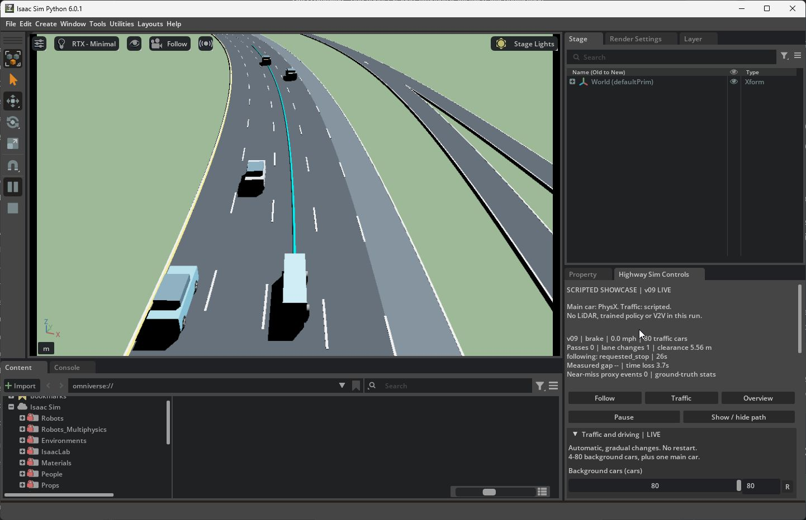
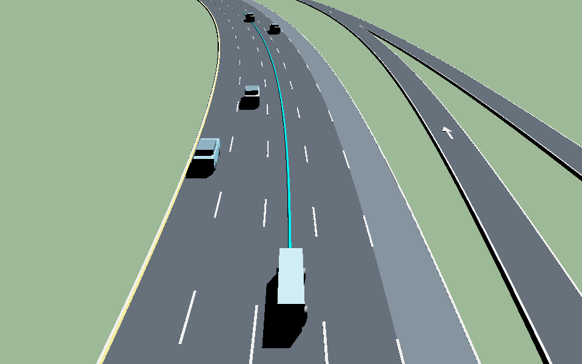
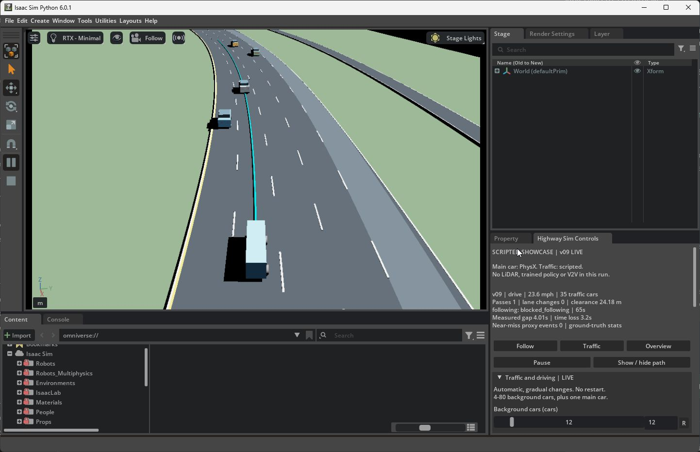
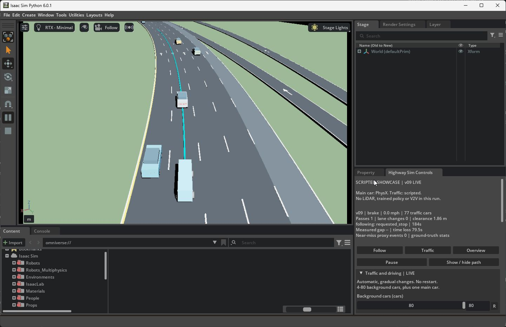
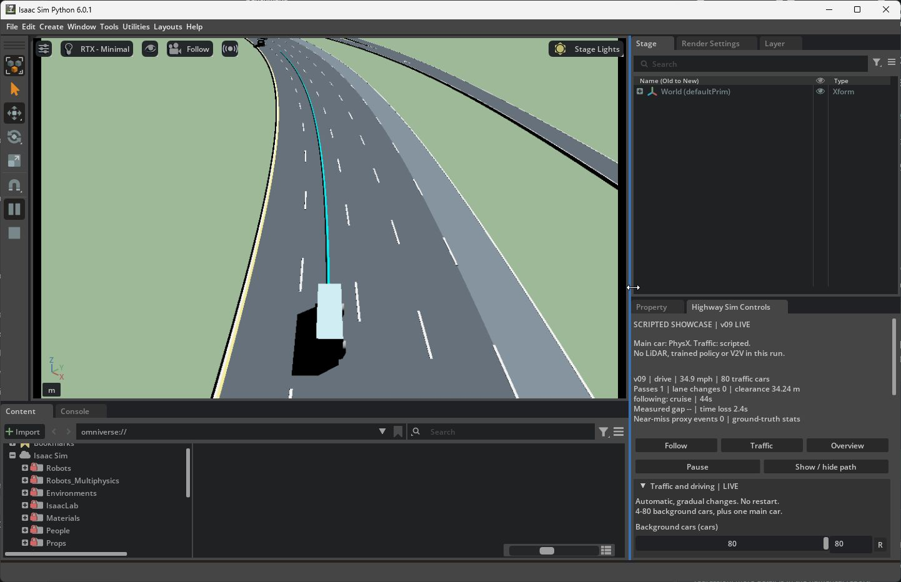

# Showcase native validation — October 19, 2026

Three fresh startup smokes passed their startup, scene, physical and shutdown
checks. The first 180-second endpoint **failed** population deadlines and
subsequent passing. After a dormant-entry repair, the legacy control smoke passed
and a new endpoint met every population deadline, but **still failed subsequent
passing**. All six runs failed the separate strict display timing checks. The
remaining planning behavior, endpoint repeat and matched performance matrix
remain open; no performance improvement is established.

This continues the [declared validation protocol](showcase-validation.md).
The [machine-readable evidence](evidence/showcase-validation-20261019.json)
preserves exact values, run IDs, source inventories and artifact hashes. Raw
telemetry remains in ignored local `outputs/`; the JSON is a selected evidence
summary, not a substitute for those records.

## Scope and provenance

These are public procedural-car, v09 editor runs: one PhysX main car and scripted
kinematic background cars on a known circular map. Controller and statistics
inputs are privileged simulator state. There is no sensor-driven control, SUMO
integration, learned policy or training in this checkpoint.

The initial four manifests record commit
`89442f51f8bb26e9989ff543bd228a985043a8f6`, following implementation commit
`3a8cea4f29be4129469dfcd20ad5c5b89c8d0a86` in
[draft PR 12](https://github.com/hudsonkaneko/hivemind-traffic/pull/12).
Each smoke captured the same 46 source hashes and resolved configuration. The
endpoint captured those same sources plus its control-validation module, for 47
files. No source changed during any run. Manifests retain working-tree status and
a patch; this report does not assert a pristine checkout.

Runtime: Isaac Sim `6.0.1-rc.7+release.42383.32955d8d.gl`, supervisor Python 3.11.9,
Windows build 26200, GeForce RTX 5070 with 12,227 MiB and driver 610.88. All runs
used seed 101, 120 Hz physics, 60 Hz controls, 10 Hz planning, requested 30 Hz
display, eight CPU workers and presentation evidence. The smokes used 80
backgrounds and viewport captures. The endpoint started with 12 backgrounds,
changed native control values and paused as specified by its scenario.

The baseline implementation already had CPU verification: 1,712 passed, 180
optional skips and 98 subtests locally. The immutable implementation commit also
passed [clean-clone GitHub CI](https://github.com/hudsonkaneko/hivemind-traffic/actions/runs/38945979178),
including four real SUMO tests and the same full-suite counts. Those CPU results
do not override the native failures below.

## Repeated startup evidence

| Label | Immutable run ID | Drive / total simulated seconds | Result | Readiness seconds |
| --- | --- | ---: | --- | ---: |
| S1 | `20261019T161716Z-e514b86e` | 15 / 27 | 32/32 run gates passed | 0.075448 |
| S2 | `20261019T161922Z-d44d31d2` | 15 / 27 | 32/32 run gates passed | 0.027523 |
| S3 | `20261019T162041Z-7f6eec77` | 15 / 27 | 32/32 run gates passed | 0.019219 |

Each exited with code zero, verified cleanup, no recorded runtime errors and no
reference warnings. Each readiness sequence took four updates: one dock request
and three confirmed docked frames, without resize repair. Native window extent
was 1440 × 900, viewport output 960 × 600 and viewport window extent 949 × 577.

The visual reviewer inspected all nine scheduled 10/16/20-second viewport PNGs
and the first run's full-window screenshot. Corresponding PNGs and complete
saved trajectories are byte-identical across the three smokes. The other two
runs' sidebar confirmations come from native readiness readback. Collapsed
Stage contents and controls below the saved viewport were not visually inspected.
This establishes three successful current-source launches. The historical
120-by-0 swapchain failure's cause remains unconfirmed; long-duration reliability
is not established by these smokes.



S1 full-window capture at the observed 26-second final braking state. The panel
shows 80 background cars and 0.0 mph. This verifies the visible editor/sidebar
layout at that instant, not interactive latency or display smoothness.



S1 viewport-only image requested at 16 simulated seconds, during driving after
the two-second settling phase. It shows the public car, scripted traffic and
cyan planned path. The exact native image frame ID was not verified.

## First endpoint: retained failure

Run `20261019T162155Z-fb9cb018` completed 180 driving seconds plus two settling
and ten final braking seconds. Process exit was zero and cleanup passed, but
overall acceptance was **false**. The failing run gate was `control_validation`;
its `endpoint_deadlines` and `settled_passing_tail` subgates failed.

| Scenario deadline, simulated seconds | Requested backgrounds | Actual backgrounds | Accepted |
| ---: | ---: | ---: | --- |
| 14 | 4 | 4 | Yes |
| 50 | 80 | 75 | No |
| 100 | 12 | 12 | Yes |
| 135 | 80 | 77 | No |

The 135–180-second tail stayed at 77 rather than 80, with no additional completed
passes or lane changes. Across the whole run there was one completed pass and
zero completed lane changes. Safety, scene and process gates passed: zero
reported contacts and minimum observed clearance 1.844801 m. These results
support the safety checks in this run, not completion of the requested controls.

Lifecycle review reconstructed active identities at every telemetry tick and
matched all lifetime bounds and exposures. There were **209 events: 137 entries
and 72 exits**, with 12 initial and 77 final backgrounds. This produced 149
background lifetimes plus the ego lifetime; 72 ended by removal and 78 remained
incomplete at run end. The largest generation was three. Minimum recorded event
arc gap was 160.002371 m, and events were at least 30 ticks apart. An assumed
220-event successful schedule would misdescribe this failed run.

The four paused UI frames left simulation clock and state unchanged; they added
no statistics exposure. This bounded pause check does not measure arbitrary
human interaction latency or establish all possible UI sequences.



Endpoint full-window capture at the observed 65-second driving state: 35 active
backgrounds, target 12 and ego speed 23.6 mph. It records a gradual transition in
progress, not a completed endpoint. The initial three published images are original,
unmodified bytes with hashes in [image provenance](images/showcase-validation-20261019/provenance.json).

## Statistics checked against telemetry

Independent reductions passed 86 consistency checks for S1 and 88 for the
endpoint. These are checks of recorded metrics and identity bookkeeping, not
additional successful simulation trials. Each row uses 120 Hz simulation state;
the panel's 5 Hz refresh is a separate setting.

| Drive-only statistic | S1 | Failed endpoint |
| --- | ---: | ---: |
| Telemetry rows, including settle/brake | 3,240 | 23,040 |
| Integrated ego drive exposure, s | 14.991667 | 179.991667 |
| Ego mean scalar speed, m/s | 11.778092 | 7.454642 |
| Integrated scalar-speed distance, m | 176.573229 | 1,341.773424 |
| Ego free-flow time loss, s | 3.706436 | 79.451848 |
| Ego time-loss fraction | 0.247233 | 0.441420 |
| Hard-braking episodes / near-miss proxy episodes | 0 / 0 | 0 / 0 |
| Minimum observed net headway, s | 4.032496 | 1.937964 |
| Headway observation exposure, s | 14.958333 | 136.791667 |
| Minimum closing TTC, s | 7.185343 | 8.359789 |

The first drive sample establishes a baseline, so interval exposure is one
1/120-second step shorter than the driving duration. Settling and forced final
braking are excluded. No sample gaps were found. Ego speed is planar chassis
speed; background speed uses measured forward velocity. Acceleration and jerk
are derivatives of scalar speed, a tangential approximation. S1 jerk RMS was
12.201631 m/s³; this raw derivative is not a lateral comfort or ride-quality
qualification.

The [metric definitions](showcase-statistics.md) remain in force: geometric net
gap is distinct from the preferred following setting; no leader or a stationary
ego gives no defined headway, and nonclosing TTC is null. TTC becomes very large
for nearly zero positive closing speed; its large mean/max is not a safety
benefit. The project near-miss proxy is clearance below 1 m or closing TTC below
1.5 s; hard braking uses acceleration at or below −3 m/s². Zero proxy events do
not establish general safety.

Time loss integrates `max(0, 1 - speed / applied_free_flow_reference)` against
each lifetime's actual exposure. The endpoint's 150 eligible lifetimes all had
at least one driving second. Its aggregate achieved-fraction Jain index was
0.998704, while the ego lost 44.14% of reference progress and the scripted
background mean was about 0.0085%. This heterogeneous, unequal-exposure cohort
statistic is descriptive; it cannot establish fair traffic service. Lifetimes
are generation-aware and run-censored, and dormant slots contribute no exposure.
Laps, detector crossings and overtakes are not completed trips. Full 120 Hz
background speed derivatives cannot be independently reconstructed from the
decimated planner records; ego reductions, saved-summary consistency and every
active membership/lifetime bound were checked.

## Timing remains unqualified

These captured startup checks and interactive endpoint are diagnostic runs,
not the predeclared matched performance matrix. S1 additionally had an external
full-window screenshot; the endpoint included pause/settings changes and a
full-window screenshot. Numerical differences between these rows establish no
performance benefit or causal capture cost.

| Run | Active wall seconds | RTF | Lag p95 / max, s | Native delivery notifications/s | Delivery interval p95 / max, ms |
| --- | ---: | ---: | ---: | ---: | ---: |
| S1 | 29.874173 | 0.903791 | 4.196117 / 4.280759 | 27.121558 | 44.345100 / 686.118500 |
| S2 | 28.986993 | 0.931452 | 3.247444 / 3.331803 | 27.943357 | 44.174900 / 66.001200 |
| S3 | 28.574440 | 0.944900 | 2.969466 / 3.052837 | 28.348833 | 42.042600 / 98.510300 |
| Endpoint | 200.565936 | 0.957291 | 9.294867 / 10.118740 | 28.723531 | 40.020000 / 256.630200 |

Active wall time includes live settling, driving, braking and recording, and
excludes startup and explicit pauses. All four `smooth_display_passed` values
are false. Unchanged strict limits require RTF 0.99–1.01, p95/max lag at most
0.10/0.50 s, native delivery p95 at most 36.667 ms at requested 30 Hz, maximum
100 ms, and event service p95/max at most 50/100 ms. The endpoint recorded 5,764
native/application notifications, including four paused UI frames. Notifications
are not verified unique scanouts, monitor FPS or mouse-to-photon latency. There
is no qualified 30 Hz or 60 FPS claim here, and the eleven-case/eight-comparison
matrix has not run at this checkpoint.

## Initial failure diagnosis

Read-only diagnosis found three dormant slots still inside the 160 m protected
ego region at 135 seconds. Their signed station gaps were approximately
−155.204, −86.664 and −104.664 m and remained effectively fixed through the tail.
Their fixed entry phases could not become admissible under the observed common
angular motion. Pending population change continued to veto new lane changes.
Remote same-lane openings existed, but that geometric observation alone does
not qualify an insertion.

The proposed repair is deterministic alternate entry placement for a dormant
slot only, retaining the original site as first choice. It must preserve the
160 m exclusion, 30-tick spacing, maneuver exclusions, front/rear separation and
exact footprint clearance; active cars must not be teleported. Runtime phase
offsets must remain separate from immutable fleet specifications and USD assets.
If no safe site exists, the request stays pending. CPU fixtures and the unchanged
endpoint scenario, then a repeat, must verify any implementation before this
failure is considered resolved.

A separate conservative planning limitation was observed at the settled
12-car state: the current forecast rejected both adjacent paths. The post-hoc
geometry inspection was not an exact planner replay. Admission repair alone
does not prove subsequent passing, and this observation does not justify
weakening the safety envelope. Preserve this failed run when adding repair or
repeat evidence.

## Dormant-entry repair: population fixed, passing still fails

The admission-only change adds deterministic remote same-lane gap placement for
dormant slots when their retained phase is inadmissible. It preserves active
phases, immutable fleet specifications, native slot identities and static USD
layers. Entry requires at least 40 m same-lane base-station separation, 0.8 m
exact analytic background footprint clearance and 160 m ego exclusion. Success
and failed searches wait at least 30 physics ticks. These are admission guards,
not reactive background headway or arbitrary traffic-control guarantees.

The changed runtime source, `traffic/live_showcase.py`, has SHA256
`8642d0de38ade1194c6b2cd3e977fdc3e9933ea6a5e15084d9a59acc926a3bcf`.
The two new native runs retain base commit `89442f51f8bb26e9989ff543bd228a985043a8f6`
plus this recorded working-tree change. Their captured runtime source inventories
differ from the initial runs only in that file. Independent admission review
found no actionable defect in the scoped implementation; it explicitly left
native behavior unverified until these trials. The admission CPU suite passed
**1,724 tests, 181 skips and 100 subtests in 77.36 s**, retained under
`outputs/showcase_validation/cpu-admission-20261019T164050Z/`. Its metadata records
the changed source/test hashes and XML report hash. This is a local checkpoint,
not a new claim about current-head hosted CI.

| Admission-source run | Driving seconds | Population result | Overall run acceptance | Completed passes / lane changes |
| --- | ---: | --- | --- | ---: |
| `20261019T164220Z-7fd95c16` — legacy control smoke | 90 | 12 / 40 / 12 at 34 / 64 / 89 s | Passed, 33/33 gates | 0 / 0; not required by this smoke |
| `20261019T164433Z-563caac3` — endpoint | 180 | 4 / 80 / 12 / 80 at 14 / 50 / 100 / 135 s | **Failed: settled passing tail** | 3 / 1 across the whole run |

Both exited zero with verified cleanup and zero reported contacts. Minimum
observed clearance was 1.811181 m in the smoke and 1.831394 m in the endpoint.
The repaired endpoint held 80 actual and requested backgrounds throughout
135–180 seconds, yet produced **zero new passes and zero new lane changes in that
tail**. Earlier passes do not satisfy this gate. Its pause/mailbox and other
control subgates passed. The original failed endpoint remains a failure; this
second run establishes population recovery only, not complete endpoint success.

The legacy smoke had 124 events (28 entries, 96 exits), 109 total lifetimes,
96 retired and 13 run-censored. The repaired endpoint had **220 actual events**
(144 entries, 76 exits): 137 entries retained an existing phase and seven used a
remote gap midpoint. It had 156 background lifetimes plus the ego, 76 retired
and 81 run-censored; maximum generation three. Minimum lifecycle ego arc gap was
187.988486 m, with at least 30 ticks between events.

Independent reductions passed **88 smoke and 94 endpoint consistency checks**,
covering scalar-speed derivatives, time-loss integration, saved gap/TTC moments,
fairness arithmetic, active counts and leader membership each tick, recorded
native identity sets, and all lifetime bounds/exposure. Every checked artifact
hash matched its manifest. No new simulator or CPU test run was launched by this
reduction.

| Drive-only statistic | Legacy smoke | Repaired endpoint, still failed |
| --- | ---: | ---: |
| Ego exposure, s | 89.991667 | 179.991667 |
| Ego mean speed, m/s | 7.409489 | 7.996980 |
| Ego time loss, s | 32.170187 | 73.212950 |
| Ego time-loss fraction | 0.357480 | 0.406757 |
| Minimum observed net headway, s | 1.903976 | 1.943188 |
| Headway observation exposure, s | 89.958333 | 134.400000 |
| Minimum closing TTC, s | 7.096361 | 7.259480 |
| Hard-braking / near-miss proxy episodes | 0 / 0 | 0 / 0 |

For all seven alternate entries, the next saved native snapshot contained the
entrant and all previously active cars. Those snapshots occur 0.25–1.00 seconds
after entry. Reversing the independently integrated shared circular advance
recovered the recorded placement to within **0.00001611 m**, and independently
computed rectangle clearance differed by at most **0.00001449 m**. Minimum
reconstructed background clearance was 5.4999855 m and front/rear same-lane
spacing at least 86.539803 m. Ego exclusion was recomputed from the recorded
ego pose at each event. This is a check against decimated native snapshots,
not a saved immediate entry-frame pose/velocity or proof of every unsaved state;
the native contact and pose audits remain separate evidence.

| Admission-source run | Active wall seconds | RTF | Lag p95 / max, s | Strict display |
| --- | ---: | ---: | ---: | --- |
| Legacy smoke | 102.000466 | 0.999995 | 1.088953 / 1.169549 | Failed |
| Repaired endpoint | 201.520949 | 0.952755 | 10.268177 / 11.119149 | Failed |

The smoke's near-one RTF does not override failed lag/frame checks. These remain
interactive diagnostics rather than matched performance trials. The remaining
planner behavior needs a separate bounded change and unchanged endpoint/repeat
validation; neither the admission code review nor its population recovery grants
that future result.



First endpoint at the observed 184-second final braking state: 77 actual versus
80 requested backgrounds, one completed pass and no lane changes. This preserves
the original failure visually.



Admission-repaired endpoint at the observed 44-second driving state: 80/80 cars,
34.9 mph, one pass and zero lane changes. This is an in-progress image; the final
run still failed its settled passing tail. All five selected images are copied
original bytes with recorded hashes and reviewed captions in the image provenance.

## Evidence locations and reproduction

Each run is retained at `outputs/loop_showcase/<run-id>/`, including
`manifest.json`, `resolved-config.json`, `summary.json`, `trajectory.json`,
`traffic-statistics.json`, native timing and startup readiness. The endpoint
also contains `control-validation.json` and `traffic-lifecycle.json`.
Independent reductions and visual review are under
`outputs/showcase_validation/oct19-review/`; their hashes are recorded in the
published JSON. These raw local paths are intentionally not committed.

From the repository root with the configured traffic Python and the recorded
source/runtime version, the original invocations are:

```text
python scripts/demo_loop_showcase.py --version v09 --vehicle public --drive-seconds 15 --capture
python scripts/demo_loop_showcase.py --version v09 --vehicle public --control-validation endpoints --drive-seconds 180
```

The admission-source legacy control smoke used:

```text
python scripts/demo_loop_showcase.py --version v09 --vehicle public --control-smoke --drive-seconds 90
```

The smoke command was run three times. Rerunning on changed source is a new
experiment, not a reproduction of the frozen baseline. The selected image
hashes and full source inventories make this report traceable; they cannot
replace unavailable raw telemetry for independent numerical recomputation.
